# Awesome Nano Banana 2.1 提示词大全

[](README.md)
[](README_zh.md)
[](README_zh-Hant.md)
[](README_ja.md)
[](README_ko.md)
[](README_es.md)
[](README_pt.md)
[](README_fr.md)
[](README_de.md)
[](README_ru.md)
[](README_tr.md)
[](README_it.md)

精选 **49** 条 Nano Banana 2.1 提示词，每条都附示例图、完整提示词、原作者和原帖链接。数据来自 [cinel.ai](https://cinel.ai/zh/prompts/model/nano-banana-2-1?utm_source=github&utm_medium=awesome&utm_campaign=awesome-nano-banana-2.1-prompts) 提示词库，自动同步更新。

👉 [在 cinel.ai 浏览全部并在线生成](https://cinel.ai/zh/prompts/model/nano-banana-2-1?utm_source=github&utm_medium=awesome&utm_campaign=awesome-nano-banana-2.1-prompts)

## 目录

- [人像写真](#portrait) (12) · [全部](cases/zh/portrait.md)
- [产品与电商](#product-photography) (2) · [全部](cases/zh/product-photography.md)
- [海报与平面设计](#poster-design) (3) · [全部](cases/zh/poster-design.md)
- [信息图与 UI](#infographic-ui) (1) · [全部](cases/zh/infographic-ui.md)
- [3D 角色与手办](#3d-figurines) (7) · [全部](cases/zh/3d-figurines.md)
- [美食饮品](#food-drink) (1) · [全部](cases/zh/food-drink.md)
- [插画与动漫](#illustration-anime) (8) · [全部](cases/zh/illustration-anime.md)
- [创意场景](#scenes-creative) (15) · [全部](cases/zh/scenes-creative.md)

<a id="portrait"></a>

## 人像写真

精选 6 条 · [查看本类全部 12 条](cases/zh/portrait.md) · [cinel 分类页](https://cinel.ai/zh/prompts/portrait?utm_source=github&utm_medium=awesome&utm_campaign=awesome-nano-banana-2.1-prompts)

### 黑白街拍中的一抹深红

<a href="https://cinel.ai/zh/prompts/p/crimson-accent-black-white-street-walk?utm_source=github&utm_medium=awesome&utm_campaign=awesome-nano-banana-2.1-prompts">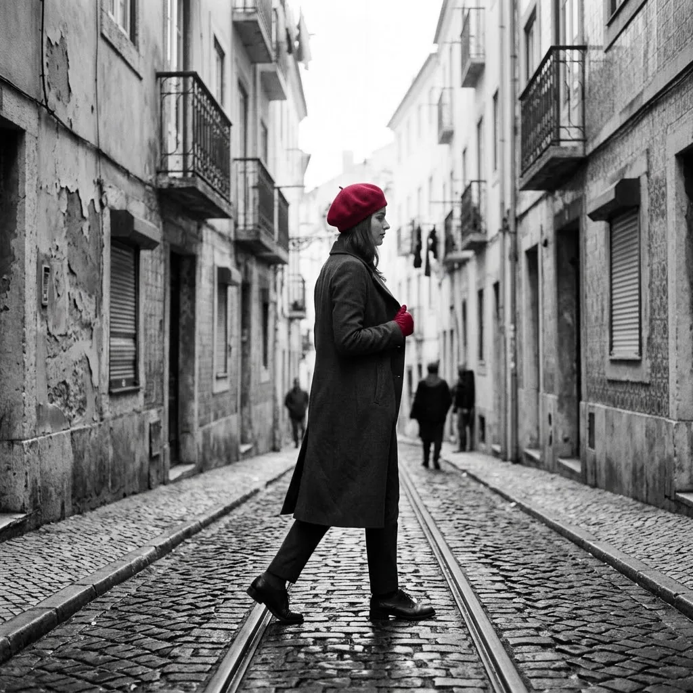</a>

> 来自 @azed_ai 的四变量模板，名为“深红足迹”。设定人物、欧洲古城地点、优雅服装和一件配饰，整张照片变成黑白，只有那件配饰是鲜艳的宝石红。斑驳的建筑、柔和晨光和 35mm 胶片颗粒带来编辑街拍质感。我们用了一位穿炭灰大衣、戴红色贝雷帽和手套的女子，走在里斯本老城。适合时装型录、旅行内容和氛围感大片。

```text
Cinematic black-and-white photograph of a young woman walking through a cobblestone lane in old Lisbon, wearing a long tailored charcoal coat with a beret and gloves in vivid ruby red as the only colored element, natural movement, graceful silhouette, weathered architecture, romantic atmosphere, subtle reflections on wet stones, delicate monochromatic tones, diffused morning light, vintage 35mm film grain, editorial street photography, atmospheric visual storytelling. Square 1:1.
```

- 原作者: [@azed_ai](https://x.com/azed_ai)
- 原帖: https://x.com/azed_ai/status/2110687901055131952
- [在 cinel 上查看详情并一键生成](https://cinel.ai/zh/prompts/p/crimson-accent-black-white-street-walk?utm_source=github&utm_medium=awesome&utm_campaign=awesome-nano-banana-2.1-prompts)

### 雕塑感高领高定编辑肖像

<a href="https://cinel.ai/zh/prompts/p/sculptural-collar-couture-editorial-portrait?utm_source=github&utm_medium=awesome&utm_campaign=awesome-nano-banana-2.1-prompts">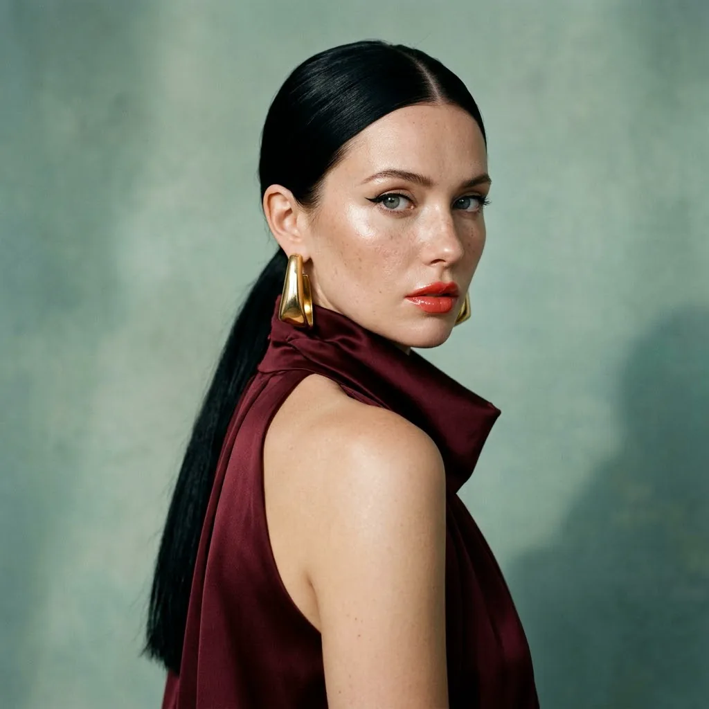</a>

> 来自 @MissDelulu9 的细致编辑肖像提示词，用 Nano Banana 2.1 生成。它逐项描述一位虚构的成年模特（蓝灰眼睛、珊瑚红唇、上扬眼线、利落低马尾），再写服装：深酒红缎面高定礼服，带夸张的雕塑感高领，配金色几何耳环，回眸姿势，背景是鼠尾草绿到青绿的渐变。很契合本周的巴黎秀场氛围。适合时装情绪板、美妆广告和编辑测试。

```text
Create an ultra-realistic, high-fashion editorial portrait of an adult woman with striking blue-grey eyes, glossy coral-red lipstick, sharp black winged eyeliner, subtle freckles and luminous dewy skin with realistic pores. Her sleek jet-black hair is center-parted and pulled into a long straight low ponytail. She wears an elegant deep burgundy satin couture dress with an exaggerated sculptural high collar, dramatic draped fabric and an asymmetrical sleeveless design, with large polished gold geometric statement earrings. Pose: three-quarter over-the-shoulder, body turned away, face looking at the viewer, confident and slightly mysterious. Background: minimalist muted sage-green and turquoise studio backdrop with soft gradients. Professional softbox lighting, cinematic shadows, delicate highlights. Square 1:1.
```

- 原作者: [@MissDelulu9](https://x.com/MissDelulu9)
- 原帖: https://x.com/MissDelulu9/status/2109630710642528421
- [在 cinel 上查看详情并一键生成](https://cinel.ai/zh/prompts/p/sculptural-collar-couture-editorial-portrait?utm_source=github&utm_medium=awesome&utm_campaign=awesome-nano-banana-2.1-prompts)

### 皮草与漆皮的斑马线街拍

<a href="https://cinel.ai/zh/prompts/p/fur-and-vinyl-street-style-crosswalk?utm_source=github&utm_medium=awesome&utm_campaign=awesome-nano-banana-2.1-prompts">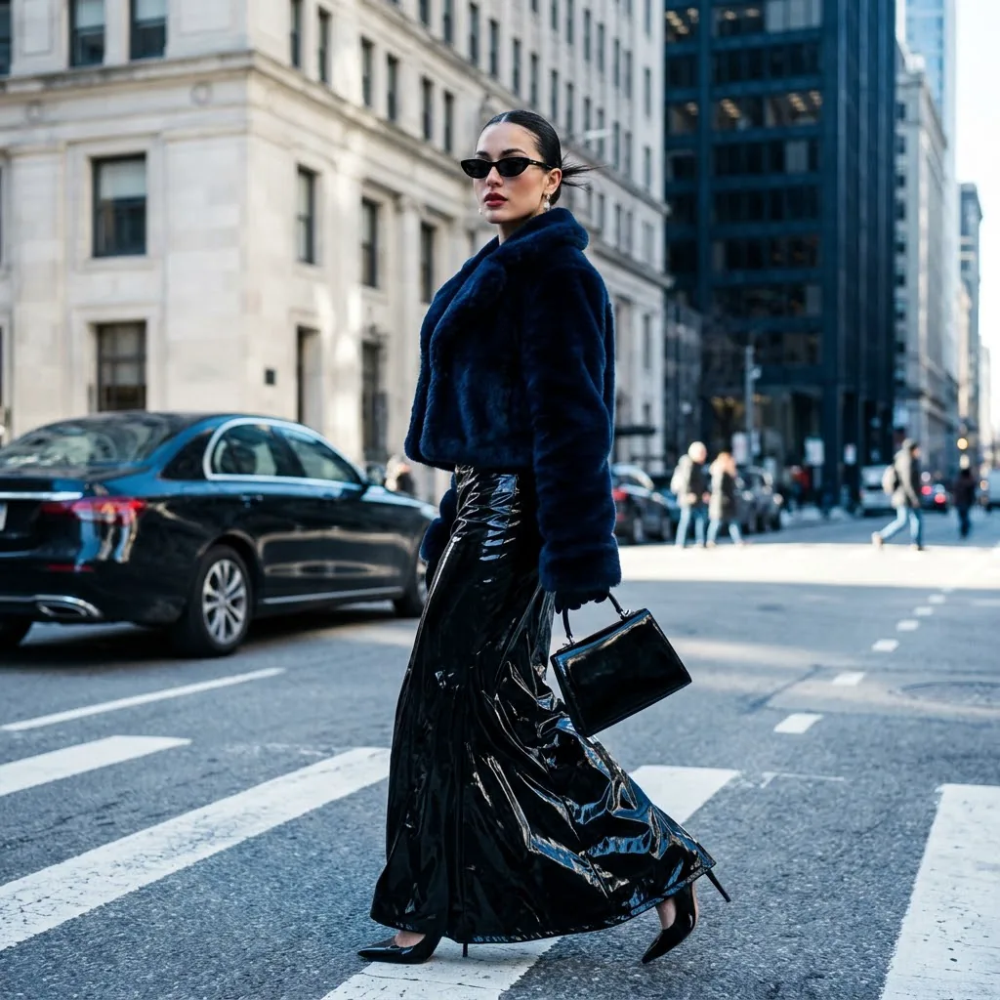</a>

> 来自 @Tanvir48992 的街拍提示词。女子在市中心街道迈步过马路、回头一瞥，身穿短款午夜海军蓝人造皮草外套，内搭及地黑色漆皮长裙，戴猫眼墨镜、珍珠耳坠和毛边手套。清冽的冬日阳光、85mm 镜头和冷调黑色电影调色完成了其余部分。我们把“Vogue street-style”改成通用的“杂志街拍”，车辆也不带品牌。适合时装周内容、型录和编辑测试。

```text
Candid high-fashion street style photograph of a woman mid-stride crossing a city street, captured side-on as she glances back over her shoulder. Dark hair slicked into a sleek low bun with a few loose strands lifted by the wind, narrow black cat-eye sunglasses, glossy red lipstick, small pearl drop earrings. A cropped voluminous midnight-navy faux fur jacket with a wide collar over a floor-length black patent vinyl gown with crinkled high-shine folds, dark fur-trimmed gloves, a structured black patent top-handle handbag, pointed black pumps. Setting: a sunlit crosswalk downtown, a parked glossy black sedan, a pale limestone building and a dark glass skyscraper, blurred pedestrians. Crisp cold winter sunlight, strong highlights on the vinyl, film-noir mood. 85mm telephoto at f/2.0, shallow depth of field, cool blue grading, magazine street-style editorial. Square 1:1. No logos.
```

- 原作者: [@Tanvir48992](https://x.com/Tanvir48992)
- 原帖: https://x.com/Tanvir48992/status/2108914406864347222
- [在 cinel 上查看详情并一键生成](https://cinel.ai/zh/prompts/p/fur-and-vinyl-street-style-crosswalk?utm_source=github&utm_medium=awesome&utm_campaign=awesome-nano-banana-2.1-prompts)

### 停车场里的粉色梦想车惊喜

<a href="https://cinel.ai/zh/prompts/p/pink-car-surprise-parking-lot-reveal?utm_source=github&utm_medium=awesome&utm_campaign=awesome-nano-banana-2.1-prompts"></a>

> 改编自 @Just_sharon7 的 11 秒 TapNow 视频提示词。原片是朋友手持拍摄的揭晓视频：一个戴着 Y2K 配饰、活泼的粉发女孩举起卡片，放下后露出一辆浅粉色跑车，最后夸张地惊呼。我们把最后的反应瞬间作为关键帧，车辆不带标志。手持角度和正午明亮阳光让它保持社交媒体原生感。适合 UGC 风格广告、反应类缩略图和生活方式内容。

```text
A single key frame shot handheld from slightly above eye level, as if a friend is filming: a cute energetic young adult woman with long pastel-pink hair and straight bangs, wearing a white baby tee with a colorful kawaii cartoon print, layered pastel beaded necklaces and colorful bracelets, gasps with her mouth wide open and both hands on top of her head in disbelief, in an empty sunny asphalt parking lot; behind her a sleek pastel-pink sports sedan with dark tinted windows and black wheels is parked diagonally, low concrete barriers, green trees and a clear blue sky. Realistic midday sunlight, natural skin texture, bright social-media aesthetic. No logos or badges on the car. Square 1:1.
```

- 原作者: [@Just_sharon7](https://x.com/Just_sharon7)
- 原帖: https://x.com/Just_sharon7/status/2109662458269040721
- [在 cinel 上查看详情并一键生成](https://cinel.ai/zh/prompts/p/pink-car-surprise-parking-lot-reveal?utm_source=github&utm_medium=awesome&utm_campaign=awesome-nano-banana-2.1-prompts)

### 月下庭院中的敦煌飞天

<a href="https://cinel.ai/zh/prompts/p/dunhuang-flying-apsara-moonlit-courtyard?utm_source=github&utm_medium=awesome&utm_campaign=awesome-nano-banana-2.1-prompts">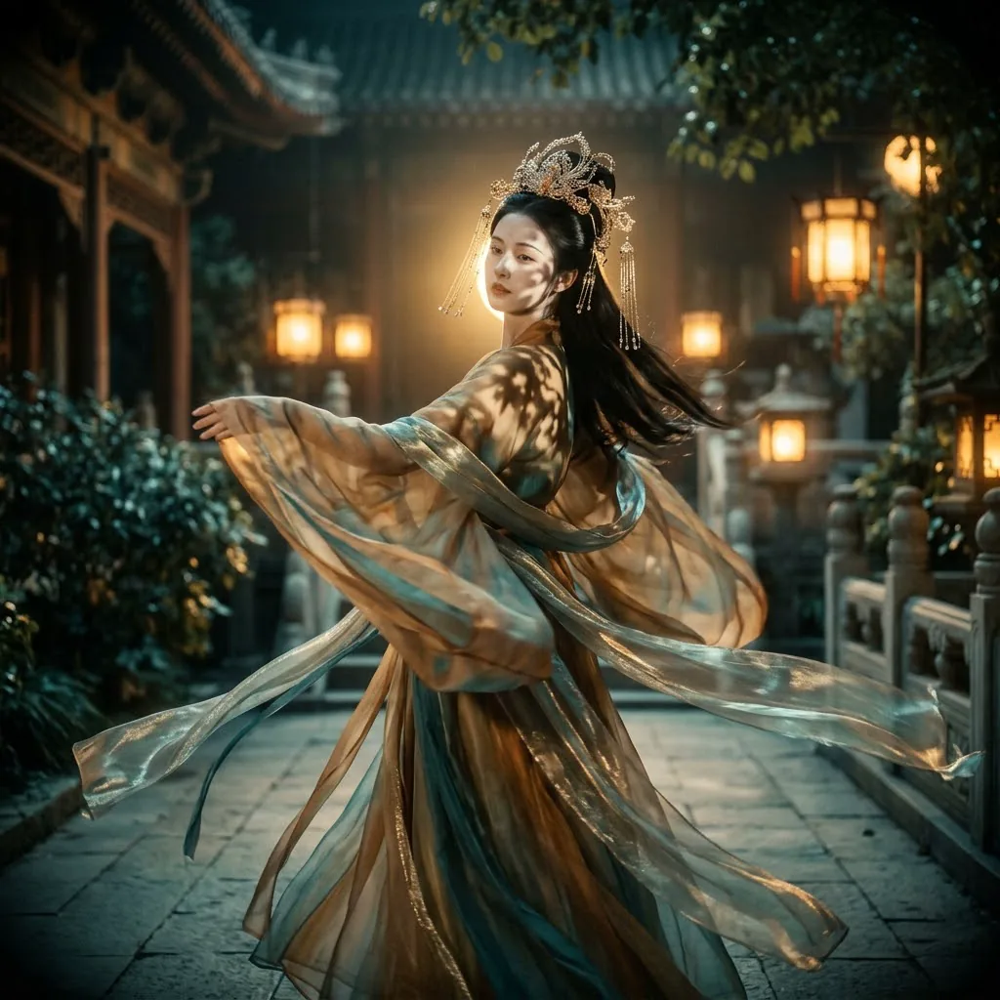</a>

> 改编自 @jackchen1919 的 13 镜中文奇幻视频提示词。总控提示词在清冷月夜的宫灯庭院和璀璨星空的敦煌壁画幻境之间切换，规定了斑驳树影、脑后金色圆光、黑柔滤镜、青橙分离调色和慢动作丝绸。我们把开场的甩袖转头镜头浓缩成一帧关键画面。人物是通用的敦煌风格形象，不对应具体角色。适合国风时尚海报、汉服写真和文化宣传。

```text
A single key frame from an Eastern fantasy fashion film: a graceful young woman in the style of a Dunhuang flying apsara, porcelain complexion, an elaborate gold and silver hair crown with swaying tassels, translucent layered silk robes and long glass-like ribbons, turns her head mid-sleeve-swing in a moonlit ancient palace courtyard with glowing lanterns. Dappled irregular leaf shadows fall naturally across her face and sleeves, a warm golden halo behind her head, teal-and-amber split-toning, Black Pro-Mist soft glow on highlights, creamy circular bokeh, subtle vignette, slow-motion silk physics, cinematic 8K. Square 1:1.
```

- 原作者: [@jackchen1919](https://x.com/jackchen1919)
- 原帖: https://x.com/jackchen1919/status/2110232484638343400
- [在 cinel 上查看详情并一键生成](https://cinel.ai/zh/prompts/p/dunhuang-flying-apsara-moonlit-courtyard?utm_source=github&utm_medium=awesome&utm_campaign=awesome-nano-banana-2.1-prompts)

### 唐僧时尚大片

<a href="https://cinel.ai/zh/prompts/p/tang-sanzang-fashion-editorial-on-set?utm_source=github&utm_medium=awesome&utm_campaign=awesome-nano-banana-2.1-prompts">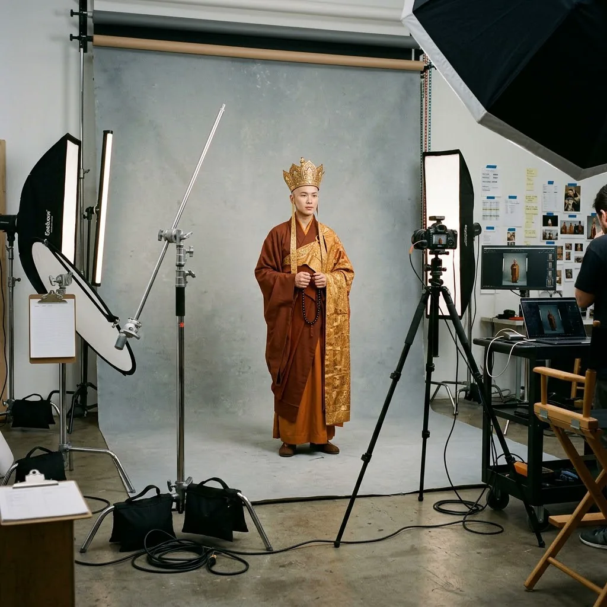</a>

> 根据 @KOF97AI 为本周“西天取经 × 西方时尚”热点发布的图片反向撰写的提示词（原帖没有提示词）。我们用自己的话描述了唐僧：一位沉静的僧人，身穿剪裁考究的锈棕与藏红袍服，披金色袈裟，头戴五佛金冠，站在灰色背景前，四周是柔光箱、三脚架相机和贴在墙上的便签。《西游记》是公版古典名著，这里是通用的角色演绎，不对应任何影视或游戏设计。适合主题时尚内容、文化宣传和角色重塑系列。

```text
Behind-the-scenes photo of a fashion magazine shoot: a monk inspired by Tang Sanzang from Journey to the West stands calmly on a grey seamless backdrop, wearing a modern tailored reinterpretation of a monk's robe in rust-brown and saffron with a draped gold kasaya sash and an ornate golden five-petal crown, holding prayer beads. Around him a real studio: softboxes, a strip light, a reflector, a camera on a tripod, a monitor, a clipboard and taped notes on the wall. Editorial lighting, photorealistic, generic interpretation of the classical character. Square 1:1.
```

- 原作者: [@KOF97AI](https://x.com/KOF97AI)
- 原帖: https://x.com/KOF97AI/status/2110670208054460752
- [在 cinel 上查看详情并一键生成](https://cinel.ai/zh/prompts/p/tang-sanzang-fashion-editorial-on-set?utm_source=github&utm_medium=awesome&utm_campaign=awesome-nano-banana-2.1-prompts)

<a id="product-photography"></a>

## 产品与电商

精选 2 条 · [查看本类全部 2 条](cases/zh/product-photography.md) · [cinel 分类页](https://cinel.ai/zh/prompts/product-photography?utm_source=github&utm_medium=awesome&utm_campaign=awesome-nano-banana-2.1-prompts)

### 包装二次利用变形方案

<a href="https://cinel.ai/zh/prompts/p/packaging-second-life-transformation?utm_source=github&utm_medium=awesome&utm_campaign=awesome-nano-banana-2.1-prompts">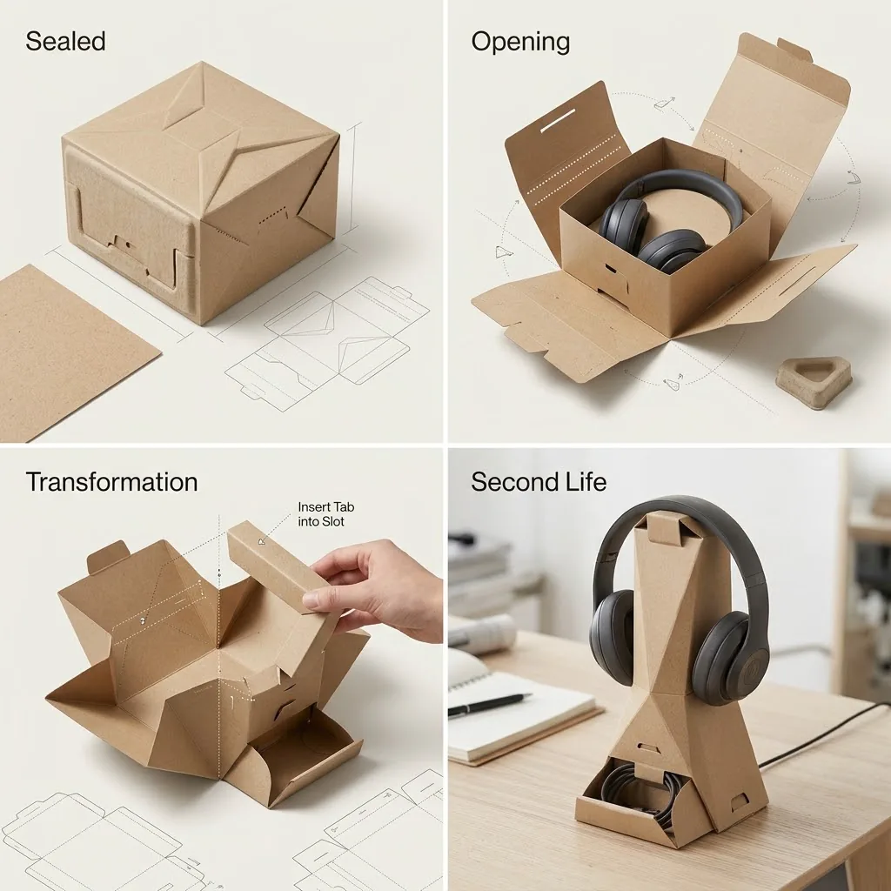</a>

> 来自 @Gdgtify 的产品概念模板。设定产品和二次功能后，它会排出一张上市方案：密封、开启、变形、二次使用四种状态，展示折叠系统、锁扣、压线、隐藏部件、刀版碎片和材料样本，风格是日式纸艺工程加高端发布会。原文特别提醒避免“漂绿”式视觉。我们用了一款包装盒能变成桌面支架的无线耳机，保持通用、不带品牌。适合设计提案、作品集和可持续主题演示。

```text
2x2 grid, square 1:1. A launch campaign for a pair of wireless headphones whose packaging does not become waste after opening: every structural component transforms into a desktop headphone stand. Show the package in four elegant states: sealed, opening, transformation, second life. Show the folding system, a tab locking method, perforations, a hidden cable-tidy component and the final stand holding the headphones on a real desk. Include clean structural diagram lines, kraft and molded-pulp material samples and flattened dieline fragments. Visual style: sustainable packaging innovation meets Japanese paper engineering meets premium product launch, off-white studio, soft shadows. No brand names, no logos, no eco-symbols.
```

- 原作者: [@Gdgtify](https://x.com/Gdgtify)
- 原帖: https://x.com/Gdgtify/status/2109404928418730378
- [在 cinel 上查看详情并一键生成](https://cinel.ai/zh/prompts/p/packaging-second-life-transformation?utm_source=github&utm_medium=awesome&utm_campaign=awesome-nano-banana-2.1-prompts)

### 巴洛克珍珠天鹅吊坠静物

<a href="https://cinel.ai/zh/prompts/p/baroque-pearl-swan-pendant-still?utm_source=github&utm_medium=awesome&utm_campaign=awesome-nano-banana-2.1-prompts">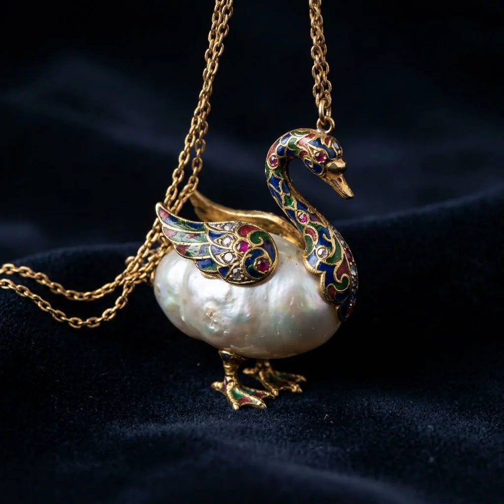</a>

> 灵感来自 @HerodotusWave 关于一件 16 世纪吊坠的帖子：天鹅的身体是一颗天然巴洛克珍珠（原帖配的是博物馆照片，没有提示词）。我们为一件文艺复兴风格的珠宝撰写了原创静物提示词：不规则珍珠做腹部，金和珐琅制成的颈、翼和足，小宝石和细链，放在深色丝绒上。我们的配图由 AI 生成，不是那件馆藏。适合珠宝概念、编辑静物和历史内容。

```text
Museum-style product still life of a Renaissance-style jewel pendant: a small swan whose soft belly is one large irregular baroque pearl, with a neck, wings and feet crafted in gold and colourful enamel and set with small gems, hanging from fine gold chains. Shot on a dark velvet background with soft focused light, crisp macro detail of the pearl's lustre and enamel, shallow depth of field. Square 1:1.
```

- 原作者: [@HerodotusWave](https://x.com/HerodotusWave)
- 原帖: https://x.com/HerodotusWave/status/2109713964187697407
- [在 cinel 上查看详情并一键生成](https://cinel.ai/zh/prompts/p/baroque-pearl-swan-pendant-still?utm_source=github&utm_medium=awesome&utm_campaign=awesome-nano-banana-2.1-prompts)

<a id="poster-design"></a>

## 海报与平面设计

精选 3 条 · [查看本类全部 3 条](cases/zh/poster-design.md) · [cinel 分类页](https://cinel.ai/zh/prompts/poster-design?utm_source=github&utm_medium=awesome&utm_campaign=awesome-nano-banana-2.1-prompts)

### 中世纪复古旅行海报

<a href="https://cinel.ai/zh/prompts/p/mid-century-vintage-travel-poster?utm_source=github&utm_medium=awesome&utm_campaign=awesome-nano-banana-2.1-prompts">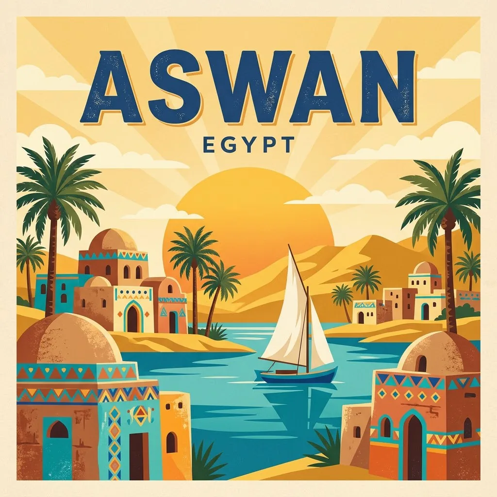</a>

> 来自 @Goodmanprotocol 的目的地模板，为 GPT Image 2.5 编写，明确只用文字、不需要参考图。它把地点变成五六十年代的彩色旅行海报，灵感来自手绘努比亚村落建筑：平面几何造型、墙面纹样、当地地标、温暖的太阳、粗体复古标题，以及日晒褪色的青绿、赤陶和奶油黄配色。我们选了埃及阿斯旺，有穹顶房屋、棕榈树和尼罗河上的三角帆船。适合旅行版画、旅游内容和墙面装饰。

```text
Create a premium full-frame square 1:1 vintage travel poster for Aswan, Egypt. Text-to-image only, generated from the destination name alone. Transform the destination into a colorful 1950s–60s mid-century travel poster inspired by hand-painted Nubian village architecture: domed houses with geometric wall patterns, palm trees, a felucca sailing on the Nile, golden desert hills and a warm sun. Place "ASWAN" in large bold retro typography across the top. Keep the composition balanced and uncluttered. Flat geometric shapes, hand-painted wall textures, sun-faded colors, subtle vintage print grain. Palette: turquoise, cobalt blue, terracotta, orange, butter yellow and warm ivory.
```

- 原作者: [@Goodmanprotocol](https://x.com/Goodmanprotocol)
- 原帖: https://x.com/Goodmanprotocol/status/2109665636700057789
- [在 cinel 上查看详情并一键生成](https://cinel.ai/zh/prompts/p/mid-century-vintage-travel-poster?utm_source=github&utm_medium=awesome&utm_campaign=awesome-nano-banana-2.1-prompts)

### 复古文化杂志拼贴封面

<a href="https://cinel.ai/zh/prompts/p/vintage-culture-magazine-collage-cover?utm_source=github&utm_medium=awesome&utm_campaign=awesome-nano-banana-2.1-prompts">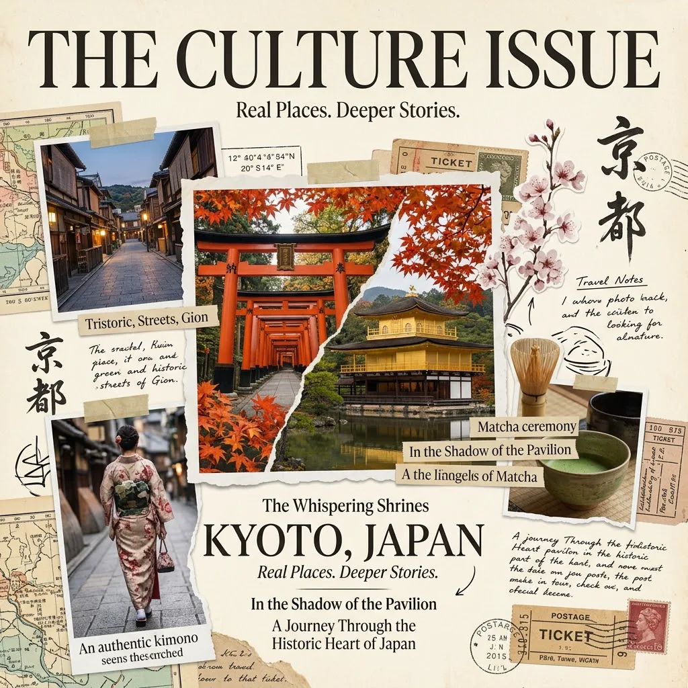</a>

> 来自 @Naiknelofar788 的 GPT Image 2.5 提示词模板，生成一张“THE CULTURE ISSUE”旅行文化杂志封面。主图是地标照片，叠加街巷、美食、手工艺的撕纸剪切照片、地图碎片和手写笔记，底色是泛黄的米白纸张。我们填入日本京都，并把画幅从 4:5 改为方形。适合旅行小志、目的地指南和文旅宣传。

```text
Create a stunning editorial travel and culture magazine cover featuring Kyoto, Japan, designed as a sophisticated vintage scrapbook collage that celebrates the destination’s authentic identity, heritage, architecture, and everyday life.

Overall aesthetic: A luxurious vintage travel magazine cover blending documentary photography, torn-paper collage, retro editorial design, travel journaling, and artistic mixed-media textures. The composition should feel handcrafted, culturally rich, nostalgic, and visually captivating.

Main composition:

Hero image: A large, beautifully detailed, photorealistic view of the destination’s most iconic and architecturally accurate landmark, surrounded by its authentic natural scenery and recognizable local environment.
Cultural photography: Smaller photographic cutouts showing traditional streets, local markets, historic buildings, traditional clothing, regional food, crafts, festivals, or everyday moments that genuinely represent the destination.
Human element: Include a person wearing authentic regional attire, viewed from behind or naturally integrated into the scene, creating an emotional connection with the place.
Local details: Incorporate recognizable cultural objects, traditional patterns, native flowers, regional ingredients, handwritten travel notes, map fragments, botanical illustrations, and subtle geographical coordinates.
Collage composition: Arrange the photographs in overlapping, irregular torn-paper shapes, layered with painted brushstrokes, rough paper edges, subtle ink marks, and fragments of vintage maps. Allow certain elements to overlap naturally, creating depth without making the layout feel cluttered.

Magazine typography and layout:

At the top, feature an oversized, bold, elegant serif masthead reading “THE CULTURE ISSUE.” The typography should dominate the composition like a premium independent travel magazine.

Include the destination’s name in large, distinctive lettering, followed by its country or region. Add smaller editorial details such as:

Travel & Culture Series
Real Places. Deeper Stories.
A short poetic description of the destination.
Geographical coordinates in handwritten script.
A few small cultural section labels.
A handwritten phrase capturing the spirit of the place.

Typography should feel editorial, sophisticated, and thoughtfully arranged around the imagery, with clear visual hierarchy and generous negative space.

Color palette and materials:

Use warm ivory and aged cream paper as the background, complemented by muted earthy tones, faded terracotta, deep olive green, dusty blue, charcoal black, and colors naturally associated with the destination. Add subtle paper grain, vintage print imperfections, faded ink, watercolor washes, pencil marks, and authentic analog photography textures.

Cultural authenticity — essential:

The destination must remain geographically, architecturally, and culturally recognizable. Accurately represent its famous landmarks, traditional clothing, local cuisine, cultural objects, and regional environment. Use genuine cultural references rather than generic or invented symbols. Every collage element should feel connected to the actual place.

Final result: A breathtaking, premium-quality editorial magazine cover that feels like a carefully curated collection of travel photographs, cultural memories, handwritten observations, and vintage paper ephemera. Artistic yet believable, richly detailed yet balanced, nostalgic yet contemporary.

Format: Square 1:1 composition, high resolution, professional magazine art direction, realistic photography blended with handcrafted collage, elegant typography, layered textures, and visually striking storytelling.
```

- 原作者: [@Naiknelofar788](https://x.com/Naiknelofar788)
- 原帖: https://x.com/Naiknelofar788/status/2109612639727009914
- [在 cinel 上查看详情并一键生成](https://cinel.ai/zh/prompts/p/vintage-culture-magazine-collage-cover?utm_source=github&utm_medium=awesome&utm_campaign=awesome-nano-banana-2.1-prompts)

### 照片/纸艺对切卡帕多西亚旅行海报

<a href="https://cinel.ai/zh/prompts/p/split-photo-papercraft-cappadocia-poster?utm_source=github&utm_medium=awesome&utm_campaign=awesome-nano-banana-2.1-prompts">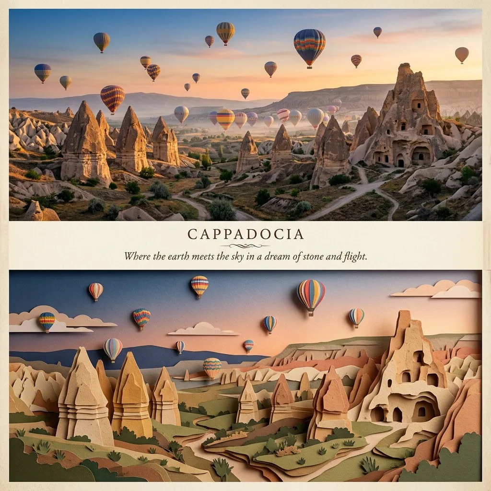</a>

> @Sairah_0 对切旅行海报方法（277 赞）。填入卡帕多西亚；1:1；纯文生图（无用户上传照片）。

```text
Square 1:1 vertical split-panel travel poster of Cappadocia, Türkiye.
TOP PANEL: wide-angle highly detailed vibrant photographic-style view of Cappadocia at dawn with hot-air balloons over fairy chimneys, soft golden light, crisp atmosphere (generated, not from an uploaded photo).
BOTTOM PANEL: the exact same viewpoint rebuilt as layered 3D paper-craft cutouts with textured edges, real paper shadows, balloons and rock spires as stacked paper layers.
Cream divider strip with elegant small serif text "CAPPADOCIA" and a short poetic caption. No logos, no real people portraits, no brand marks.
```

- 原作者: [@Sairah_0](https://x.com/Sairah_0)
- 原帖: https://x.com/Sairah_0/status/2101555686060536233
- [在 cinel 上查看详情并一键生成](https://cinel.ai/zh/prompts/p/split-photo-papercraft-cappadocia-poster?utm_source=github&utm_medium=awesome&utm_campaign=awesome-nano-banana-2.1-prompts)

<a id="infographic-ui"></a>

## 信息图与 UI

精选 1 条 · [查看本类全部 1 条](cases/zh/infographic-ui.md) · [cinel 分类页](https://cinel.ai/zh/prompts/infographic-ui?utm_source=github&utm_medium=awesome&utm_campaign=awesome-nano-banana-2.1-prompts)

### 文字与物件融合的标志网格

<a href="https://cinel.ai/zh/prompts/p/typographic-object-logo-mark-grid?utm_source=github&utm_medium=awesome&utm_campaign=awesome-nano-banana-2.1-prompts">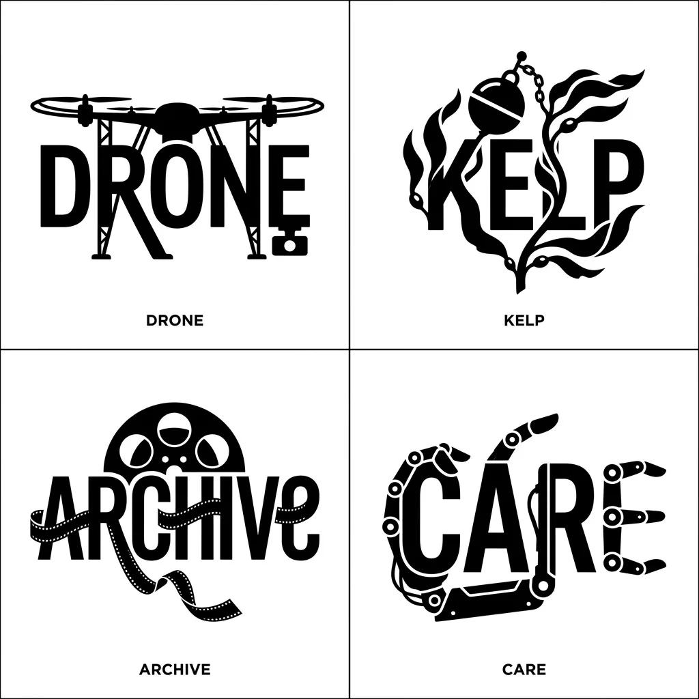</a>

> 来自 @Gdgtify 的字体模板。它把字母拆成字形结构（主干、字碗、字腔、上伸部、末端、花饰），把物件拆成主体、把手、开口和尖端，再把一方映射到另一方，让物件变成文字，同时每个字腔都保持可读。我们用四种未来职业生成了一张 2x2 方图：无人机飞手、海洋农夫、记忆档案员和机器人护理员。适合标志探索、工作坊练习和品牌情绪板。

```text
2x2 grid, square 1:1, four clean high-contrast logo marks for four jobs of the future: DRONE (letters fused with a quadcopter), KELP (letters fused with a kelp frond and buoy), ARCHIVE (letters fused with a film reel), CARE (letters fused with a robot hand). For each, analyze glyph anatomy (stem, bowl, counter, ascender, descender, terminal, swash, join) and map the object's anatomy into it: body to stem, opening to bowl, extensions to ascenders and descenders, tips to terminals, while keeping every counter readable. Flat black marks on white, no gradients, no 3D, readable typography, small caption under each mark naming the job.
```

- 原作者: [@Gdgtify](https://x.com/Gdgtify)
- 原帖: https://x.com/Gdgtify/status/2110060246215635036
- [在 cinel 上查看详情并一键生成](https://cinel.ai/zh/prompts/p/typographic-object-logo-mark-grid?utm_source=github&utm_medium=awesome&utm_campaign=awesome-nano-banana-2.1-prompts)

<a id="3d-figurines"></a>

## 3D 角色与手办

精选 6 条 · [查看本类全部 7 条](cases/zh/3d-figurines.md) · [cinel 分类页](https://cinel.ai/zh/prompts/3d-figurines?utm_source=github&utm_medium=awesome&utm_campaign=awesome-nano-banana-2.1-prompts)

### 玩具泡泡字主题立体模型

<a href="https://cinel.ai/zh/prompts/p/toy-bubble-letter-topic-diorama?utm_source=github&utm_medium=awesome&utm_campaign=awesome-nano-banana-2.1-prompts">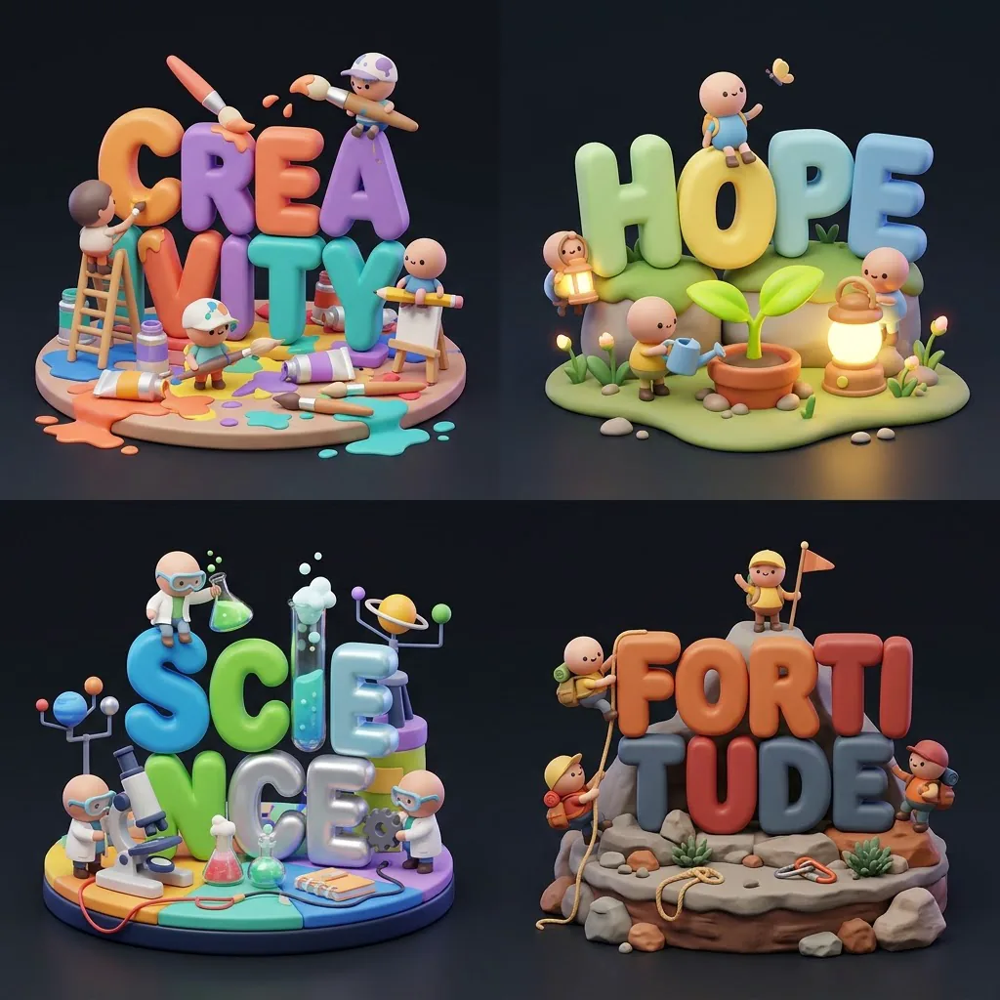</a>

> 来自 @Gdgtify 的代码式模板，适用于 Nano Banana 2.1 和 GPT Image 2.5。它定义了一个 ToyBubbleDiorama 类：模型为每个主题推导出简短标题、核心瞬间、三个标志性道具、小人物和底座，再用软塑料或黏土质感的圆润泡泡字做标题，周围摆上道具。我们用创造力、希望、科学、坚毅四个主题生成了一张 2x2 方图。适合课堂海报、价值观墙和科普轮播图。

```text
2x2 grid, square 1:1. Four compact 3D toy dioramas, one each for CREATIVITY, HOPE, SCIENCE and FORTITUDE. In each panel the short title is built from chunky rounded 3D bubble letters in soft toy plastic, clay and rubbery foam, matte with gentle gloss highlights, large and centered; around the letters, three iconic props and tiny cute mini characters act out the core moment of the topic on a small environment base (paint tubes and brushes; a sprouting seedling and a lantern; a microscope and bubbling flasks; a small climber on a rocky ledge). Playful palette per panel, dark studio backdrop, soft studio lighting, tactile toy diorama render.
```

- 原作者: [@Gdgtify](https://x.com/Gdgtify)
- 原帖: https://x.com/Gdgtify/status/2109732587099070660
- [在 cinel 上查看详情并一键生成](https://cinel.ai/zh/prompts/p/toy-bubble-letter-topic-diorama?utm_source=github&utm_medium=awesome&utm_campaign=awesome-nano-banana-2.1-prompts)

### 微型外星工程师建造火星飞船

<a href="https://cinel.ai/zh/prompts/p/tiny-alien-engineers-mars-spacecraft-factory?utm_source=github&utm_medium=awesome&utm_campaign=awesome-nano-banana-2.1-prompts">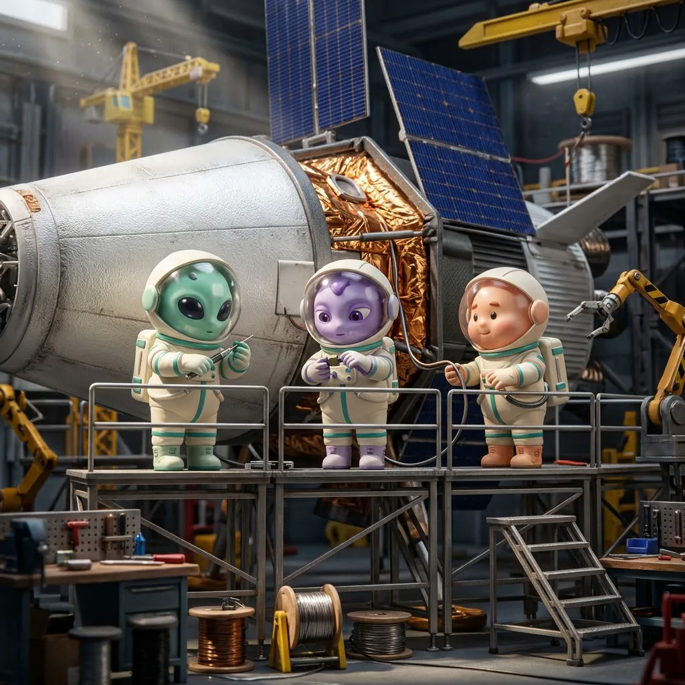</a>

> 改编自 @Fujimoto_hina 的 30 秒 Seedance 2.5 视频提示词。原文的 JSON 分镜讲述三位原创小工程师（薄荷绿、薰衣草紫、蜜桃色）在一座巨大的手工微缩工厂里，为一个虚构航天品牌组装 AEGON-01 飞船。我们把它改成脚手架上的一帧关键画面，保留了团队、航天服、铜金隔热层、蓝色太阳能板和强烈的尺度感，去掉了品牌标牌。适合科学主题广告、儿童科普海报和动画提案。

```text
A single key frame from a photorealistic miniature diorama commercial: three cute tiny original alien engineers (mint-green with large dark eyes, lavender with violet eyes, peach with rounded cheeks), all in matching ivory-white aerospace suits with teal stripes, tiny boots and visors, work on scaffolding inside a gigantic handcrafted miniature aerospace factory around an enormous Mars exploration spacecraft with a silver-white fuselage, copper-gold thermal insulation, graphite parts and folding blue solar arrays. Miniature cranes, robotic arms, precision tools, dramatic industrial lighting, cinematic macro photography, strong sense of scale. No text, no logos. Square 1:1.
```

- 原作者: [@Fujimoto_hina](https://x.com/Fujimoto_hina)
- 原帖: https://x.com/Fujimoto_hina/status/2109923277053501452
- [在 cinel 上查看详情并一键生成](https://cinel.ai/zh/prompts/p/tiny-alien-engineers-mars-spacecraft-factory?utm_source=github&utm_medium=awesome&utm_campaign=awesome-nano-banana-2.1-prompts)

### 撑叶子伞的毛线小怪

<a href="https://cinel.ai/zh/prompts/p/knitted-creature-leaf-umbrella-rooftop?utm_source=github&utm_medium=awesome&utm_campaign=awesome-nano-banana-2.1-prompts">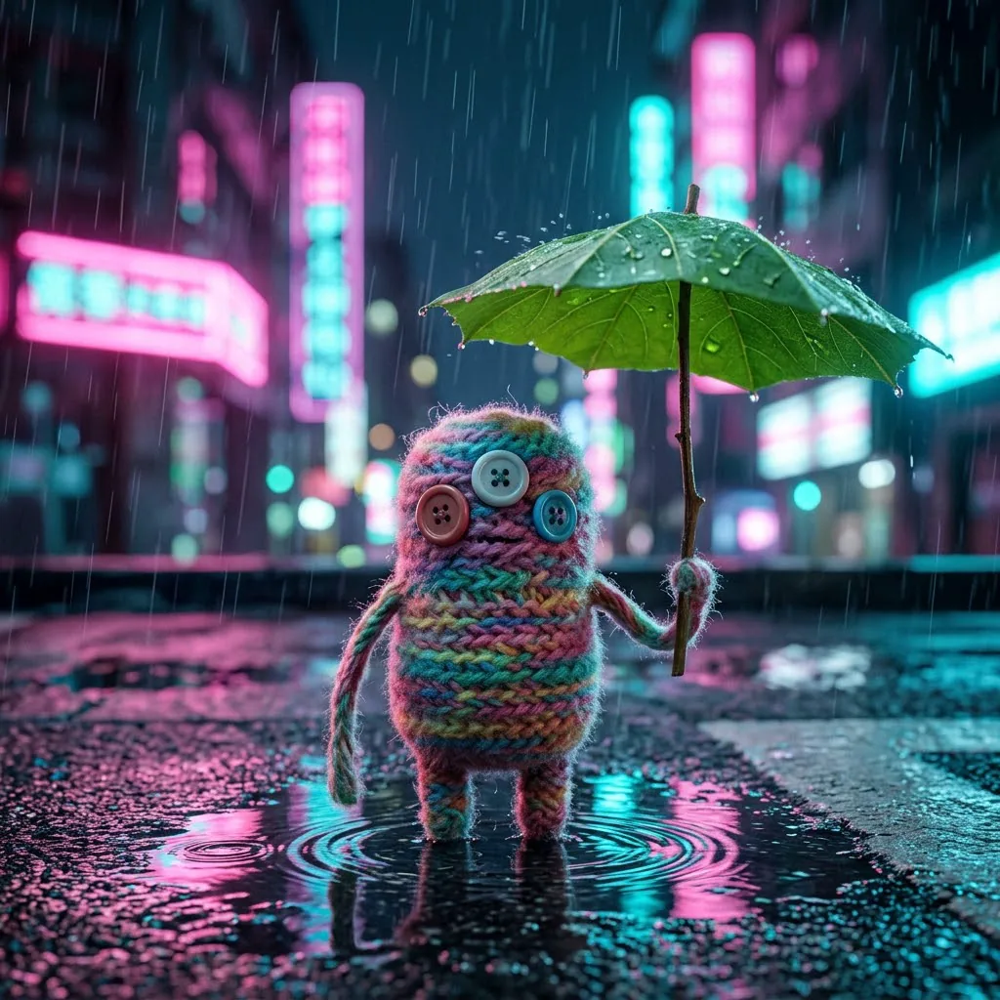</a>

> 改编自 @KorpiAi 的一句话视频提示词，他在一次测试中把它交给了五个视频模型。主角是一只小小的毛线怪，三颗纽扣眼睛、长长的面条手臂，踮脚穿过下雨的霓虹屋顶，停下来看向镜头，撑开一片叶子做的伞。我们定格在撑伞的瞬间。提示词短小，很容易复用。适合温馨吉祥物、雨天内容和定格动画风格测试。

```text
A single key frame: a tiny knitted wool creature with three button eyes and long noodle arms stands on a rainy neon-lit city rooftop at night, looks straight at the camera and pops open a miniature umbrella made from a green leaf. Raindrops, glowing pink and cyan neon reflections in puddles, visible wool fibers, macro cinematography, shallow depth of field. Square 1:1.
```

- 原作者: [@KorpiAi](https://x.com/KorpiAi)
- 原帖: https://x.com/KorpiAi/status/2108687594913738792
- [在 cinel 上查看详情并一键生成](https://cinel.ai/zh/prompts/p/knitted-creature-leaf-umbrella-rooftop?utm_source=github&utm_medium=awesome&utm_campaign=awesome-nano-banana-2.1-prompts)

### 穿高帮鞋的 3D 美食吉祥物

<a href="https://cinel.ai/zh/prompts/p/food-mascot-high-top-sneakers-3d?utm_source=github&utm_medium=awesome&utm_campaign=awesome-nano-banana-2.1-prompts">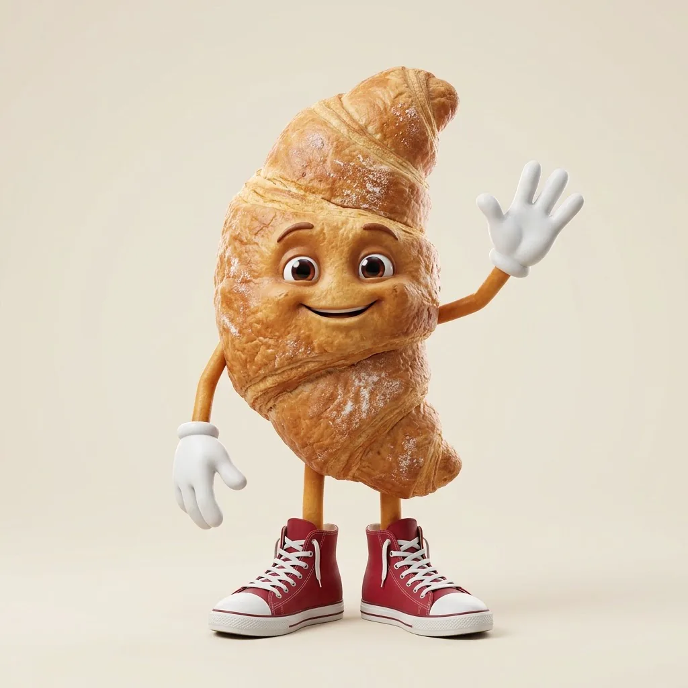</a>

> 来自 @azed_ai 分享的“Food Mascot”提示词模板。它能把任意食物变成写实的 3D 角色：保留真实表面质感，配上亮晶晶的眼睛、细细的手臂、白色卡通手套和厚底高帮球鞋，并用影棚灯光呈现。我们填入金棕色的可颂，配樱桃红球鞋。适合烘焙与零食品牌、菜单吉祥物和贴纸。

```text
Cute anthropomorphic croissant mascot, full body, front three-quarter view, realistic golden-brown surface with natural texture, imperfections and detailed ingredients, expressive glossy eyes, cheerful smile, thin matching arms and short legs, oversized white cartoon gloves, one hand waving, oversized cherry-red high-top sneakers with white laces and soles, photorealistic 3D CGI, realistic materials, cinematic studio lighting, soft shadows, subtle rim light, neutral cream background, centered, fully visible, sharp focus Square 1:1 composition.
```

- 原作者: [@azed_ai](https://x.com/azed_ai)
- 原帖: https://x.com/azed_ai/status/2108511815181434974
- [在 cinel 上查看详情并一键生成](https://cinel.ai/zh/prompts/p/food-mascot-high-top-sneakers-3d?utm_source=github&utm_medium=awesome&utm_campaign=awesome-nano-banana-2.1-prompts)

### 怪趣机械猫头鹰半透明翅膀潮玩

<a href="https://cinel.ai/zh/prompts/p/whimsy-mechanical-owl-translucent-wings?utm_source=github&utm_medium=awesome&utm_campaign=awesome-nano-banana-2.1-prompts">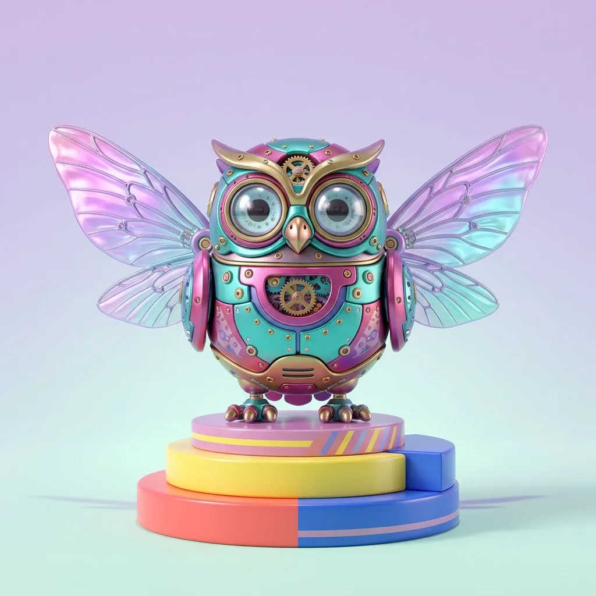</a>

> @RockGrokAI Designer-Toy Whimsy（8 赞，提示在 alt）。虚构机械猫头鹰；1:1。

```text
Square 1:1 Designer-Toy Whimsy style: an ORIGINAL unique designer toy resembling a mechanical owl with translucent iridescent wings, displayed on a sleek colorful pedestal. 3D whimsical aesthetic, colorful and fun, soft studio lighting, clean backdrop. Fictional OC only, no brands.
```

- 原作者: [@RockGrokAI](https://x.com/RockGrokAI)
- 原帖: https://x.com/RockGrokAI/status/2101696887355302359
- [在 cinel 上查看详情并一键生成](https://cinel.ai/zh/prompts/p/whimsy-mechanical-owl-translucent-wings?utm_source=github&utm_medium=awesome&utm_campaign=awesome-nano-banana-2.1-prompts)

### 马卡龙小屋 chibi 奶油女巫潮玩场景

<a href="https://cinel.ai/zh/prompts/p/macaron-house-chibi-cream-witch?utm_source=github&utm_medium=awesome&utm_campaign=awesome-nano-banana-2.1-prompts">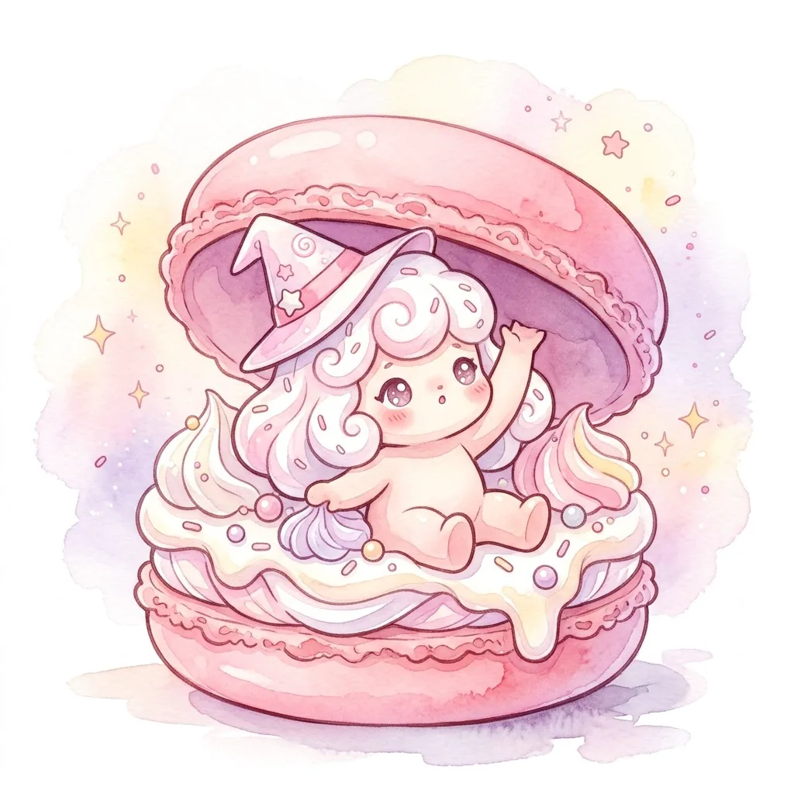</a>

> @gen_with_love 马卡龙 chibi 方法（4 赞）。去掉上传照片，改写虚构奶油女巫；1:1。

```text
Square 1:1 premium kawaii watercolor-style designer-toy illustration of an ORIGINAL fictional tiny chibi Cream Witch sitting inside a giant pastel strawberry-pink macaron. She has a tiny pointed hat, cream swirls hair, stubby limbs, holds up the upper macaron shell with both hands, soft whipped cream and confectionery pearls around her. Pastel macaron art, clean sweet composition, no logos, no real people, no attached photo reference — invent the OC fully.
```

- 原作者: [@gen_with_love](https://x.com/gen_with_love)
- 原帖: https://x.com/gen_with_love/status/2108498459775156225
- [在 cinel 上查看详情并一键生成](https://cinel.ai/zh/prompts/p/macaron-house-chibi-cream-witch?utm_source=github&utm_medium=awesome&utm_campaign=awesome-nano-banana-2.1-prompts)

<a id="food-drink"></a>

## 美食饮品

精选 1 条 · [查看本类全部 1 条](cases/zh/food-drink.md) · [cinel 分类页](https://cinel.ai/zh/prompts/food-drink?utm_source=github&utm_medium=awesome&utm_campaign=awesome-nano-banana-2.1-prompts)

### 夜市烈火炒锅大厨

<a href="https://cinel.ai/zh/prompts/p/night-market-flaming-wok-chef?utm_source=github&utm_medium=awesome&utm_campaign=awesome-nano-banana-2.1-prompts">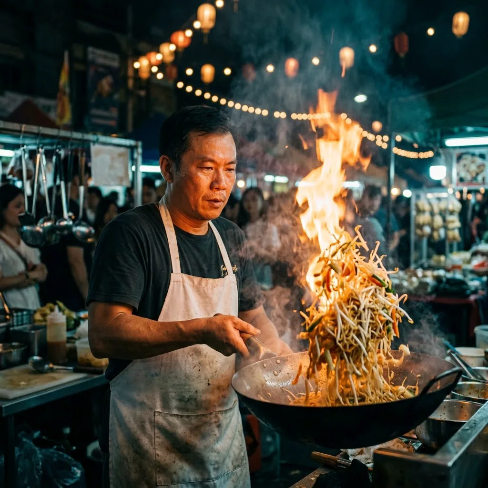</a>

> 改编自 @fatih_ogpu 发布的视频对比：他把同一句简短描述（夜市厨师、烈火炒锅、飞起的面条）分别交给 Kling 3.0 Omni 和 Seedance 2.5。原帖没有公开完整提示词，所以我们根据这句描述和缩略图写出静帧：高高抛起的面条、冲天的火焰、蒸汽和成串的暖色灯泡。适合餐厅广告、美食节海报和烹饪频道缩略图。

```text
A single key frame from a cinematic street-food film: a night-market chef in a white apron tosses noodles high from a flaming wok, a tall burst of orange fire lighting his focused face, noodles and vegetables flying in the air, steam and smoke rising, a busy night market behind him with strings of warm bulbs and blurred stalls. Shallow depth of field, crisp motion freeze, rich warm and teal tones. No text, no signage. Square 1:1.
```

- 原作者: [@fatih_ogpu](https://x.com/fatih_ogpu)
- 原帖: https://x.com/fatih_ogpu/status/2109630235134095673
- [在 cinel 上查看详情并一键生成](https://cinel.ai/zh/prompts/p/night-market-flaming-wok-chef?utm_source=github&utm_medium=awesome&utm_campaign=awesome-nano-banana-2.1-prompts)

<a id="illustration-anime"></a>

## 插画与动漫

精选 6 条 · [查看本类全部 8 条](cases/zh/illustration-anime.md) · [cinel 分类页](https://cinel.ai/zh/prompts/illustration-anime?utm_source=github&utm_medium=awesome&utm_campaign=awesome-nano-banana-2.1-prompts)

### 风暴中的九尾狐神女

<a href="https://cinel.ai/zh/prompts/p/nine-tailed-fox-goddess-storm?utm_source=github&utm_medium=awesome&utm_campaign=awesome-nano-banana-2.1-prompts"></a>

> 来自 @Sirilee2026 的神话肖像提示词，原帖附的是简短的说明式提示词（完整版在评论区）。中国民间传说中的狐仙，一身赤金，闭目沉静，丝绸、流苏和九条发光的尾巴在暴风雨天空中飘动。我们在原句基础上略作扩写，加入狐尾、发饰和金色光线。很契合本周“神话 × 时尚”的热点。适合奇幻封面、游戏主视觉和海报。

```text
The nine-tailed fox goddess in crimson and gold, eyes closed in quiet divinity. Silk and tassels flow amid the stormy sky. Nine luminous white fox tails fan out behind her, ornate gold hairpiece with dangling tassels, layered crimson silk robes with gold embroidery whipping in the wind, dark storm clouds lit by soft golden light, cinematic fantasy portrait, ultra-detailed. Square 1:1.
```

- 原作者: [@Sirilee2026](https://x.com/Sirilee2026)
- 原帖: https://x.com/Sirilee2026/status/2110685868033769884
- [在 cinel 上查看详情并一键生成](https://cinel.ai/zh/prompts/p/nine-tailed-fox-goddess-storm?utm_source=github&utm_medium=awesome&utm_campaign=awesome-nano-banana-2.1-prompts)

### 灰纸上的秋湖速写

<a href="https://cinel.ai/zh/prompts/p/autumn-lake-sketch-on-gray-paper?utm_source=github&utm_medium=awesome&utm_campaign=awesome-nano-banana-2.1-prompts">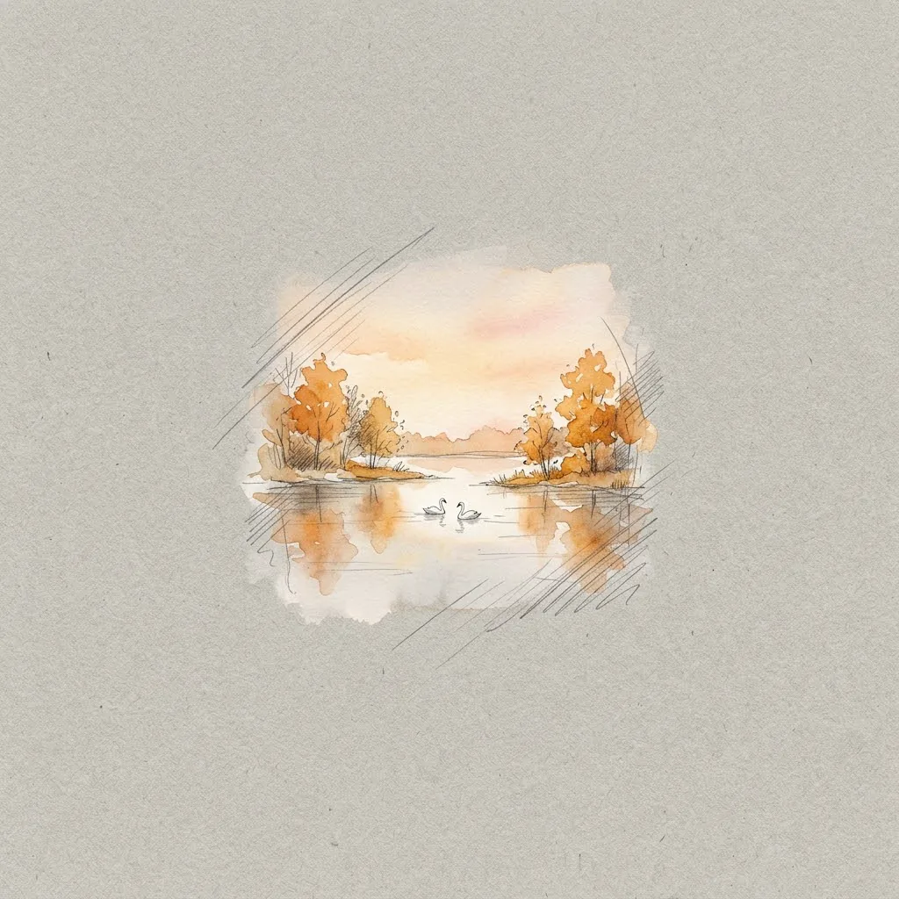</a>

> 根据 @churvikv 一张题为“秋天在灰纸上呼出暖意”的壁纸反向撰写的提示词（原帖没有提示词）。我们自己描述了画面：一小块松散的铅笔速写，在中心渐变为水彩，有橙色秋树、蜜桃色日出、两只天鹅和柔和倒影，周围留出大片空白的灰色纹理纸。适合手机壁纸、贺卡和安静的季节内容。

```text
A minimalist art wallpaper: on a textured gray paper background, a small loose pencil-sketch vignette that fades into soft watercolor in the centre, showing a calm autumn lake at sunrise with orange and golden trees on the shores, a soft peach sky, two white swans gliding on the water and gentle reflections. A few diagonal graphite strokes frame the vignette; the rest of the paper is left empty. Delicate, warm, hand-drawn. Square 1:1.
```

- 原作者: [@churvikv](https://x.com/churvikv)
- 原帖: https://x.com/churvikv/status/2109631329403113516
- [在 cinel 上查看详情并一键生成](https://cinel.ai/zh/prompts/p/autumn-lake-sketch-on-gray-paper?utm_source=github&utm_medium=awesome&utm_campaign=awesome-nano-banana-2.1-prompts)

### VHS 黑色电影铅笔速写

<a href="https://cinel.ai/zh/prompts/p/vhs-noir-pencil-sketch-scene?utm_source=github&utm_medium=awesome&utm_campaign=awesome-nano-banana-2.1-prompts">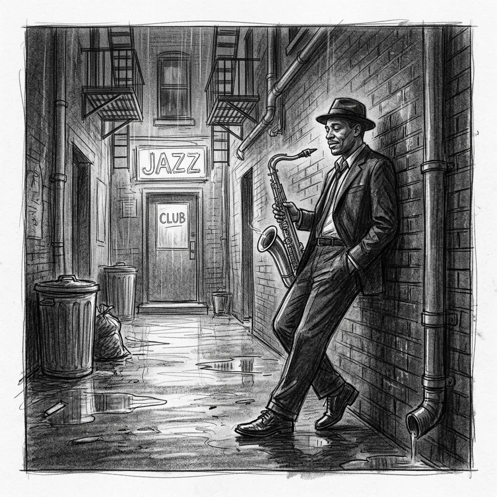</a>

> 来自 @azed_ai 分享的“VHS Noir Sketch”提示词。它融合了两种风格：90 年代手持 VHS 的抓拍画面，以及插画师松散的铅笔速写，线条擦了又画。我们填入了“爵士俱乐部后面雨巷里中场休息的萨克斯手”。替换主体和场景，可用于音乐海报、独立杂志插画和氛围分镜。

```text
Retro 1990s handheld VHS of a saxophonist taking a break between sets, leaning on a brick wall in a rainy alley behind a jazz club, black-and-white film noir atmosphere, candid unposed moment, natural weight shift, relaxed asymmetrical posture, expressive hands and feet, subtle facial expression, spontaneous imperfect framing, loose pencil sketch rendering, overlapping construction marks, exploratory strokes, erased and redrawn lines, imperfect contours, charming irregularities, personal illustrator sketchbook feel, subtle VHS grain, analog tracking noise, soft motion blur, deep monochrome contrast, raw handmade finish. Square 1:1 composition.
```

- 原作者: [@azed_ai](https://x.com/azed_ai)
- 原帖: https://x.com/azed_ai/status/2109600238428463125
- [在 cinel 上查看详情并一键生成](https://cinel.ai/zh/prompts/p/vhs-noir-pencil-sketch-scene?utm_source=github&utm_medium=awesome&utm_campaign=awesome-nano-banana-2.1-prompts)

### 钢笔建筑街景速写

<a href="https://cinel.ai/zh/prompts/p/ink-architectural-street-sketch?utm_source=github&utm_medium=awesome&utm_campaign=awesome-nano-banana-2.1-prompts">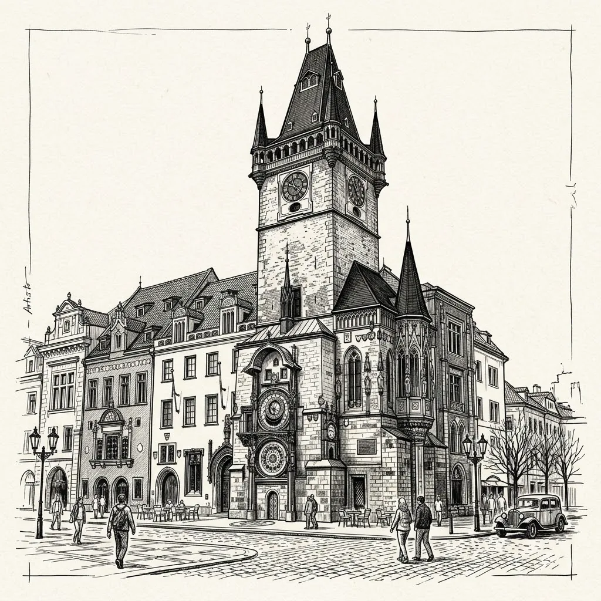</a>

> 来自 @Naiknelofar788 的“Streets of the World”系列。提示词要求用黑白针管笔速写一条真实街道：交叉排线、鹅卵石路、老爷车和光秃的树，中心是准确的地标。我们用布拉格老城市政厅钟楼填充，并把画幅从 4:5 改为 1:1。适合旅行手账、城市版画和明信片。

```text
Create a highly detailed black-and-white architectural sketch of a beautiful street in Prague, Czech Republic, featuring the Old Town Hall clock tower as the main subject. Capture the authentic character of the city through its traditional architecture, distinctive rooftops, intricate windows, textured walls, cobblestone streets, and charming surrounding buildings.

Use a hand-drawn ink illustration style with fine black pen lines, realistic architectural details, cross-hatching, sketchy textures, and delicate shading. Include subtle street elements such as a parked vintage car, bare trees, street lamps, and small details that bring the scene to life.

The composition should resemble a page from an artist’s travel sketchbook, with the landmark naturally integrated into its real urban surroundings. Use varied line weights, imperfect hand-drawn strokes, and intricate textures to create depth and dimension.

Style: Monochrome architectural line art, fine-liner pen sketch, urban sketching, realistic perspective, intricate ink detailing, travel journal aesthetic, white paper background, high contrast, no colors, no watercolor, no digital painting.

Important: Keep the landmark architecturally accurate and instantly recognizable. Avoid generic AI-generated buildings. Focus on the city’s real architectural identity and authentic street atmosphere.

Aspect ratio: 1:1 — square composition.
```

- 原作者: [@Naiknelofar788](https://x.com/Naiknelofar788)
- 原帖: https://x.com/Naiknelofar788/status/2110593708953686148
- [在 cinel 上查看详情并一键生成](https://cinel.ai/zh/prompts/p/ink-architectural-street-sketch?utm_source=github&utm_medium=awesome&utm_campaign=awesome-nano-banana-2.1-prompts)

### 哥特水墨动漫剑斗关键帧

<a href="https://cinel.ai/zh/prompts/p/gothic-ink-anime-sword-duel-keyframe?utm_source=github&utm_medium=awesome&utm_campaign=awesome-nano-banana-2.1-prompts">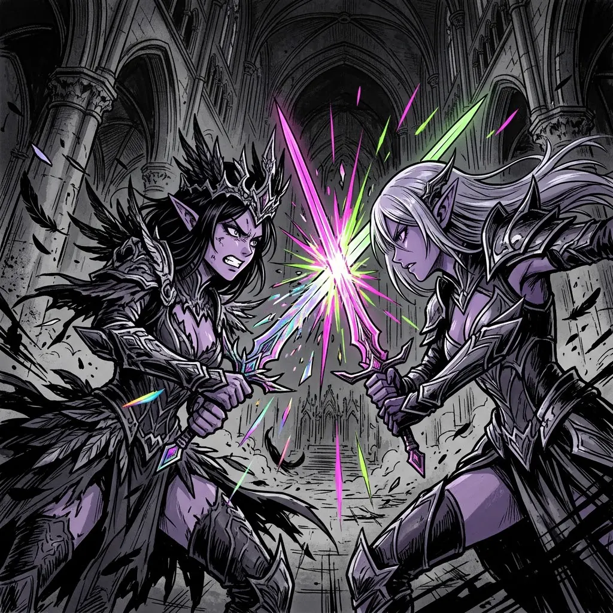</a>

> 改编自 @aimikoda 发布在其动漫对决视频下的 Seedance 2.5 视频提示词。原文描述了一场哥特水墨动漫风格的极速剑斗：黑色线描、炭灰阴影、紫调肤色，以及霓虹粉、酸性绿和棱彩火花。原作的风格依赖一张参考图，所以我们用文字描述了两位原创女剑士。我们定格在废墟大教堂里的一次刀剑相抵。适合动漫主视觉、游戏开屏图和奇幻小说封面。

```text
A single key frame from a dark fantasy 2D anime film fused with gothic ink illustration: inside a ruined cathedral swallowed by darkness, two gothic elven swordswomen lock blades at close range, a black-haired warrior with a feathered crown and a prismatic sword against a silver-haired warrior with a neon blade. Intricate black linework, rough hand-drawn textures, charcoal-gray shading, muted violet skin tones and elaborate gothic silhouettes; the clash bursts with razor-sharp neon pink, acid green and prismatic sparks and fractured ink splashes that light the monochrome ruins. Drifting ash, torn feathers and broken pillars, dramatic Dutch angle, extreme foreshortening, strong silhouette control, high-contrast graphic composition, hand-drawn anime expressiveness, no realistic CGI. Square 1:1 composition.
```

- 原作者: [@aimikoda](https://x.com/aimikoda)
- 原帖: https://x.com/aimikoda/status/2109235247162245339
- [在 cinel 上查看详情并一键生成](https://cinel.ai/zh/prompts/p/gothic-ink-anime-sword-duel-keyframe?utm_source=github&utm_medium=awesome&utm_campaign=awesome-nano-banana-2.1-prompts)

### 厚涂油画雨中撑伞街景关键帧

<a href="https://cinel.ai/zh/prompts/p/impasto-rainy-umbrella-street-keyframe?utm_source=github&utm_medium=awesome&utm_campaign=awesome-nano-banana-2.1-prompts">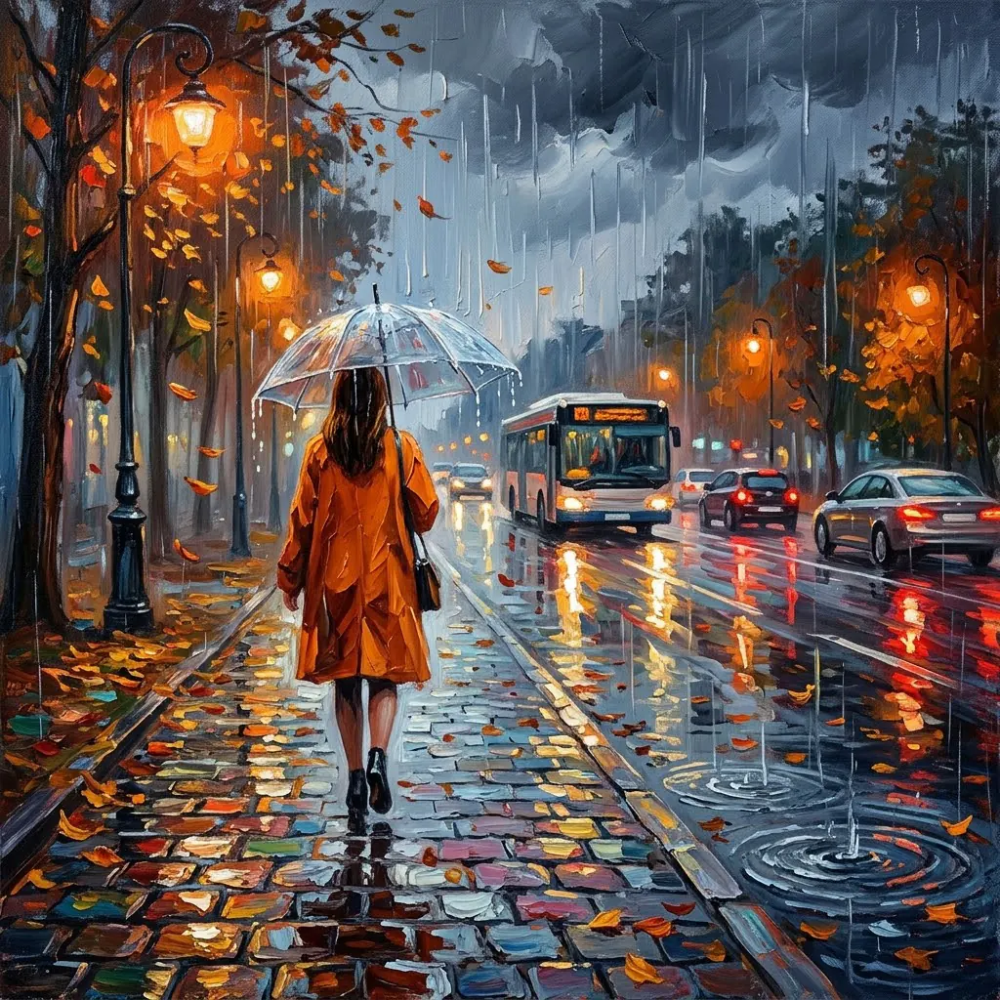</a>

> 改编自 @churvikv 的 Seedance 2.5 视频提示词，原帖配文“雨声像掌声”。原作是一段 8 秒的刮刀厚涂油画短片：穿橙色大衣、撑透明伞的女子，驶过的公交车，闪烁的路灯和飘落的树叶。我们把它改写成一帧静止画面。适合秋季海报、书籍封面和氛围壁纸。

```text
A single key frame in impasto oil painting style with thick palette-knife texture: a woman in an orange coat walks slowly forward on a wet cobblestone sidewalk, holding a transparent umbrella with rain dripping from its edges. Heavy rain falls in vertical streaks; a bus and cars pass along the slick road, their headlights and taillights reflecting on the wet surface. Street lamps cast a warm orange glow, autumn leaves drift down, puddles ripple, wet cobblestones shimmer with reflected light, dark stormy clouds overhead. Moody cinematic autumn evening atmosphere, no text. Square 1:1 composition.
```

- 原作者: [@churvikv](https://x.com/churvikv)
- 原帖: https://x.com/churvikv/status/2110031241139360215
- [在 cinel 上查看详情并一键生成](https://cinel.ai/zh/prompts/p/impasto-rainy-umbrella-street-keyframe?utm_source=github&utm_medium=awesome&utm_campaign=awesome-nano-banana-2.1-prompts)

<a id="scenes-creative"></a>

## 创意场景

精选 6 条 · [查看本类全部 15 条](cases/zh/scenes-creative.md) · [cinel 分类页](https://cinel.ai/zh/prompts/scenes-creative?utm_source=github&utm_medium=awesome&utm_campaign=awesome-nano-banana-2.1-prompts)

### 剪影树与城市日落合成

<a href="https://cinel.ai/zh/prompts/p/silhouette-tree-city-sunset-composite?utm_source=github&utm_medium=awesome&utm_campaign=awesome-nano-banana-2.1-prompts">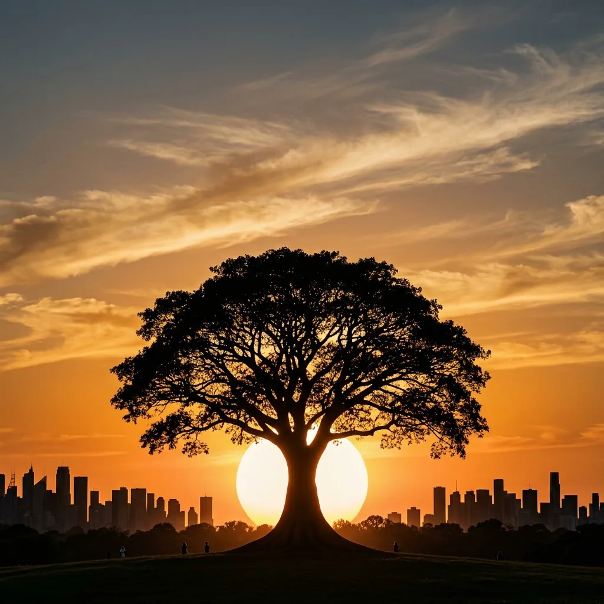</a>

> 来自 @churvikv 的结构化风景提示词，为 GPT Image 2.5 编写。它按 SKY、SUN、TREE、CITY 分块，每块负责一层：琥珀到灰蓝渐变、带条状卷云的天空，正中一轮巨大圆日，舒展的大树纯黑剪影，两侧黑色摩天楼。树与城的对比就是画面的故事。我们保留结构，改成了方图。适合壁纸、专辑封面和安静诗意的海报。

```text
Photorealistic silhouette sunset composite, square 1:1 composition, cinematic, ultra-detailed, edge to edge, no frame. SKY: a furnace of amber, apricot and burnt gold, deepest at the horizon, cooling to smoky blue-grey at the top, long streaky cirrus clouds sweeping diagonally with gold-lit undersides. SUN: one huge perfectly round pale white-hot sun disc exactly at the centre just above the treeline, its rim bleeding a soft warm halo. TREE: dead centre in front of the sun, a single massive spreading broadleaf tree in pure black silhouette, thick trunk flaring into a rounded knoll, vast dense canopy of fine branch tracery. CITY: flanking the tree, a dense skyline of black skyscraper silhouettes along the horizon. FOREGROUND: dark grass knoll and a few tiny human silhouettes for scale. No text.
```

- 原作者: [@churvikv](https://x.com/churvikv)
- 原帖: https://x.com/churvikv/status/2110114825082945740
- [在 cinel 上查看详情并一键生成](https://cinel.ai/zh/prompts/p/silhouette-tree-city-sunset-composite?utm_source=github&utm_medium=awesome&utm_campaign=awesome-nano-banana-2.1-prompts)

### 月夜港湾里的霓虹游艇

<a href="https://cinel.ai/zh/prompts/p/neon-yacht-moonlit-harbour?utm_source=github&utm_medium=awesome&utm_campaign=awesome-nano-banana-2.1-prompts">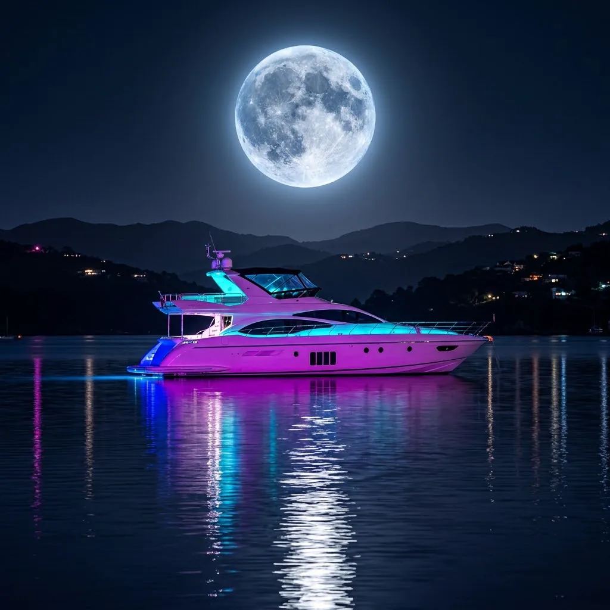</a>

> 来自 @churvikv 的夜港提示词，为 GPT Image 2.5 编写，同样按 HARBOUR、MOON、BOAT、HILLS 分块：平静的黑水与拉长的倒影，环形山清晰的巨大满月，被紫外洋红和电光青色笼罩的白色游艇，以及背后的暗色山脊。霓虹与月光的冷暖对比是画面的关键。适合壁纸、夜生活海报和合成波风格封面。

```text
Photorealistic night harbour scene, square 1:1 composition, cinematic, ultra-detailed, edge to edge. HARBOUR: the lower half is calm black water in fine horizontal chop carrying long smeared vertical reflections. MOON: high in the deep navy sky hangs one enormous sharply detailed full moon with crisp craters and a soft blue-white halo. BOAT: just left of centre a sleek modern white motor yacht at rest, seen broadside, its hull washed in vivid neon ultraviolet magenta and its upper deck and railings glowing electric cyan, dark tinted glass bridge, radar mast, blue-lit stern platform, small dark portholes. HILLS: layered dark ridgelines behind, dotted with a few warm house lights. Long neon and moonlight reflections in the water. No text, no logos.
```

- 原作者: [@churvikv](https://x.com/churvikv)
- 原帖: https://x.com/churvikv/status/2109710598972035578
- [在 cinel 上查看详情并一键生成](https://cinel.ai/zh/prompts/p/neon-yacht-moonlit-harbour?utm_source=github&utm_medium=awesome&utm_campaign=awesome-nano-banana-2.1-prompts)

### 满月山脊小屋奇幻夜景

<a href="https://cinel.ai/zh/prompts/p/full-moon-ridge-house-fantasy-landscape?utm_source=github&utm_medium=awesome&utm_campaign=awesome-nano-banana-2.1-prompts">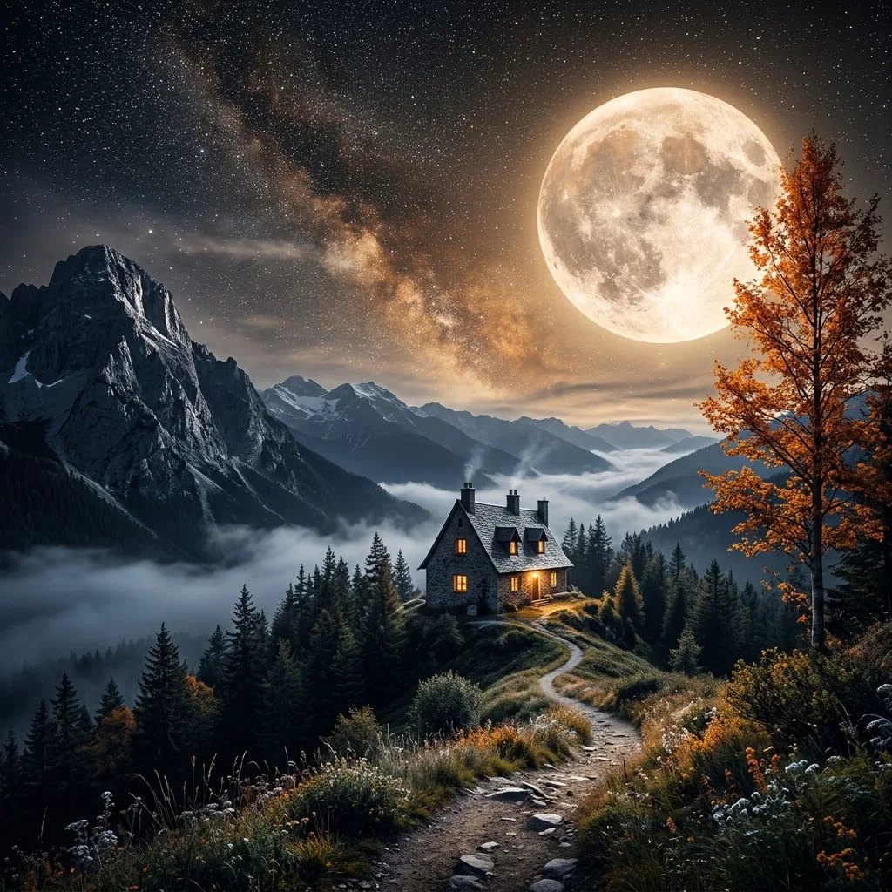</a>

> 来自 @churvikv 的奇幻风景提示词，用 GPT Image 2.5 Flare 生成。分块搭建画面：星光密布、带琥珀星云的夜空和巨大满月，被月光照亮的嶙峋山峰，谷中积聚的雾气，山脊上窗户透着暖光的老石屋，以及前景一棵火红的秋树。暖色窗光和冷月光的对比带来童话般的感觉。适合书籍封面、壁纸和温馨奇幻插画。

```text
Surreal photorealistic night fantasy landscape, square 1:1 composition, cinematic, ultra-detailed. SKY: an immense star-filled night sky, dense pinpoint stars and a warm amber nebula glow behind the moon; a huge luminous full moon with crisp craters in the upper right with a soft warm halo. MOUNTAINS: on the left a towering dark rocky mountain catching cold silver moonlight, distant snow-dusted ridgelines fading into blue-grey mist, low clouds spilling into the valley. HOUSE: perched on a forested ridge, a weathered gabled stone house with a steep roof, two chimneys and small windows glowing warm gold. FOREGROUND RIGHT: a tall slender tree in fiery orange and amber autumn leaves. A winding path leads toward the moon. No text.
```

- 原作者: [@churvikv](https://x.com/churvikv)
- 原帖: https://x.com/churvikv/status/2109362817786896480
- [在 cinel 上查看详情并一键生成](https://cinel.ai/zh/prompts/p/full-moon-ridge-house-fantasy-landscape?utm_source=github&utm_medium=awesome&utm_campaign=awesome-nano-banana-2.1-prompts)

### 3D 剪贴簿悬浮照片剪纸

<a href="https://cinel.ai/zh/prompts/p/3d-scrapbook-floating-photo-cutout?utm_source=github&utm_medium=awesome&utm_campaign=awesome-nano-banana-2.1-prompts">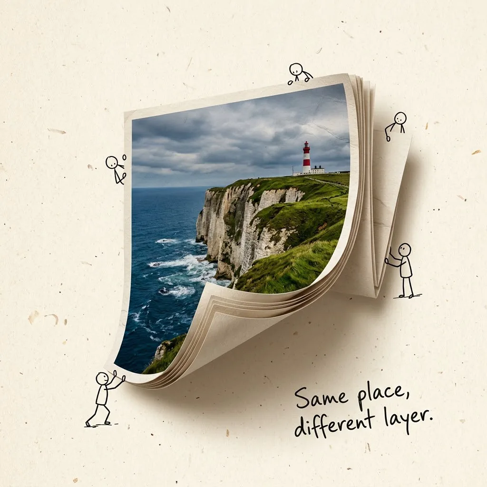</a>

> 来自 @Taaruk_ 的混合媒介提示词。一个写实场景变成一张厚实、弯曲、边缘分层、带柔和阴影的纸片，悬浮在暖象牙白纸面上，小小的手绘火柴人推着、抬着、扶着它的边缘，旁边配手写说明。场景用文字描述，不需要上传照片。我们用了原文中的海岸悬崖与灯塔场景。适合杂志封面、旅行手账和有趣的品牌内容。

```text
Create a creative minimalist 3D scrapbook composition featuring a realistic photograph transformed into a thick, floating paper cutout on a warm ivory textured background. The photograph shows dramatic white coastal cliffs covered in vibrant green grass, deep blue ocean waves and a striking red-and-white lighthouse beneath a cloudy sky. Make the photograph a curved, folded sheet of thick paper with realistic depth, visible layered edges, soft shadows and a floating effect. Add tiny hand-drawn black stick-figure characters interacting with the paper, pushing, lifting and holding its edges, with a playful handwritten caption "Same place, different layer." Elegant editorial photography, realistic textures, subtle imperfections, minimalist art direction, soft beige palette. Square 1:1.
```

- 原作者: [@Taaruk_](https://x.com/Taaruk_)
- 原帖: https://x.com/Taaruk_/status/2110655754927772000
- [在 cinel 上查看详情并一键生成](https://cinel.ai/zh/prompts/p/3d-scrapbook-floating-photo-cutout?utm_source=github&utm_medium=awesome&utm_campaign=awesome-nano-banana-2.1-prompts)

### 抽象概念的物理化呈现

<a href="https://cinel.ai/zh/prompts/p/abstract-concept-as-physical-phenomenon?utm_source=github&utm_medium=awesome&utm_campaign=awesome-nano-banana-2.1-prompts">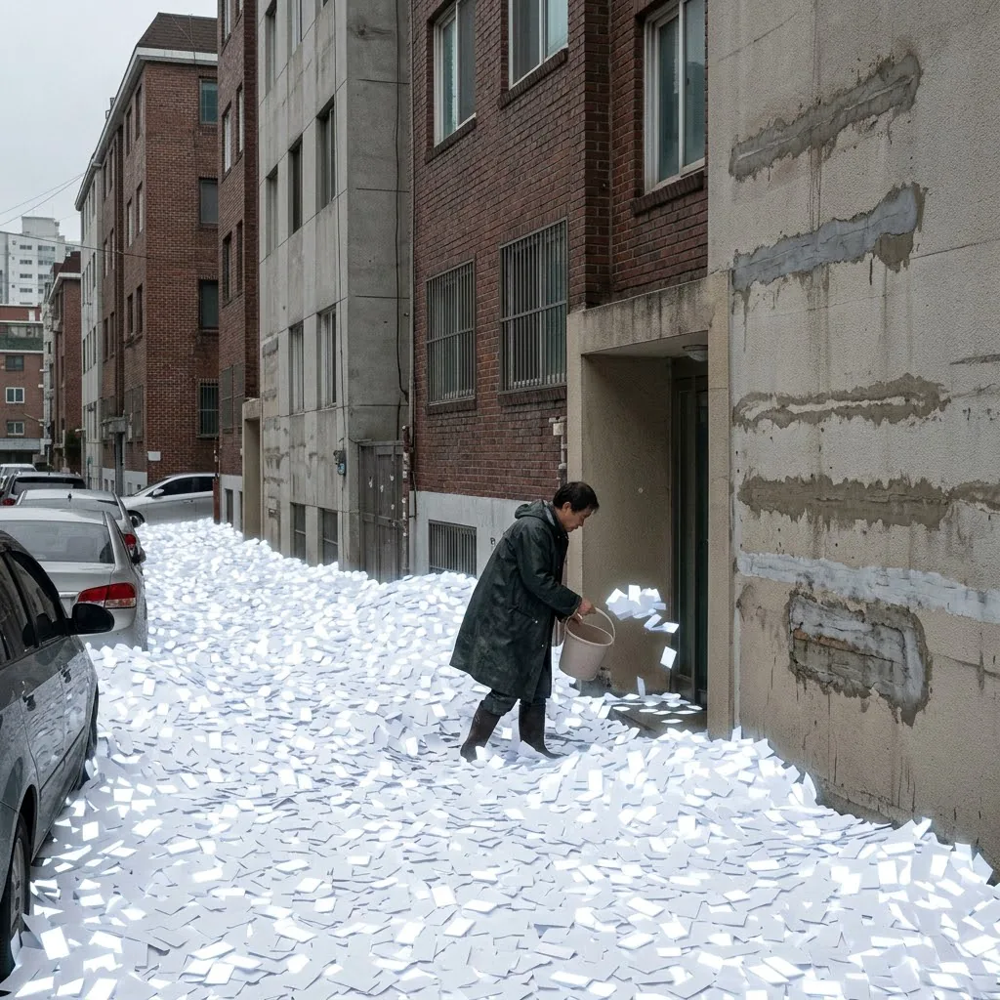</a>

> 来自 @Gdgtify 的分步模板。它先推断概念的行为方式（累积、泄漏、侵蚀），为它匹配一种自然过程，再加入一个习以为常地适应它的普通人，并留下水位线和修补痕迹作为证据。渲染规则很严格：冷静写实，阴天光线，无标签，无文字。我们试了“通知过载”，表现为发光纸条像潮水一样淹没街道。适合评论配图、文章封面和概念艺术。

```text
A single calm observational photograph that turns the abstract concept of notification overload into a physical phenomenon: a slow rising tide of small glowing white paper slips flooding an ordinary apartment street. One ordinary person in a raincoat wades through it with routine calm, carrying a bucket and bailing slips out of a doorway; the walls show successive high-water marks and repairs at different heights, and one old repair sits far below the current level. Long lens, overcast light, quiet realism. No symbols painted on the phenomenon, no labels, no text, no second metaphor. Square 1:1.
```

- 原作者: [@Gdgtify](https://x.com/Gdgtify)
- 原帖: https://x.com/Gdgtify/status/2109653566558437642
- [在 cinel 上查看详情并一键生成](https://cinel.ai/zh/prompts/p/abstract-concept-as-physical-phenomenon?utm_source=github&utm_medium=awesome&utm_campaign=awesome-nano-banana-2.1-prompts)

### 单词提示词：Thoughts（思绪）

<a href="https://cinel.ai/zh/prompts/p/one-word-prompt-thoughts?utm_source=github&utm_medium=awesome&utm_campaign=awesome-nano-banana-2.1-prompts"></a>

> 来自 @AllaAisling 的单词提示词系列：整条提示词只有一个词，其余全部交给模型决定。“Thoughts”通常会生成关于头脑和思绪的超现实隐喻。我们只输入这个词，未做任何修改，这次生成的是一位女子在洒满阳光的书桌前写字的安静画面。每次结果都不同，这正是它的乐趣。适合创意热身、模型对比和灵感启发。

```text
Thoughts
```

- 原作者: [@AllaAisling](https://x.com/AllaAisling)
- 原帖: https://x.com/AllaAisling/status/2109313324504551930
- [在 cinel 上查看详情并一键生成](https://cinel.ai/zh/prompts/p/one-word-prompt-thoughts?utm_source=github&utm_medium=awesome&utm_campaign=awesome-nano-banana-2.1-prompts)

## 许可

代码（scripts/、.github/）采用 MIT 许可，见 [LICENSE](LICENSE)。每条提示词均注明原作者和原帖链接。
