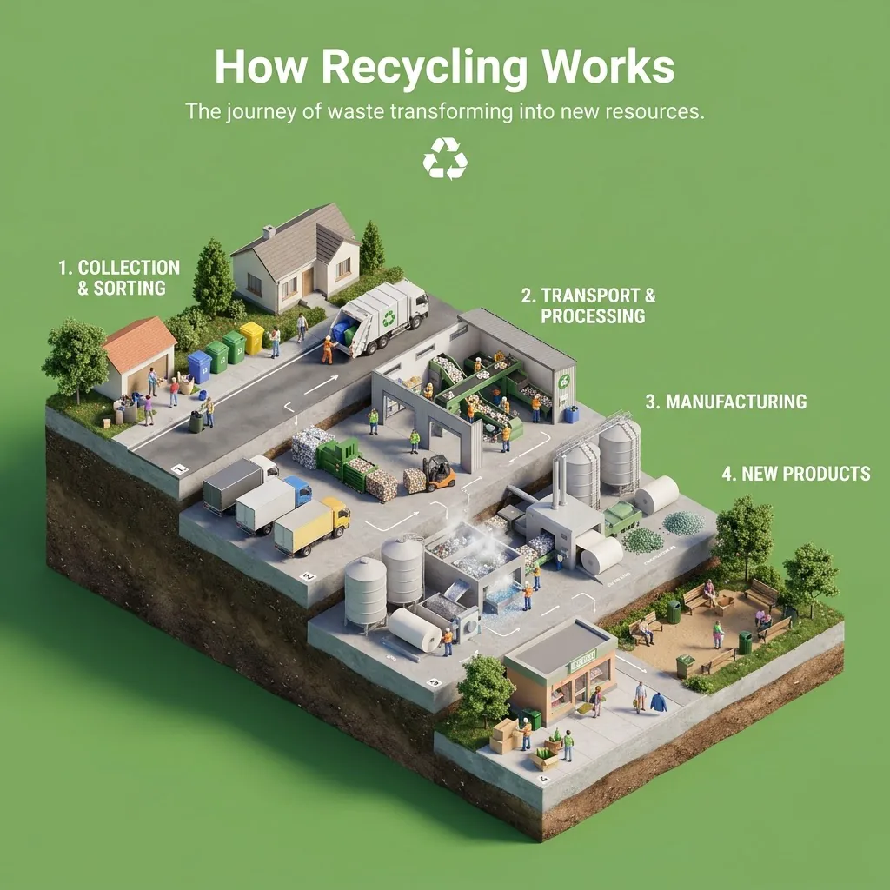

# 3D Characters & Figurines · Nano Banana 2.1

[← README](../README.md) · 7 · [Category on cinel](https://cinel.ai/prompts/3d-figurines?utm_source=github&utm_medium=awesome&utm_campaign=awesome-nano-banana-2.1-prompts)

### Toy Bubble Letter Topic Diorama Grid

<a href="https://cinel.ai/prompts/p/toy-bubble-letter-topic-diorama?utm_source=github&utm_medium=awesome&utm_campaign=awesome-nano-banana-2.1-prompts"></a>

> A code-style template from @Gdgtify that works in Nano Banana 2.1 and GPT Image 2.5. It defines a ToyBubbleDiorama class: for each topic the model derives a short title, a core moment, three iconic props, mini characters and a base, then renders chunky rounded bubble letters in soft toy plastic or clay surrounded by the props. We ran it for creativity, hope, science and fortitude in one 2x2 square. Use it for class posters, values walls and explainer carousels.

```text
2x2 grid, square 1:1. Four compact 3D toy dioramas, one each for CREATIVITY, HOPE, SCIENCE and FORTITUDE. In each panel the short title is built from chunky rounded 3D bubble letters in soft toy plastic, clay and rubbery foam, matte with gentle gloss highlights, large and centered; around the letters, three iconic props and tiny cute mini characters act out the core moment of the topic on a small environment base (paint tubes and brushes; a sprouting seedling and a lantern; a microscope and bubbling flasks; a small climber on a rocky ledge). Playful palette per panel, dark studio backdrop, soft studio lighting, tactile toy diorama render.
```

- Author: [@Gdgtify](https://x.com/Gdgtify)
- Original post: https://x.com/Gdgtify/status/2109732587099070660
- [View on cinel and generate with this prompt](https://cinel.ai/prompts/p/toy-bubble-letter-topic-diorama?utm_source=github&utm_medium=awesome&utm_campaign=awesome-nano-banana-2.1-prompts)

### Tiny Alien Engineers Build a Mars Spacecraft

<a href="https://cinel.ai/prompts/p/tiny-alien-engineers-mars-spacecraft-factory?utm_source=github&utm_medium=awesome&utm_campaign=awesome-nano-banana-2.1-prompts"></a>

> Adapted from a 30-second Seedance 2.5 video prompt by @Fujimoto_hina. The original JSON storyboard follows three original mini engineers (mint, lavender and peach) as they assemble the AEGON-01 spacecraft in a gigantic handcrafted factory for a fictional aerospace brand. We turned it into one key frame on the scaffolding, keeping the crew, suits, copper-gold insulation, blue solar arrays and the strong sense of scale, and left out the brand sign. Use it for science-themed ads, kids' STEM posters and animation pitches.

```text
A single key frame from a photorealistic miniature diorama commercial: three cute tiny original alien engineers (mint-green with large dark eyes, lavender with violet eyes, peach with rounded cheeks), all in matching ivory-white aerospace suits with teal stripes, tiny boots and visors, work on scaffolding inside a gigantic handcrafted miniature aerospace factory around an enormous Mars exploration spacecraft with a silver-white fuselage, copper-gold thermal insulation, graphite parts and folding blue solar arrays. Miniature cranes, robotic arms, precision tools, dramatic industrial lighting, cinematic macro photography, strong sense of scale. No text, no logos. Square 1:1.
```

- Author: [@Fujimoto_hina](https://x.com/Fujimoto_hina)
- Original post: https://x.com/Fujimoto_hina/status/2109923277053501452
- [View on cinel and generate with this prompt](https://cinel.ai/prompts/p/tiny-alien-engineers-mars-spacecraft-factory?utm_source=github&utm_medium=awesome&utm_campaign=awesome-nano-banana-2.1-prompts)

### Knitted Creature with a Leaf Umbrella

<a href="https://cinel.ai/prompts/p/knitted-creature-leaf-umbrella-rooftop?utm_source=github&utm_medium=awesome&utm_campaign=awesome-nano-banana-2.1-prompts"></a>

> Adapted from a one-sentence video prompt that @KorpiAi ran through five video models in one test. The creature is a tiny knitted wool character with three button eyes and long noodle arms who tiptoes across a rainy neon rooftop, stops, looks at the camera and pops open a leaf umbrella. We froze the umbrella-pop moment. It is short and easy to reuse. Use it for cozy mascots, rainy-day posts and stop-motion style tests.

```text
A single key frame: a tiny knitted wool creature with three button eyes and long noodle arms stands on a rainy neon-lit city rooftop at night, looks straight at the camera and pops open a miniature umbrella made from a green leaf. Raindrops, glowing pink and cyan neon reflections in puddles, visible wool fibers, macro cinematography, shallow depth of field. Square 1:1.
```

- Author: [@KorpiAi](https://x.com/KorpiAi)
- Original post: https://x.com/KorpiAi/status/2108687594913738792
- [View on cinel and generate with this prompt](https://cinel.ai/prompts/p/knitted-creature-leaf-umbrella-rooftop?utm_source=github&utm_medium=awesome&utm_campaign=awesome-nano-banana-2.1-prompts)

### Food Mascot in High-Top Sneakers 3D

<a href="https://cinel.ai/prompts/p/food-mascot-high-top-sneakers-3d?utm_source=github&utm_medium=awesome&utm_campaign=awesome-nano-banana-2.1-prompts"></a>

> A 'Food Mascot' prompt template shared by @azed_ai. It turns any food into a photoreal 3D character with real surface texture, glossy eyes, thin arms, white cartoon gloves and chunky high-top sneakers, lit like a studio shot. We filled it with a golden-brown croissant in cherry-red sneakers. Use it for bakery and snack branding, menu mascots and stickers.

```text
Cute anthropomorphic croissant mascot, full body, front three-quarter view, realistic golden-brown surface with natural texture, imperfections and detailed ingredients, expressive glossy eyes, cheerful smile, thin matching arms and short legs, oversized white cartoon gloves, one hand waving, oversized cherry-red high-top sneakers with white laces and soles, photorealistic 3D CGI, realistic materials, cinematic studio lighting, soft shadows, subtle rim light, neutral cream background, centered, fully visible, sharp focus Square 1:1 composition.
```

- Author: [@azed_ai](https://x.com/azed_ai)
- Original post: https://x.com/azed_ai/status/2108511815181434974
- [View on cinel and generate with this prompt](https://cinel.ai/prompts/p/food-mascot-high-top-sneakers-3d?utm_source=github&utm_medium=awesome&utm_campaign=awesome-nano-banana-2.1-prompts)

### Whimsy Mechanical Owl with Translucent Wings

<a href="https://cinel.ai/prompts/p/whimsy-mechanical-owl-translucent-wings?utm_source=github&utm_medium=awesome&utm_campaign=awesome-nano-banana-2.1-prompts"></a>

> @RockGrokAI Designer-Toy Whimsy (8 likes, prompt in alt). Fictional mechanical owl OC; square 1:1.

```text
Square 1:1 Designer-Toy Whimsy style: an ORIGINAL unique designer toy resembling a mechanical owl with translucent iridescent wings, displayed on a sleek colorful pedestal. 3D whimsical aesthetic, colorful and fun, soft studio lighting, clean backdrop. Fictional OC only, no brands.
```

- Author: [@RockGrokAI](https://x.com/RockGrokAI)
- Original post: https://x.com/RockGrokAI/status/2101696887355302359
- [View on cinel and generate with this prompt](https://cinel.ai/prompts/p/whimsy-mechanical-owl-translucent-wings?utm_source=github&utm_medium=awesome&utm_campaign=awesome-nano-banana-2.1-prompts)

### Macaron-House Chibi Cream Witch Toy Scene

<a href="https://cinel.ai/prompts/p/macaron-house-chibi-cream-witch?utm_source=github&utm_medium=awesome&utm_campaign=awesome-nano-banana-2.1-prompts"></a>

> @gen_with_love macaron chibi collection method (4 likes). Rewrote without photo upload into fictional Cream Witch; square 1:1.

```text
Square 1:1 premium kawaii watercolor-style designer-toy illustration of an ORIGINAL fictional tiny chibi Cream Witch sitting inside a giant pastel strawberry-pink macaron. She has a tiny pointed hat, cream swirls hair, stubby limbs, holds up the upper macaron shell with both hands, soft whipped cream and confectionery pearls around her. Pastel macaron art, clean sweet composition, no logos, no real people, no attached photo reference — invent the OC fully.
```

- Author: [@gen_with_love](https://x.com/gen_with_love)
- Original post: https://x.com/gen_with_love/status/2108498459775156225
- [View on cinel and generate with this prompt](https://cinel.ai/prompts/p/macaron-house-chibi-cream-witch?utm_source=github&utm_medium=awesome&utm_campaign=awesome-nano-banana-2.1-prompts)

### How Recycling Works

<a href="https://cinel.ai/prompts/p/edu-diorama-how-recycling-works?utm_source=github&utm_medium=awesome&utm_campaign=awesome-nano-banana-2.1-prompts"></a>

> @aleenaamiir isometric educational 3D diorama (~920 likes). Same-template fill of isometric-educational-3d-diorama: How Recycling Works; square 1:1. Synthetic unique id.

```text
Create a clear, 45° top-down isometric miniature 3D educational diorama explaining how recycling works, from sorting bins and collection through processing plants to new everyday products.

Use soft refined textures, realistic PBR materials, and gentle lifelike lighting.

Build a stepped or layered diorama base showing each stage of the process with subtle arrows or paths.

Include tiny stylized figures interacting with each stage (no facial details).

Use a clean solid fresh leaf green background.
At the top-center, display How Recycling Works in large bold text, directly beneath it show a short explanation subtitle, and place a minimal symbolic icon below.

All text must automatically match the background contrast (white or black).

Square 1:1. No brand logos, no watermarks, no real celebrity likeness.
```

- Author: [@aleenaamiir](https://x.com/aleenaamiir)
- Original post: https://x.com/aleenaamiir/status/2013493349156823287
- [View on cinel and generate with this prompt](https://cinel.ai/prompts/p/edu-diorama-how-recycling-works?utm_source=github&utm_medium=awesome&utm_campaign=awesome-nano-banana-2.1-prompts)
