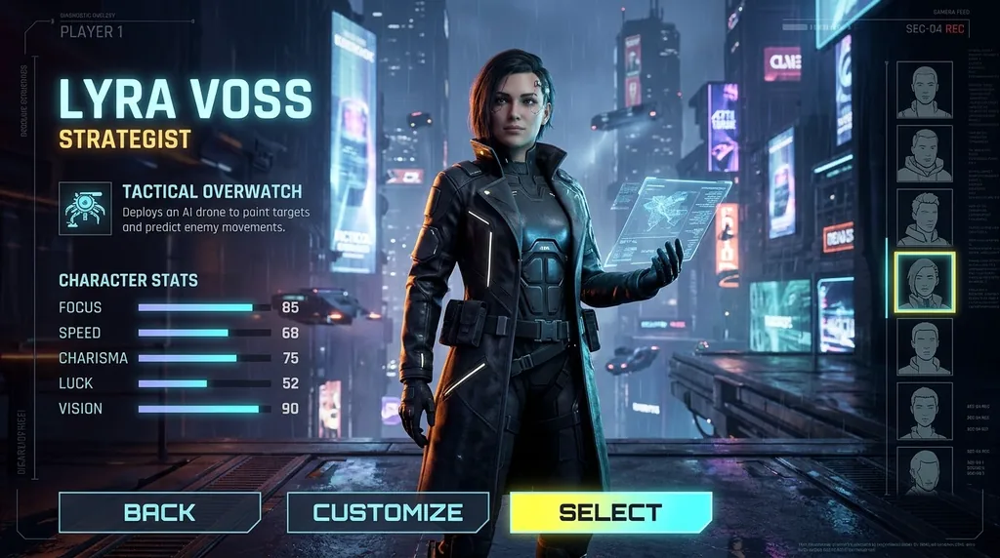
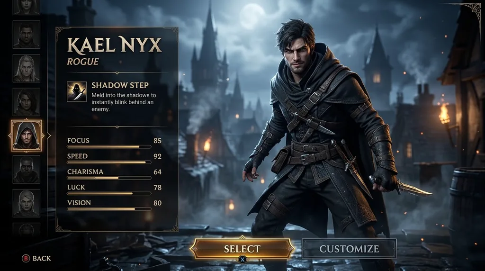
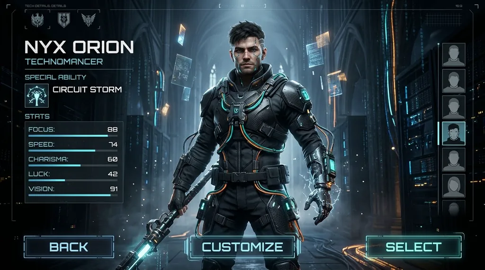
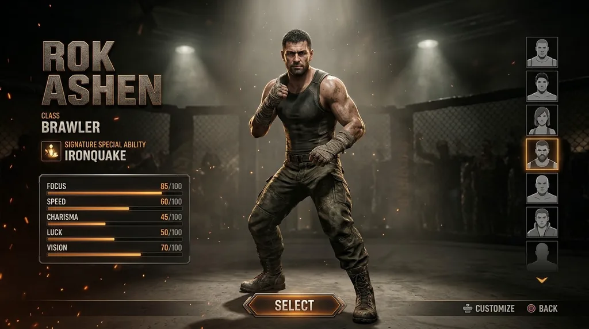

# Infographics & UI · Nano Banana 2.1

[← README](../README.md) · 5 · [Category on cinel](https://cinel.ai/prompts/infographic-ui?utm_source=github&utm_medium=awesome&utm_campaign=awesome-nano-banana-2.1-prompts)

### Typographic Object Logo Mark Grid

<a href="https://cinel.ai/prompts/p/typographic-object-logo-mark-grid?utm_source=github&utm_medium=awesome&utm_campaign=awesome-nano-banana-2.1-prompts"></a>

> A typography template from @Gdgtify. It breaks letters into glyph anatomy (stem, bowl, counter, ascender, terminal, swash) and objects into body, handle, opening and tip, then maps one onto the other so the object becomes the word while every counter stays readable. We ran it for four jobs of the future in one 2x2 square: drone pilot, ocean farmer, memory archivist and robot carer. Use it for logo exploration, workshop exercises and identity moodboards.

```text
2x2 grid, square 1:1, four clean high-contrast logo marks for four jobs of the future: DRONE (letters fused with a quadcopter), KELP (letters fused with a kelp frond and buoy), ARCHIVE (letters fused with a film reel), CARE (letters fused with a robot hand). For each, analyze glyph anatomy (stem, bowl, counter, ascender, descender, terminal, swash, join) and map the object's anatomy into it: body to stem, opening to bowl, extensions to ascenders and descenders, tips to terminals, while keeping every counter readable. Flat black marks on white, no gradients, no 3D, readable typography, small caption under each mark naming the job.
```

- Author: [@Gdgtify](https://x.com/Gdgtify)
- Original post: https://x.com/Gdgtify/status/2110060246215635036
- [View on cinel and generate with this prompt](https://cinel.ai/prompts/p/typographic-object-logo-mark-grid?utm_source=github&utm_medium=awesome&utm_campaign=awesome-nano-banana-2.1-prompts)

### AAA Character Select — Strategist Lyra

<a href="https://cinel.ai/prompts/p/aaa-character-select-strategist-lyra?utm_source=github&utm_medium=awesome&utm_campaign=awesome-nano-banana-2.1-prompts"></a>

> TEXT-ONLY rewrite of a face_reference / uploaded_image / identity_preservation character-select template. Invented fictional adult hero; no real-person photo upload.

```text
You are an AAA game UI artist, character designer, and cinematic key art director. Create a high-end video game character select screen for a FULLY FICTIONAL adult playable hero named Lyra Voss, class Strategist, special ability Tactical Overwatch, genre cyberpunk rpg. TEXT-ONLY generation — do NOT use any uploaded photo, face_reference, or identity preservation of a real person. Invent an original face and look. Outfit: sleek tactical coat, data tablet, calm posture. Environment: neon megacity night with holographic billboards. Full-body hero model centered; readable UI panels showing player name, class, ability, and stats (focus, speed, charisma, luck, vision) with invented numbers; buttons labeled Select, Customize, Back; small simplified character portrait thumbnails on the side. AAA game key art, Unreal Engine realism, crisp character model, cinematic rim light, polished UI, strong silhouette. Widescreen 16:9 cinematic. No mobile-app look, no lockscreen, no messy UI, no unreadable stats, no distorted hands, no copyrighted game logos, no brand watermarks, no real celebrity likeness.
```

- Author: [@Gdgtify](https://x.com/Gdgtify)
- Original post: https://x.com/Gdgtify/status/2062196107627896884
- [View on cinel and generate with this prompt](https://cinel.ai/prompts/p/aaa-character-select-strategist-lyra?utm_source=github&utm_medium=awesome&utm_campaign=awesome-nano-banana-2.1-prompts)

### AAA Character Select — Rogue Kael

<a href="https://cinel.ai/prompts/p/aaa-character-select-rogue-kael?utm_source=github&utm_medium=awesome&utm_campaign=awesome-nano-banana-2.1-prompts"></a>

> TEXT-ONLY rewrite of a face_reference / uploaded_image / identity_preservation character-select template. Invented fictional adult hero; no real-person photo upload.

```text
You are an AAA game UI artist, character designer, and cinematic key art director. Create a high-end video game character select screen for a FULLY FICTIONAL adult playable hero named Kael Nyx, class Rogue, special ability Shadow Step, genre fantasy rpg. TEXT-ONLY generation — do NOT use any uploaded photo, face_reference, or identity preservation of a real person. Invent an original face and look. Outfit: layered streetwear cloak, hidden tools, agile stance. Environment: moonlit rooftop alleys of a fantasy capital. Full-body hero model centered; readable UI panels showing player name, class, ability, and stats (focus, speed, charisma, luck, vision) with invented numbers; buttons labeled Select, Customize, Back; small simplified character portrait thumbnails on the side. AAA game key art, Unreal Engine realism, crisp character model, cinematic rim light, polished UI, strong silhouette. Widescreen 16:9 cinematic. No mobile-app look, no lockscreen, no messy UI, no unreadable stats, no distorted hands, no copyrighted game logos, no brand watermarks, no real celebrity likeness.
```

- Author: [@Gdgtify](https://x.com/Gdgtify)
- Original post: https://x.com/Gdgtify/status/2062196107627896884
- [View on cinel and generate with this prompt](https://cinel.ai/prompts/p/aaa-character-select-rogue-kael?utm_source=github&utm_medium=awesome&utm_campaign=awesome-nano-banana-2.1-prompts)

### AAA Character Select — Technomancer Nyx

<a href="https://cinel.ai/prompts/p/aaa-character-select-technomancer-nyx?utm_source=github&utm_medium=awesome&utm_campaign=awesome-nano-banana-2.1-prompts"></a>

> TEXT-ONLY rewrite of a face_reference / uploaded_image / identity_preservation character-select template. Invented fictional adult hero; no real-person photo upload.

```text
You are an AAA game UI artist, character designer, and cinematic key art director. Create a high-end video game character select screen for a FULLY FICTIONAL adult playable hero named Nyx Orion, class Technomancer, special ability Circuit Storm, genre cyberpunk rpg. TEXT-ONLY generation — do NOT use any uploaded photo, face_reference, or identity preservation of a real person. Invent an original face and look. Outfit: glowing devices, cable harness, clean sci-fi silhouette. Environment: server-cathedral with floating data shards. Full-body hero model centered; readable UI panels showing player name, class, ability, and stats (focus, speed, charisma, luck, vision) with invented numbers; buttons labeled Select, Customize, Back; small simplified character portrait thumbnails on the side. AAA game key art, Unreal Engine realism, crisp character model, cinematic rim light, polished UI, strong silhouette. Widescreen 16:9 cinematic. No mobile-app look, no lockscreen, no messy UI, no unreadable stats, no distorted hands, no copyrighted game logos, no brand watermarks, no real celebrity likeness.
```

- Author: [@Gdgtify](https://x.com/Gdgtify)
- Original post: https://x.com/Gdgtify/status/2062196107627896884
- [View on cinel and generate with this prompt](https://cinel.ai/prompts/p/aaa-character-select-technomancer-nyx?utm_source=github&utm_medium=awesome&utm_campaign=awesome-nano-banana-2.1-prompts)

### AAA Character Select — Brawler Rok

<a href="https://cinel.ai/prompts/p/aaa-character-select-brawler-rok?utm_source=github&utm_medium=awesome&utm_campaign=awesome-nano-banana-2.1-prompts"></a>

> TEXT-ONLY rewrite of a face_reference / uploaded_image / identity_preservation character-select template. Invented fictional adult hero; no real-person photo upload.

```text
You are an AAA game UI artist, character designer, and cinematic key art director. Create a high-end video game character select screen for a FULLY FICTIONAL adult playable hero named Rok Ashen, class Brawler, special ability Ironquake, genre fighting game. TEXT-ONLY generation — do NOT use any uploaded photo, face_reference, or identity preservation of a real person. Invent an original face and look. Outfit: athletic gear, hand wraps, grounded pose. Environment: underground arena with dramatic spotlights. Full-body hero model centered; readable UI panels showing player name, class, ability, and stats (focus, speed, charisma, luck, vision) with invented numbers; buttons labeled Select, Customize, Back; small simplified character portrait thumbnails on the side. AAA game key art, Unreal Engine realism, crisp character model, cinematic rim light, polished UI, strong silhouette. Widescreen 16:9 cinematic. No mobile-app look, no lockscreen, no messy UI, no unreadable stats, no distorted hands, no copyrighted game logos, no brand watermarks, no real celebrity likeness.
```

- Author: [@Gdgtify](https://x.com/Gdgtify)
- Original post: https://x.com/Gdgtify/status/2062196107627896884
- [View on cinel and generate with this prompt](https://cinel.ai/prompts/p/aaa-character-select-brawler-rok?utm_source=github&utm_medium=awesome&utm_campaign=awesome-nano-banana-2.1-prompts)
