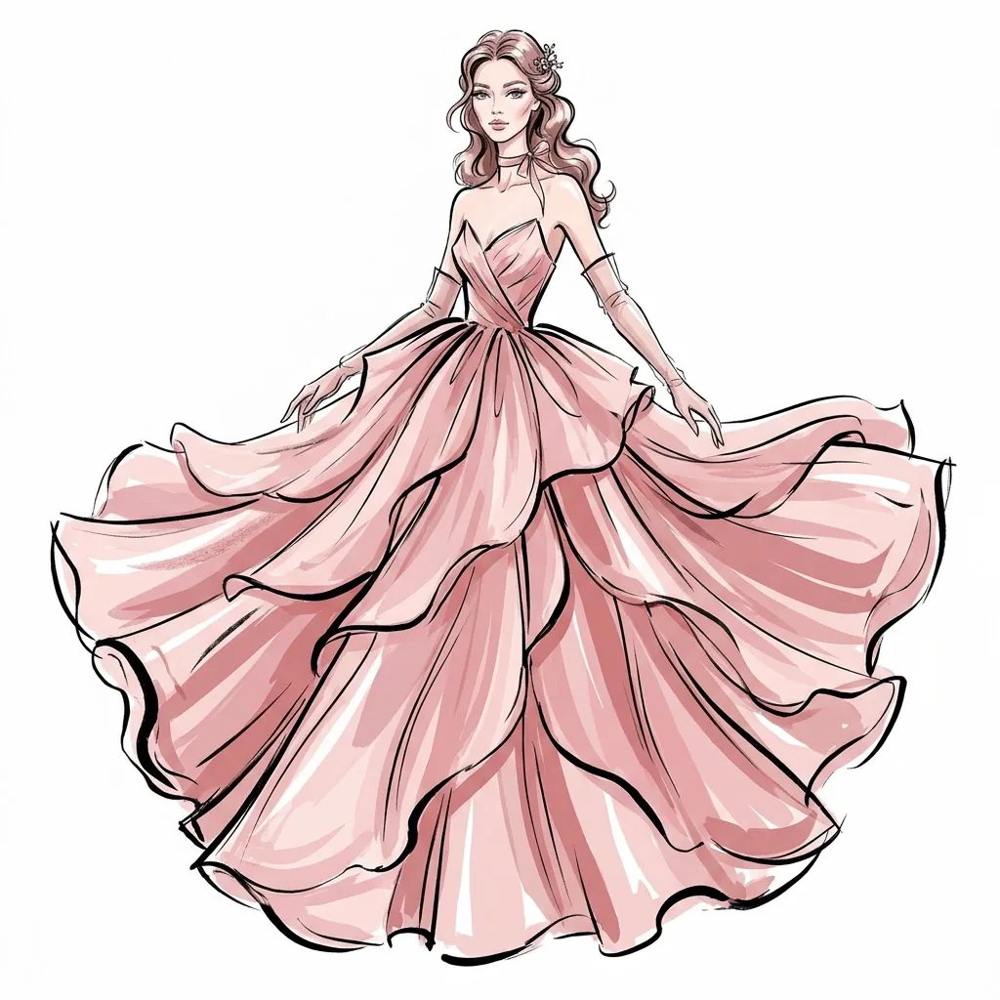
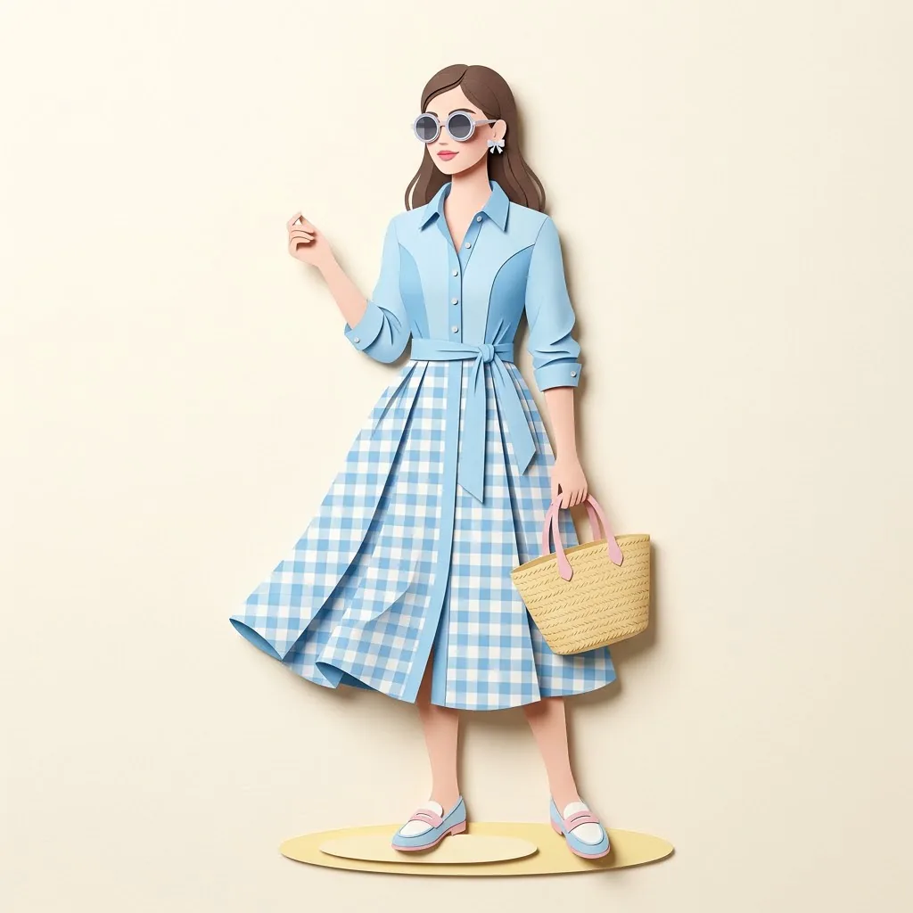
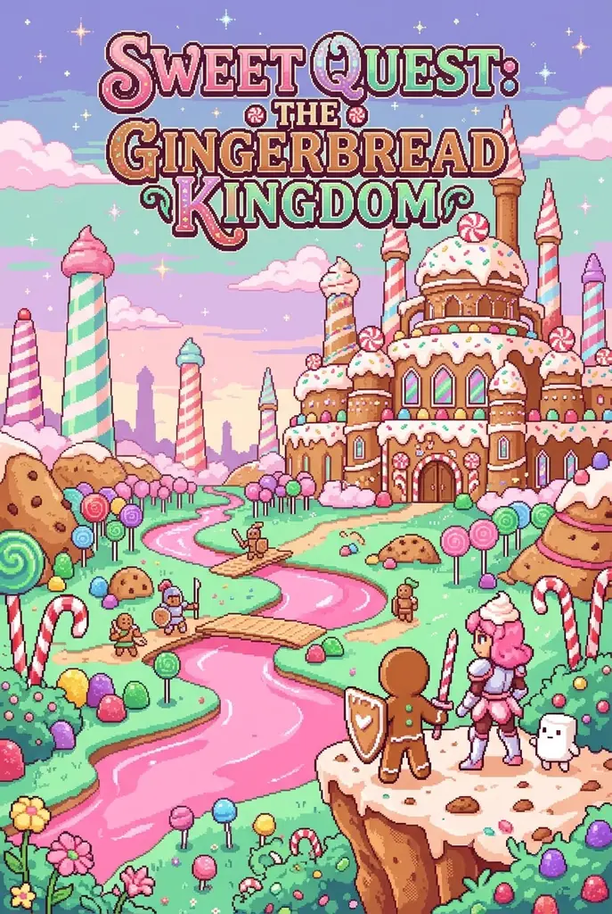

# 插画与动漫 · Nano Banana 2.1

[← README](../../README_zh.md) · 9 · [cinel 分类页](https://cinel.ai/zh/prompts/illustration-anime?utm_source=github&utm_medium=awesome&utm_campaign=awesome-nano-banana-2.1-prompts)

### 风暴中的九尾狐神女

<a href="https://cinel.ai/zh/prompts/p/nine-tailed-fox-goddess-storm?utm_source=github&utm_medium=awesome&utm_campaign=awesome-nano-banana-2.1-prompts"></a>

> 来自 @Sirilee2026 的神话肖像提示词，原帖附的是简短的说明式提示词（完整版在评论区）。中国民间传说中的狐仙，一身赤金，闭目沉静，丝绸、流苏和九条发光的尾巴在暴风雨天空中飘动。我们在原句基础上略作扩写，加入狐尾、发饰和金色光线。很契合本周“神话 × 时尚”的热点。适合奇幻封面、游戏主视觉和海报。

```text
The nine-tailed fox goddess in crimson and gold, eyes closed in quiet divinity. Silk and tassels flow amid the stormy sky. Nine luminous white fox tails fan out behind her, ornate gold hairpiece with dangling tassels, layered crimson silk robes with gold embroidery whipping in the wind, dark storm clouds lit by soft golden light, cinematic fantasy portrait, ultra-detailed. Square 1:1.
```

- 原作者: [@Sirilee2026](https://x.com/Sirilee2026)
- 原帖: https://x.com/Sirilee2026/status/2110685868033769884
- [在 cinel 上查看详情并一键生成](https://cinel.ai/zh/prompts/p/nine-tailed-fox-goddess-storm?utm_source=github&utm_medium=awesome&utm_campaign=awesome-nano-banana-2.1-prompts)

### 灰纸上的秋湖速写

<a href="https://cinel.ai/zh/prompts/p/autumn-lake-sketch-on-gray-paper?utm_source=github&utm_medium=awesome&utm_campaign=awesome-nano-banana-2.1-prompts"></a>

> 根据 @churvikv 一张题为“秋天在灰纸上呼出暖意”的壁纸反向撰写的提示词（原帖没有提示词）。我们自己描述了画面：一小块松散的铅笔速写，在中心渐变为水彩，有橙色秋树、蜜桃色日出、两只天鹅和柔和倒影，周围留出大片空白的灰色纹理纸。适合手机壁纸、贺卡和安静的季节内容。

```text
A minimalist art wallpaper: on a textured gray paper background, a small loose pencil-sketch vignette that fades into soft watercolor in the centre, showing a calm autumn lake at sunrise with orange and golden trees on the shores, a soft peach sky, two white swans gliding on the water and gentle reflections. A few diagonal graphite strokes frame the vignette; the rest of the paper is left empty. Delicate, warm, hand-drawn. Square 1:1.
```

- 原作者: [@churvikv](https://x.com/churvikv)
- 原帖: https://x.com/churvikv/status/2109631329403113516
- [在 cinel 上查看详情并一键生成](https://cinel.ai/zh/prompts/p/autumn-lake-sketch-on-gray-paper?utm_source=github&utm_medium=awesome&utm_campaign=awesome-nano-banana-2.1-prompts)

### VHS 黑色电影铅笔速写

<a href="https://cinel.ai/zh/prompts/p/vhs-noir-pencil-sketch-scene?utm_source=github&utm_medium=awesome&utm_campaign=awesome-nano-banana-2.1-prompts"></a>

> 来自 @azed_ai 分享的“VHS Noir Sketch”提示词。它融合了两种风格：90 年代手持 VHS 的抓拍画面，以及插画师松散的铅笔速写，线条擦了又画。我们填入了“爵士俱乐部后面雨巷里中场休息的萨克斯手”。替换主体和场景，可用于音乐海报、独立杂志插画和氛围分镜。

```text
Retro 1990s handheld VHS of a saxophonist taking a break between sets, leaning on a brick wall in a rainy alley behind a jazz club, black-and-white film noir atmosphere, candid unposed moment, natural weight shift, relaxed asymmetrical posture, expressive hands and feet, subtle facial expression, spontaneous imperfect framing, loose pencil sketch rendering, overlapping construction marks, exploratory strokes, erased and redrawn lines, imperfect contours, charming irregularities, personal illustrator sketchbook feel, subtle VHS grain, analog tracking noise, soft motion blur, deep monochrome contrast, raw handmade finish. Square 1:1 composition.
```

- 原作者: [@azed_ai](https://x.com/azed_ai)
- 原帖: https://x.com/azed_ai/status/2109600238428463125
- [在 cinel 上查看详情并一键生成](https://cinel.ai/zh/prompts/p/vhs-noir-pencil-sketch-scene?utm_source=github&utm_medium=awesome&utm_campaign=awesome-nano-banana-2.1-prompts)

### 钢笔建筑街景速写

<a href="https://cinel.ai/zh/prompts/p/ink-architectural-street-sketch?utm_source=github&utm_medium=awesome&utm_campaign=awesome-nano-banana-2.1-prompts"></a>

> 来自 @Naiknelofar788 的“Streets of the World”系列。提示词要求用黑白针管笔速写一条真实街道：交叉排线、鹅卵石路、老爷车和光秃的树，中心是准确的地标。我们用布拉格老城市政厅钟楼填充，并把画幅从 4:5 改为 1:1。适合旅行手账、城市版画和明信片。

```text
Create a highly detailed black-and-white architectural sketch of a beautiful street in Prague, Czech Republic, featuring the Old Town Hall clock tower as the main subject. Capture the authentic character of the city through its traditional architecture, distinctive rooftops, intricate windows, textured walls, cobblestone streets, and charming surrounding buildings.

Use a hand-drawn ink illustration style with fine black pen lines, realistic architectural details, cross-hatching, sketchy textures, and delicate shading. Include subtle street elements such as a parked vintage car, bare trees, street lamps, and small details that bring the scene to life.

The composition should resemble a page from an artist’s travel sketchbook, with the landmark naturally integrated into its real urban surroundings. Use varied line weights, imperfect hand-drawn strokes, and intricate textures to create depth and dimension.

Style: Monochrome architectural line art, fine-liner pen sketch, urban sketching, realistic perspective, intricate ink detailing, travel journal aesthetic, white paper background, high contrast, no colors, no watercolor, no digital painting.

Important: Keep the landmark architecturally accurate and instantly recognizable. Avoid generic AI-generated buildings. Focus on the city’s real architectural identity and authentic street atmosphere.

Aspect ratio: 1:1 — square composition.
```

- 原作者: [@Naiknelofar788](https://x.com/Naiknelofar788)
- 原帖: https://x.com/Naiknelofar788/status/2110593708953686148
- [在 cinel 上查看详情并一键生成](https://cinel.ai/zh/prompts/p/ink-architectural-street-sketch?utm_source=github&utm_medium=awesome&utm_campaign=awesome-nano-banana-2.1-prompts)

### 哥特水墨动漫剑斗关键帧

<a href="https://cinel.ai/zh/prompts/p/gothic-ink-anime-sword-duel-keyframe?utm_source=github&utm_medium=awesome&utm_campaign=awesome-nano-banana-2.1-prompts"></a>

> 改编自 @aimikoda 发布在其动漫对决视频下的 Seedance 2.5 视频提示词。原文描述了一场哥特水墨动漫风格的极速剑斗：黑色线描、炭灰阴影、紫调肤色，以及霓虹粉、酸性绿和棱彩火花。原作的风格依赖一张参考图，所以我们用文字描述了两位原创女剑士。我们定格在废墟大教堂里的一次刀剑相抵。适合动漫主视觉、游戏开屏图和奇幻小说封面。

```text
A single key frame from a dark fantasy 2D anime film fused with gothic ink illustration: inside a ruined cathedral swallowed by darkness, two gothic elven swordswomen lock blades at close range, a black-haired warrior with a feathered crown and a prismatic sword against a silver-haired warrior with a neon blade. Intricate black linework, rough hand-drawn textures, charcoal-gray shading, muted violet skin tones and elaborate gothic silhouettes; the clash bursts with razor-sharp neon pink, acid green and prismatic sparks and fractured ink splashes that light the monochrome ruins. Drifting ash, torn feathers and broken pillars, dramatic Dutch angle, extreme foreshortening, strong silhouette control, high-contrast graphic composition, hand-drawn anime expressiveness, no realistic CGI. Square 1:1 composition.
```

- 原作者: [@aimikoda](https://x.com/aimikoda)
- 原帖: https://x.com/aimikoda/status/2109235247162245339
- [在 cinel 上查看详情并一键生成](https://cinel.ai/zh/prompts/p/gothic-ink-anime-sword-duel-keyframe?utm_source=github&utm_medium=awesome&utm_campaign=awesome-nano-banana-2.1-prompts)

### 厚涂油画雨中撑伞街景关键帧

<a href="https://cinel.ai/zh/prompts/p/impasto-rainy-umbrella-street-keyframe?utm_source=github&utm_medium=awesome&utm_campaign=awesome-nano-banana-2.1-prompts"></a>

> 改编自 @churvikv 的 Seedance 2.5 视频提示词，原帖配文“雨声像掌声”。原作是一段 8 秒的刮刀厚涂油画短片：穿橙色大衣、撑透明伞的女子，驶过的公交车，闪烁的路灯和飘落的树叶。我们把它改写成一帧静止画面。适合秋季海报、书籍封面和氛围壁纸。

```text
A single key frame in impasto oil painting style with thick palette-knife texture: a woman in an orange coat walks slowly forward on a wet cobblestone sidewalk, holding a transparent umbrella with rain dripping from its edges. Heavy rain falls in vertical streaks; a bus and cars pass along the slick road, their headlights and taillights reflecting on the wet surface. Street lamps cast a warm orange glow, autumn leaves drift down, puddles ripple, wet cobblestones shimmer with reflected light, dark stormy clouds overhead. Moody cinematic autumn evening atmosphere, no text. Square 1:1 composition.
```

- 原作者: [@churvikv](https://x.com/churvikv)
- 原帖: https://x.com/churvikv/status/2110031241139360215
- [在 cinel 上查看详情并一键生成](https://cinel.ai/zh/prompts/p/impasto-rainy-umbrella-street-keyframe?utm_source=github&utm_medium=awesome&utm_campaign=awesome-nano-banana-2.1-prompts)

### 腮红欧根纱层叠裙墨线高定速写

<a href="https://cinel.ai/zh/prompts/p/ink-couture-blush-organza-cascade?utm_source=github&utm_medium=awesome&utm_campaign=awesome-nano-banana-2.1-prompts"></a>

> @azed_ai 编辑墨线高定速写（23 赞）。填入服装/配色/姿势/头饰/配饰；1:1。 同源模板变体（合成唯一 id）。

```text
Artistic haute couture fashion illustration of a single elegant model wearing a blush organza cascade gown with layered translucent petals in soft blush pink, rose, black ink outlines, thick expressive black ink outlines, bold solid color fills, elongated fashion proportions, stylized facial features, dramatic flowing fabric, soft twirl pose with fabric petals floating outward, romantic loose waves with a tiny floral ink pin, delicate ribbon choker and translucent gloves, sophisticated editorial fashion sketch aesthetic, full-body composition, pure white background Square 1:1. No brand logos, no watermarks, no real celebrity likeness. Fictional adult model only.
```

- 原作者: [@azed_ai](https://x.com/azed_ai)
- 原帖: https://x.com/azed_ai/status/2114310517619921351
- [在 cinel 上查看详情并一键生成](https://cinel.ai/zh/prompts/p/ink-couture-blush-organza-cascade?utm_source=github&utm_medium=awesome&utm_campaign=awesome-nano-banana-2.1-prompts)

### 天蓝格纹纸艺时装大片

<a href="https://cinel.ai/zh/prompts/p/papercut-fashion-gingham-sky-editorial?utm_source=github&utm_medium=awesome&utm_campaign=awesome-nano-banana-2.1-prompts"></a>

> @Tech_Apex0 3D 纸艺时装编辑插画（约 101 赞）。变化服装、色块与图案；1:1。 同源模板变体（合成唯一 id）。

```text
Create a high-end editorial fashion illustration of a stylish fictional adult woman wearing a sky-blue shirt dress with a cinched waist sash. Use a polished 3D paper-cut illustration aesthetic with smooth surfaces, layered shapes, subtle paper-like textures, and clean, elegant edges. Feature vibrant color combinations of sky blue, soft white, pastel pink, and light yellow, paired with contrasting patterns: classic gingham check on the skirt portion and solid sky panels on the bodice. Add fashionable accessories including round sunglasses, tiny bow earrings, a woven-look paper tote, and loafers. Give the character a confident, expressive pose with natural body proportions and a stylish attitude. Use a minimalist warm ivory background with soft studio lighting, gentle shadows beneath the feet, and a refined luxury fashion-campaign composition. Full-body character, beautifully detailed clothing folds, crisp silhouettes, sophisticated color blocking, playful yet elegant styling, premium fashion magazine aesthetic, clean negative space, high-resolution digital illustration. No text, no logos, no watermark. Square 1:1. No brand logos, no watermarks, no real celebrity likeness. Fictional adult model only.
```

- 原作者: [@Tech_Apex0](https://x.com/Tech_Apex0)
- 原帖: https://x.com/Tech_Apex0/status/2109687049666347113
- [在 cinel 上查看详情并一键生成](https://cinel.ai/zh/prompts/p/papercut-fashion-gingham-sky-editorial?utm_source=github&utm_medium=awesome&utm_campaign=awesome-nano-banana-2.1-prompts)

### 姜饼王国像素游戏

<a href="https://cinel.ai/zh/prompts/p/pixel-game-gingerbread-kingdom?utm_source=github&utm_medium=awesome&utm_campaign=awesome-nano-banana-2.1-prompts"></a>

> 可复用的1:1像素游戏主视觉模板，填充虚构/公有领域安全的电影概念（“a fairy-tale gingerbread kingdom quest”），非现代片厂IP片名。

```text
Make me a pixel art version of a fairy-tale gingerbread kingdom quest if it was a video game. Portrait 2:3 (vertical game cover / card) retro video-game key art: candy towers, icing rivers, cookie knights, pastel pink-and-mint fairy-tale pixel palette. Dense readable pixels, strong silhouette, limited vibrant palette, cinematic composition suitable as a game title screen. Do not use any real studio film titles, brand logos, watermarks, or trademarked franchise names. No real celebrity likeness. Optional fictional title lettering only if it is clearly invented and not a known trademark. Portrait 2:3 (vertical game cover / card).
```

- 原作者: [@icreatelife](https://x.com/icreatelife)
- 原帖: https://x.com/icreatelife/status/1992598016868720997
- [在 cinel 上查看详情并一键生成](https://cinel.ai/zh/prompts/p/pixel-game-gingerbread-kingdom?utm_source=github&utm_medium=awesome&utm_campaign=awesome-nano-banana-2.1-prompts)
