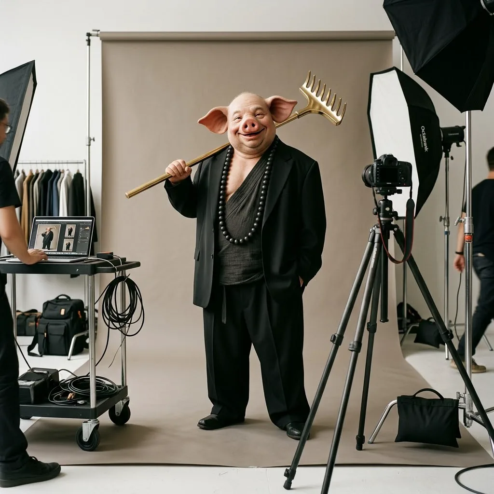
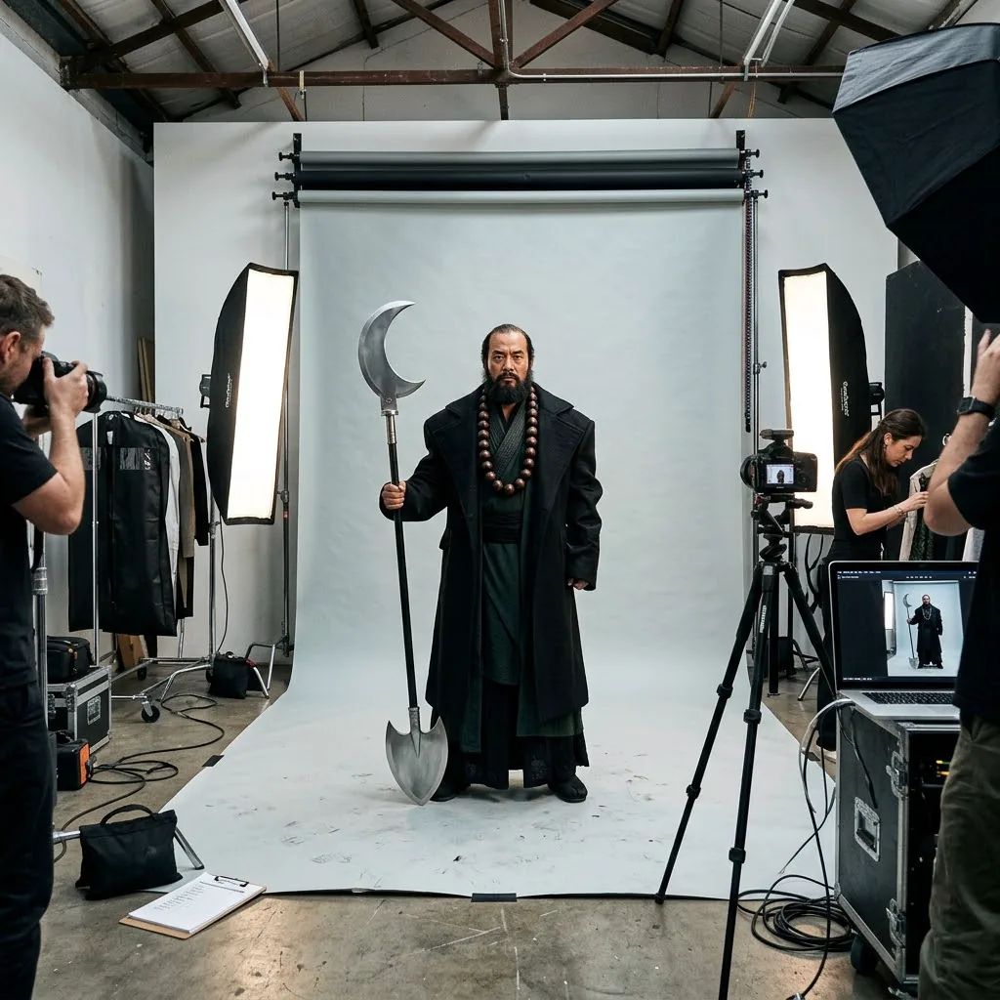
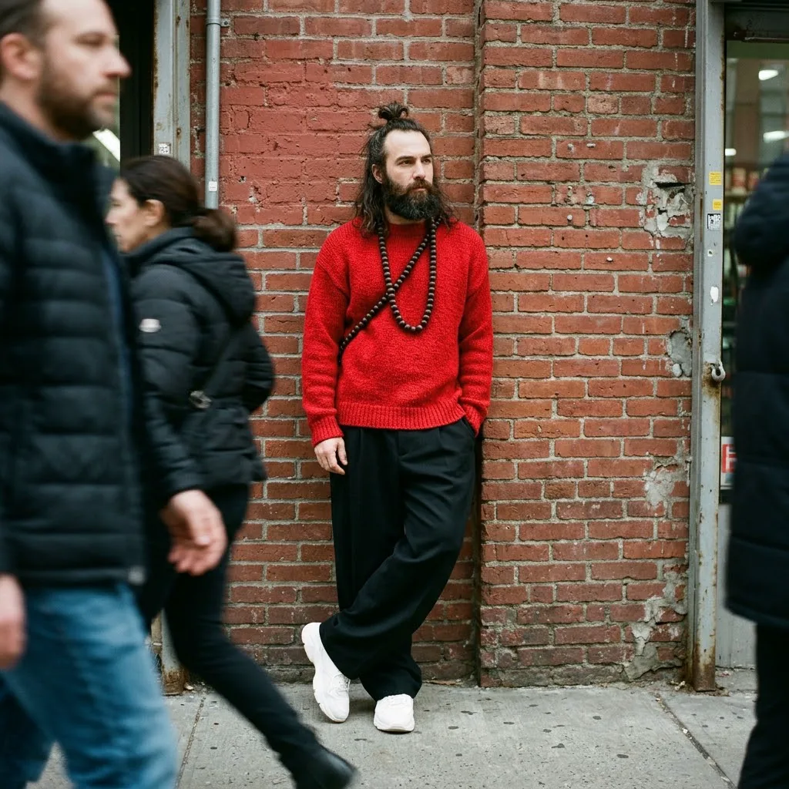
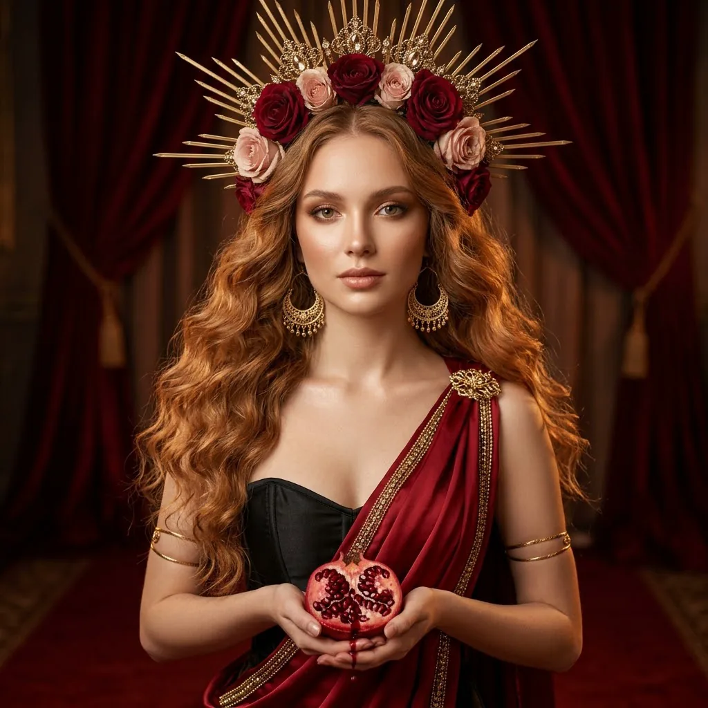
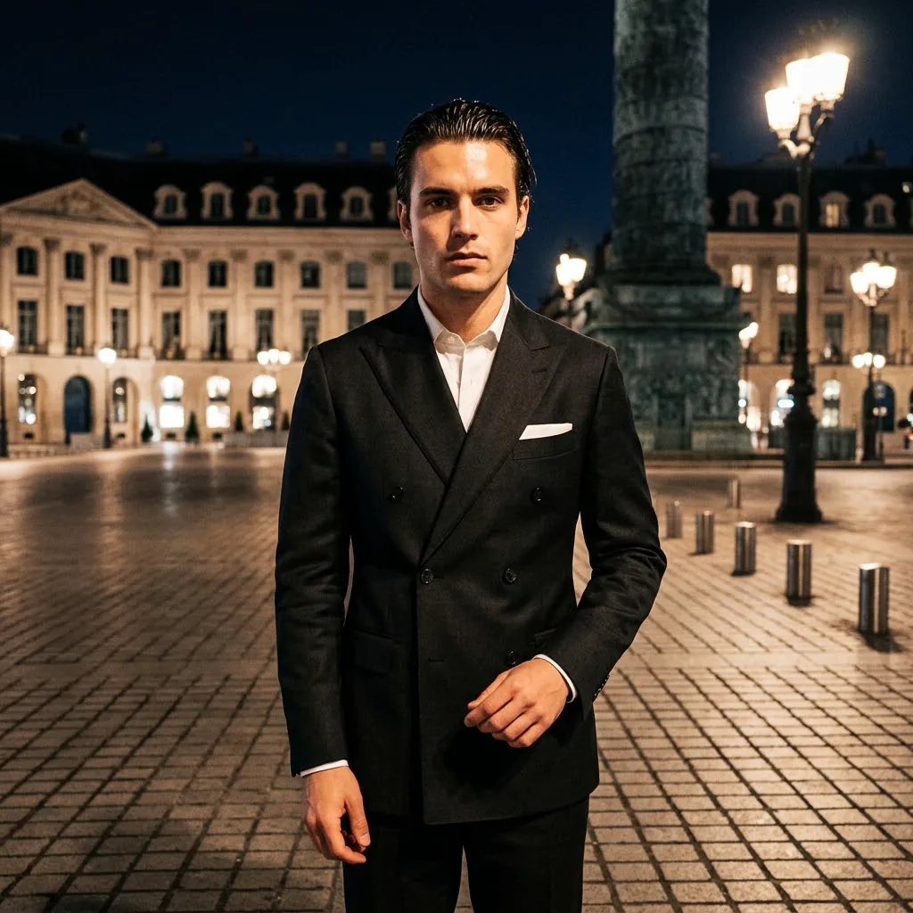
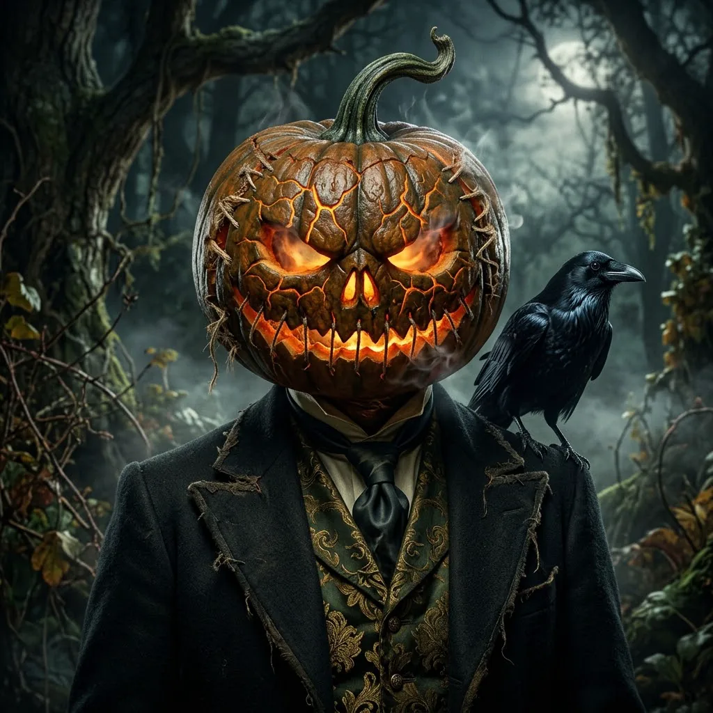

# 人像写真 · Nano Banana 2.1

[← README](../../README_zh.md) · 12 · [cinel 分类页](https://cinel.ai/zh/prompts/portrait?utm_source=github&utm_medium=awesome&utm_campaign=awesome-nano-banana-2.1-prompts)

### 黑白街拍中的一抹深红

<a href="https://cinel.ai/zh/prompts/p/crimson-accent-black-white-street-walk?utm_source=github&utm_medium=awesome&utm_campaign=awesome-nano-banana-2.1-prompts"></a>

> 来自 @azed_ai 的四变量模板，名为“深红足迹”。设定人物、欧洲古城地点、优雅服装和一件配饰，整张照片变成黑白，只有那件配饰是鲜艳的宝石红。斑驳的建筑、柔和晨光和 35mm 胶片颗粒带来编辑街拍质感。我们用了一位穿炭灰大衣、戴红色贝雷帽和手套的女子，走在里斯本老城。适合时装型录、旅行内容和氛围感大片。

```text
Cinematic black-and-white photograph of a young woman walking through a cobblestone lane in old Lisbon, wearing a long tailored charcoal coat with a beret and gloves in vivid ruby red as the only colored element, natural movement, graceful silhouette, weathered architecture, romantic atmosphere, subtle reflections on wet stones, delicate monochromatic tones, diffused morning light, vintage 35mm film grain, editorial street photography, atmospheric visual storytelling. Square 1:1.
```

- 原作者: [@azed_ai](https://x.com/azed_ai)
- 原帖: https://x.com/azed_ai/status/2110687901055131952
- [在 cinel 上查看详情并一键生成](https://cinel.ai/zh/prompts/p/crimson-accent-black-white-street-walk?utm_source=github&utm_medium=awesome&utm_campaign=awesome-nano-banana-2.1-prompts)

### 雕塑感高领高定编辑肖像

<a href="https://cinel.ai/zh/prompts/p/sculptural-collar-couture-editorial-portrait?utm_source=github&utm_medium=awesome&utm_campaign=awesome-nano-banana-2.1-prompts"></a>

> 来自 @MissDelulu9 的细致编辑肖像提示词，用 Nano Banana 2.1 生成。它逐项描述一位虚构的成年模特（蓝灰眼睛、珊瑚红唇、上扬眼线、利落低马尾），再写服装：深酒红缎面高定礼服，带夸张的雕塑感高领，配金色几何耳环，回眸姿势，背景是鼠尾草绿到青绿的渐变。很契合本周的巴黎秀场氛围。适合时装情绪板、美妆广告和编辑测试。

```text
Create an ultra-realistic, high-fashion editorial portrait of an adult woman with striking blue-grey eyes, glossy coral-red lipstick, sharp black winged eyeliner, subtle freckles and luminous dewy skin with realistic pores. Her sleek jet-black hair is center-parted and pulled into a long straight low ponytail. She wears an elegant deep burgundy satin couture dress with an exaggerated sculptural high collar, dramatic draped fabric and an asymmetrical sleeveless design, with large polished gold geometric statement earrings. Pose: three-quarter over-the-shoulder, body turned away, face looking at the viewer, confident and slightly mysterious. Background: minimalist muted sage-green and turquoise studio backdrop with soft gradients. Professional softbox lighting, cinematic shadows, delicate highlights. Square 1:1.
```

- 原作者: [@MissDelulu9](https://x.com/MissDelulu9)
- 原帖: https://x.com/MissDelulu9/status/2109630710642528421
- [在 cinel 上查看详情并一键生成](https://cinel.ai/zh/prompts/p/sculptural-collar-couture-editorial-portrait?utm_source=github&utm_medium=awesome&utm_campaign=awesome-nano-banana-2.1-prompts)

### 皮草与漆皮的斑马线街拍

<a href="https://cinel.ai/zh/prompts/p/fur-and-vinyl-street-style-crosswalk?utm_source=github&utm_medium=awesome&utm_campaign=awesome-nano-banana-2.1-prompts"></a>

> 来自 @Tanvir48992 的街拍提示词。女子在市中心街道迈步过马路、回头一瞥，身穿短款午夜海军蓝人造皮草外套，内搭及地黑色漆皮长裙，戴猫眼墨镜、珍珠耳坠和毛边手套。清冽的冬日阳光、85mm 镜头和冷调黑色电影调色完成了其余部分。我们把“Vogue street-style”改成通用的“杂志街拍”，车辆也不带品牌。适合时装周内容、型录和编辑测试。

```text
Candid high-fashion street style photograph of a woman mid-stride crossing a city street, captured side-on as she glances back over her shoulder. Dark hair slicked into a sleek low bun with a few loose strands lifted by the wind, narrow black cat-eye sunglasses, glossy red lipstick, small pearl drop earrings. A cropped voluminous midnight-navy faux fur jacket with a wide collar over a floor-length black patent vinyl gown with crinkled high-shine folds, dark fur-trimmed gloves, a structured black patent top-handle handbag, pointed black pumps. Setting: a sunlit crosswalk downtown, a parked glossy black sedan, a pale limestone building and a dark glass skyscraper, blurred pedestrians. Crisp cold winter sunlight, strong highlights on the vinyl, film-noir mood. 85mm telephoto at f/2.0, shallow depth of field, cool blue grading, magazine street-style editorial. Square 1:1. No logos.
```

- 原作者: [@Tanvir48992](https://x.com/Tanvir48992)
- 原帖: https://x.com/Tanvir48992/status/2108914406864347222
- [在 cinel 上查看详情并一键生成](https://cinel.ai/zh/prompts/p/fur-and-vinyl-street-style-crosswalk?utm_source=github&utm_medium=awesome&utm_campaign=awesome-nano-banana-2.1-prompts)

### 停车场里的粉色梦想车惊喜

<a href="https://cinel.ai/zh/prompts/p/pink-car-surprise-parking-lot-reveal?utm_source=github&utm_medium=awesome&utm_campaign=awesome-nano-banana-2.1-prompts"></a>

> 改编自 @Just_sharon7 的 11 秒 TapNow 视频提示词。原片是朋友手持拍摄的揭晓视频：一个戴着 Y2K 配饰、活泼的粉发女孩举起卡片，放下后露出一辆浅粉色跑车，最后夸张地惊呼。我们把最后的反应瞬间作为关键帧，车辆不带标志。手持角度和正午明亮阳光让它保持社交媒体原生感。适合 UGC 风格广告、反应类缩略图和生活方式内容。

```text
A single key frame shot handheld from slightly above eye level, as if a friend is filming: a cute energetic young adult woman with long pastel-pink hair and straight bangs, wearing a white baby tee with a colorful kawaii cartoon print, layered pastel beaded necklaces and colorful bracelets, gasps with her mouth wide open and both hands on top of her head in disbelief, in an empty sunny asphalt parking lot; behind her a sleek pastel-pink sports sedan with dark tinted windows and black wheels is parked diagonally, low concrete barriers, green trees and a clear blue sky. Realistic midday sunlight, natural skin texture, bright social-media aesthetic. No logos or badges on the car. Square 1:1.
```

- 原作者: [@Just_sharon7](https://x.com/Just_sharon7)
- 原帖: https://x.com/Just_sharon7/status/2109662458269040721
- [在 cinel 上查看详情并一键生成](https://cinel.ai/zh/prompts/p/pink-car-surprise-parking-lot-reveal?utm_source=github&utm_medium=awesome&utm_campaign=awesome-nano-banana-2.1-prompts)

### 月下庭院中的敦煌飞天

<a href="https://cinel.ai/zh/prompts/p/dunhuang-flying-apsara-moonlit-courtyard?utm_source=github&utm_medium=awesome&utm_campaign=awesome-nano-banana-2.1-prompts"></a>

> 改编自 @jackchen1919 的 13 镜中文奇幻视频提示词。总控提示词在清冷月夜的宫灯庭院和璀璨星空的敦煌壁画幻境之间切换，规定了斑驳树影、脑后金色圆光、黑柔滤镜、青橙分离调色和慢动作丝绸。我们把开场的甩袖转头镜头浓缩成一帧关键画面。人物是通用的敦煌风格形象，不对应具体角色。适合国风时尚海报、汉服写真和文化宣传。

```text
A single key frame from an Eastern fantasy fashion film: a graceful young woman in the style of a Dunhuang flying apsara, porcelain complexion, an elaborate gold and silver hair crown with swaying tassels, translucent layered silk robes and long glass-like ribbons, turns her head mid-sleeve-swing in a moonlit ancient palace courtyard with glowing lanterns. Dappled irregular leaf shadows fall naturally across her face and sleeves, a warm golden halo behind her head, teal-and-amber split-toning, Black Pro-Mist soft glow on highlights, creamy circular bokeh, subtle vignette, slow-motion silk physics, cinematic 8K. Square 1:1.
```

- 原作者: [@jackchen1919](https://x.com/jackchen1919)
- 原帖: https://x.com/jackchen1919/status/2110232484638343400
- [在 cinel 上查看详情并一键生成](https://cinel.ai/zh/prompts/p/dunhuang-flying-apsara-moonlit-courtyard?utm_source=github&utm_medium=awesome&utm_campaign=awesome-nano-banana-2.1-prompts)

### 唐僧时尚大片

<a href="https://cinel.ai/zh/prompts/p/tang-sanzang-fashion-editorial-on-set?utm_source=github&utm_medium=awesome&utm_campaign=awesome-nano-banana-2.1-prompts"></a>

> 根据 @KOF97AI 为本周“西天取经 × 西方时尚”热点发布的图片反向撰写的提示词（原帖没有提示词）。我们用自己的话描述了唐僧：一位沉静的僧人，身穿剪裁考究的锈棕与藏红袍服，披金色袈裟，头戴五佛金冠，站在灰色背景前，四周是柔光箱、三脚架相机和贴在墙上的便签。《西游记》是公版古典名著，这里是通用的角色演绎，不对应任何影视或游戏设计。适合主题时尚内容、文化宣传和角色重塑系列。

```text
Behind-the-scenes photo of a fashion magazine shoot: a monk inspired by Tang Sanzang from Journey to the West stands calmly on a grey seamless backdrop, wearing a modern tailored reinterpretation of a monk's robe in rust-brown and saffron with a draped gold kasaya sash and an ornate golden five-petal crown, holding prayer beads. Around him a real studio: softboxes, a strip light, a reflector, a camera on a tripod, a monitor, a clipboard and taped notes on the wall. Editorial lighting, photorealistic, generic interpretation of the classical character. Square 1:1.
```

- 原作者: [@KOF97AI](https://x.com/KOF97AI)
- 原帖: https://x.com/KOF97AI/status/2110670208054460752
- [在 cinel 上查看详情并一键生成](https://cinel.ai/zh/prompts/p/tang-sanzang-fashion-editorial-on-set?utm_source=github&utm_medium=awesome&utm_campaign=awesome-nano-banana-2.1-prompts)

### 猪八戒时尚大片

<a href="https://cinel.ai/zh/prompts/p/zhu-bajie-fashion-editorial-on-set?utm_source=github&utm_medium=awesome&utm_campaign=awesome-nano-banana-2.1-prompts"></a>

> 根据 @KOF97AI 为本周“西天取经 × 西方时尚”热点发布的图片反向撰写的提示词（原帖没有提示词）。我们用自己的话描述了猪八戒：一位乐呵呵的猪脸角色，身穿宽大的黑色西装，内搭僧人腰带，挂着大颗念珠，肩扛擦亮的黄铜钉耙道具，在柔光箱和衣架之间自信摆拍。《西游记》是公版古典名著，这里是通用的角色演绎，不对应任何影视或游戏设计。适合主题时尚内容、文化宣传和角色重塑系列。

```text
Behind-the-scenes photo of a fashion magazine shoot: a jovial pig-faced character inspired by Zhu Bajie from Journey to the West poses confidently on a warm grey seamless backdrop, wearing an oversized black tailored suit over a monk's sash, a long string of large dark prayer beads and a traditional rake reimagined as a polished brass prop on his shoulder. A real studio around him: softboxes, a camera on a tripod, a laptop tethered on a cart, clothing rack. Editorial lighting, photorealistic, playful mood, generic interpretation of the classical character. Square 1:1.
```

- 原作者: [@KOF97AI](https://x.com/KOF97AI)
- 原帖: https://x.com/KOF97AI/status/2110700910175220168
- [在 cinel 上查看详情并一键生成](https://cinel.ai/zh/prompts/p/zhu-bajie-fashion-editorial-on-set?utm_source=github&utm_medium=awesome&utm_campaign=awesome-nano-banana-2.1-prompts)

### 沙僧时尚大片

<a href="https://cinel.ai/zh/prompts/p/sha-wujing-fashion-editorial-on-set?utm_source=github&utm_medium=awesome&utm_campaign=awesome-nano-banana-2.1-prompts"></a>

> 根据 @KOF97AI 为本周“西天取经 × 西方时尚”热点发布的图片反向撰写的提示词（原帖没有提示词）。我们用自己的话描述了沙僧：一位神情严肃的大胡子人物，身穿硬挺的黑色长大衣，内搭深绿长袍，挂着大颗念珠项链，手持月牙铲，四周是条形柔光箱、三脚架相机和防尘衣袋。《西游记》是公版古典名著，这里是通用的角色演绎，不对应任何影视或游戏设计。适合主题时尚内容、文化宣传和角色重塑系列。

```text
Behind-the-scenes photo of a fashion magazine shoot: a stern bearded figure inspired by Sha Wujing from Journey to the West stands on a pale grey seamless backdrop, wearing a long structured black coat over dark green robes, a necklace of large prayer beads, and holding a crescent-moon spade staff. Studio around him: strip softboxes, a camera tripod, a monitor showing the shot, garment bags and a clipboard on the floor. Strong hard-lined styling, editorial lighting, photorealistic, generic interpretation of the classical character. Square 1:1.
```

- 原作者: [@KOF97AI](https://x.com/KOF97AI)
- 原帖: https://x.com/KOF97AI/status/2110568298064585053
- [在 cinel 上查看详情并一键生成](https://cinel.ai/zh/prompts/p/sha-wujing-fashion-editorial-on-set?utm_source=github&utm_medium=awesome&utm_campaign=awesome-nano-banana-2.1-prompts)

### 沙师弟时尚大片

<a href="https://cinel.ai/zh/prompts/p/sha-wujing-streetwear-brick-wall?utm_source=github&utm_medium=awesome&utm_campaign=awesome-nano-banana-2.1-prompts"></a>

> 根据 @miowdexior6156 为本周“西天取经 × 西方时尚”热点发布的图片反向撰写的提示词（原帖没有提示词）。我们用自己的话描述了沙师弟：一位扎着小发髻的大胡子男人，穿红色圆领毛衣、宽松黑裤和白色运动鞋，挂着一长串深色念珠，倚在红砖墙边，行人带着动态模糊从身边走过。《西游记》是公版古典名著，这里是通用的角色演绎，不对应任何影视或游戏设计。适合主题时尚内容、文化宣传和角色重塑系列。

```text
Street-style fashion photograph: a bearded man inspired by Sha Wujing from Journey to the West, hair in a small topknot, leans against a red brick wall wearing a red crew-neck sweater, wide black trousers and white sneakers, a long necklace of large dark prayer beads across his chest. Blurred pedestrians stream past in the foreground with motion blur. Overcast city light, candid editorial street photography, photorealistic, generic interpretation of the classical character. Square 1:1.
```

- 原作者: [@miowdexior6156](https://x.com/miowdexior6156)
- 原帖: https://x.com/miowdexior6156/status/2109839626370503094
- [在 cinel 上查看详情并一键生成](https://cinel.ai/zh/prompts/p/sha-wujing-streetwear-brick-wall?utm_source=github&utm_medium=awesome&utm_campaign=awesome-nano-banana-2.1-prompts)

### 石榴女神时尚大片

<a href="https://cinel.ai/zh/prompts/p/pomegranate-goddess-fashion-editorial?utm_source=github&utm_medium=awesome&utm_campaign=awesome-nano-banana-2.1-prompts"></a>

> 来自 @runaroseee 的纯提示词帖（没有配图），赶上了本周“神话 × 时尚”的热点。它读起来像一组受珀耳塞福涅启发的大片：沉静的女神手捧刚切开的石榴，头戴缀玫瑰的金色光芒光环冠，戴新月形吊灯耳环，黑色骨架束腰外披金边深红缎面希腊式披挂，背景是红色丝绒帷幕和温暖的电影光。我们改成了方图。适合时尚大片、美妆广告和神话主题海报。

```text
A striking photorealistic mythological goddess portrait of an elegant young woman with fair glowing skin and soft bronze glam makeup, standing facing the camera and holding a freshly cut pomegranate in both hands, hazel eyes looking at the camera with a calm, graceful, slightly mysterious expression. Long wavy light golden-brown hair with copper tones, an ornate halo-style crown of golden sunburst spikes with jeweled filigree and a cluster of red and blush roses, large gold crescent chandelier earrings, thin gold armbands. A black boned corset top draped with a flowing deep red satin Grecian wrap fastened at one shoulder with a gold brooch, shimmering gold beaded trim. Background of rich deep red velvet drapes and a red carpet, warm dramatic cinematic lighting, shallow depth of field, mythological goddess fashion editorial, ultra-detailed. Square 1:1.
```

- 原作者: [@runaroseee](https://x.com/runaroseee)
- 原帖: https://x.com/runaroseee/status/2110400241501430174
- [在 cinel 上查看详情并一键生成](https://cinel.ai/zh/prompts/p/pomegranate-goddess-fashion-editorial?utm_source=github&utm_medium=awesome&utm_campaign=awesome-nano-banana-2.1-prompts)

### 夜色广场双排扣西装肖像

<a href="https://cinel.ai/zh/prompts/p/night-square-double-breasted-suit-portrait?utm_source=github&utm_medium=awesome&utm_campaign=awesome-nano-banana-2.1-prompts"></a>

> 来自 @pictsbyai 的 Nano Banana 2.1 提示词。这是一张细节丰富的夜间街头时尚肖像：神情严肃的年轻男子身穿炭黑双排扣西装，站在巴黎风格古典广场的棋盘格石板路上，45 度硬光照明，暖色路灯、纪念柱和 ISO 3200 颗粒感。我们只把画幅从 3:4 改成方形。适合男装宣传、定制西装广告和氛围感肖像。

```text
A young adult male stands centered and facing the camera in a dark charcoal-black double-breasted suit, sharply accented by a crisp white shirt collar and pocket square. His expression is serious and confident, holding a direct gaze with neutral eyebrows and an unsmiling mouth, while his slicked, wet hair catches distinct specular highlights. Deliberately posed with level shoulders, his right hand rests relaxed near his hip with fingers loosely curled. He stands upon dark grey and brown stone cobblestones laid in a checkered grid pattern that reflects warm light spills, set within a deep outdoor urban square resembling Place Vendôme. In the slightly blurred midground to the right, vintage ornate black metal streetlamps cast a glowing warm light near metal bollards, while a tall, weathered monument column forms a prominent dark silhouette against the deep night-blue sky. The distant background features a pristine classical building facade stretching across the horizon, showcasing matte finished stone architecture detailed with warmly illuminated arches, windows, classical columns, and mansard roofs. The sophisticated, dramatic nighttime atmosphere is shaped by highly directional hard artificial light striking from the front at a 45-degree angle. This creates a striking high-contrast scene with bright highlights on the subject's forehead, nose, and cheeks, sharply juxtaposed against harsh, deep black shadows falling across the left side of his face, under his chin, and deep within the folds of his jacket to balance the cool night tones with warm golden accents. Captured as a realistic digital portrait influenced by nighttime street fashion photography, this straight-on, slightly low-angle shot utilizes a medium depth of field with slightly soft sharpness and a moderately grainy digital noise texture typical of ISO 3200, f/2.8 at 1/60s. The image is finished with a high contrast color grade, lifted shadows, and a warm golden highlight tint, all beautifully framed in a 1:1 square aspect ratio.
```

- 原作者: [@pictsbyai](https://x.com/pictsbyai)
- 原帖: https://x.com/pictsbyai/status/2109921582760030358
- [在 cinel 上查看详情并一键生成](https://cinel.ai/zh/prompts/p/night-square-double-breasted-suit-portrait?utm_source=github&utm_medium=awesome&utm_campaign=awesome-nano-banana-2.1-prompts)

### 哥特缝合南瓜头肖像

<a href="https://cinel.ai/zh/prompts/p/gothic-stitched-pumpkin-head-portrait?utm_source=github&utm_medium=awesome&utm_campaign=awesome-nano-banana-2.1-prompts"></a>

> 根据 @lexx_aura 于 2025-10-31 的帖子改写（记录时 149 赞）。我们改成一张干净的1:1南瓜头写真，去掉品牌、Logo、名人/IP元素，也不需要你的照片。一次只改一个变量。

```text
Fine-art photoreal portrait, square 1:1: a mysterious figure whose entire head is a stitched jack-o'-lantern with intricate glowing carved cracks, eerie hollow eyes and lifelike pumpkin skin texture with subtle moisture; late-Victorian suit, brocade vest and silk tie; a sleek black raven on the shoulder; deep forest greens and antique golds, dramatic chiaroscuro moonlight, no text, no logo, no celebrity likeness. Square 1:1 composition.
```

- 原作者: [@lexx_aura](https://x.com/lexx_aura)
- 原帖: https://x.com/lexx_aura/status/1984176759152025635
- [在 cinel 上查看详情并一键生成](https://cinel.ai/zh/prompts/p/gothic-stitched-pumpkin-head-portrait?utm_source=github&utm_medium=awesome&utm_campaign=awesome-nano-banana-2.1-prompts)
