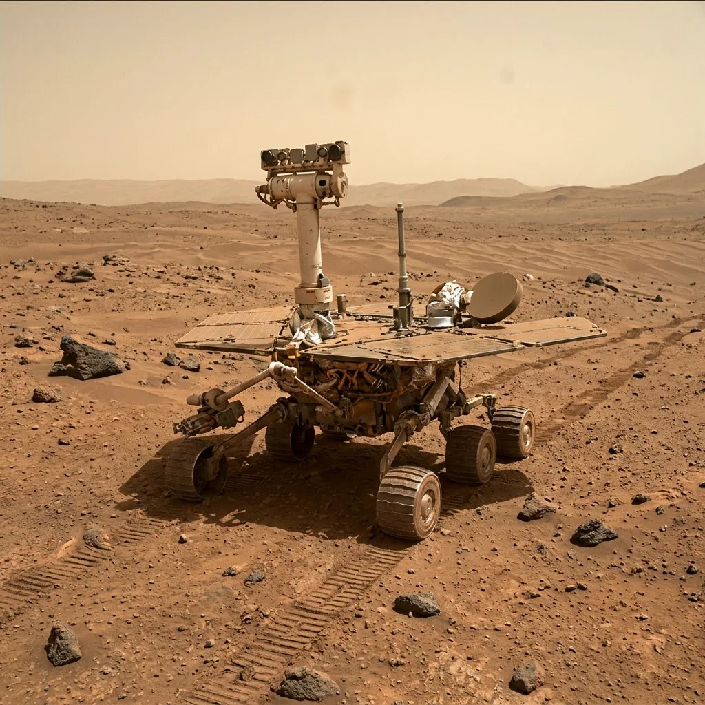
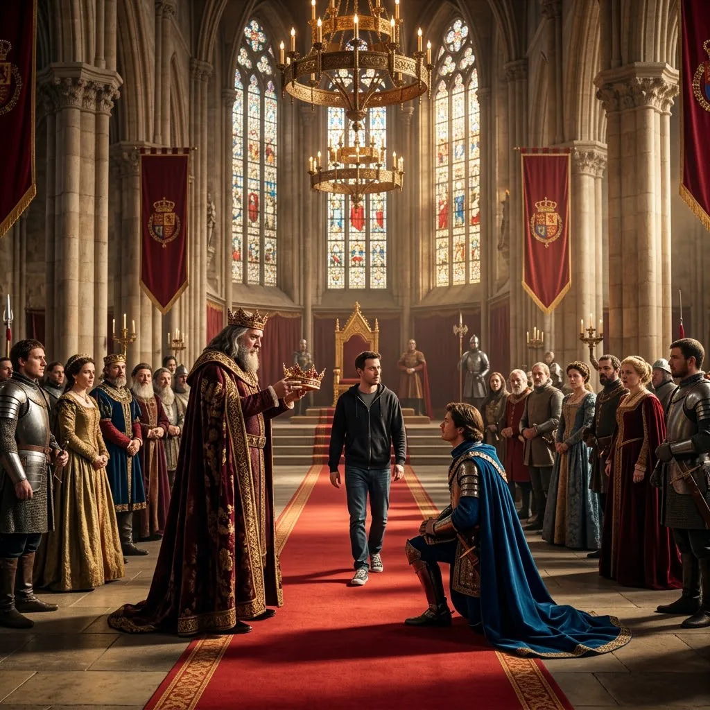
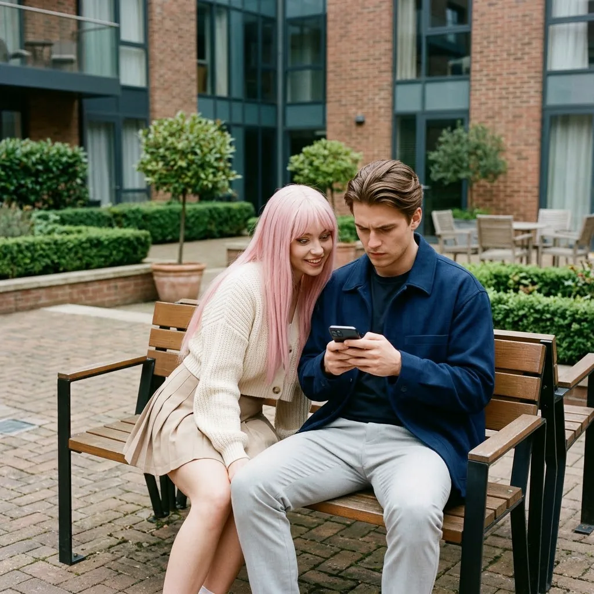
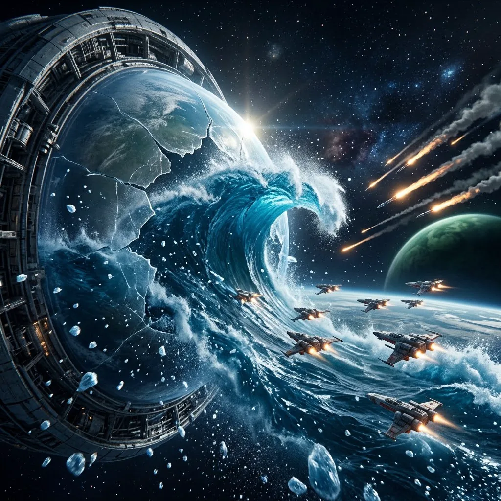
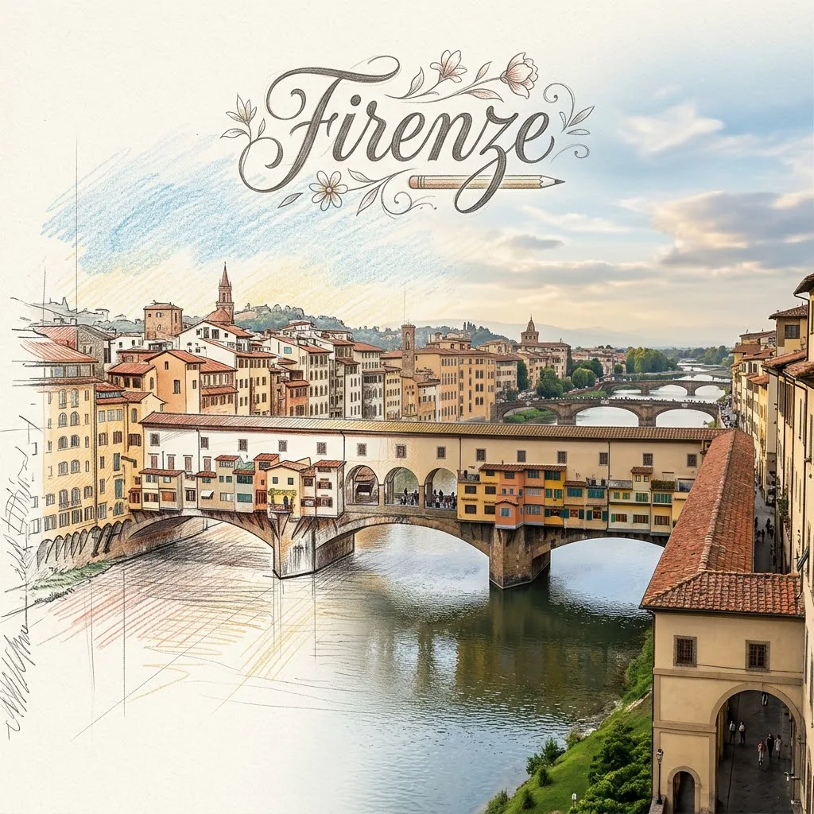
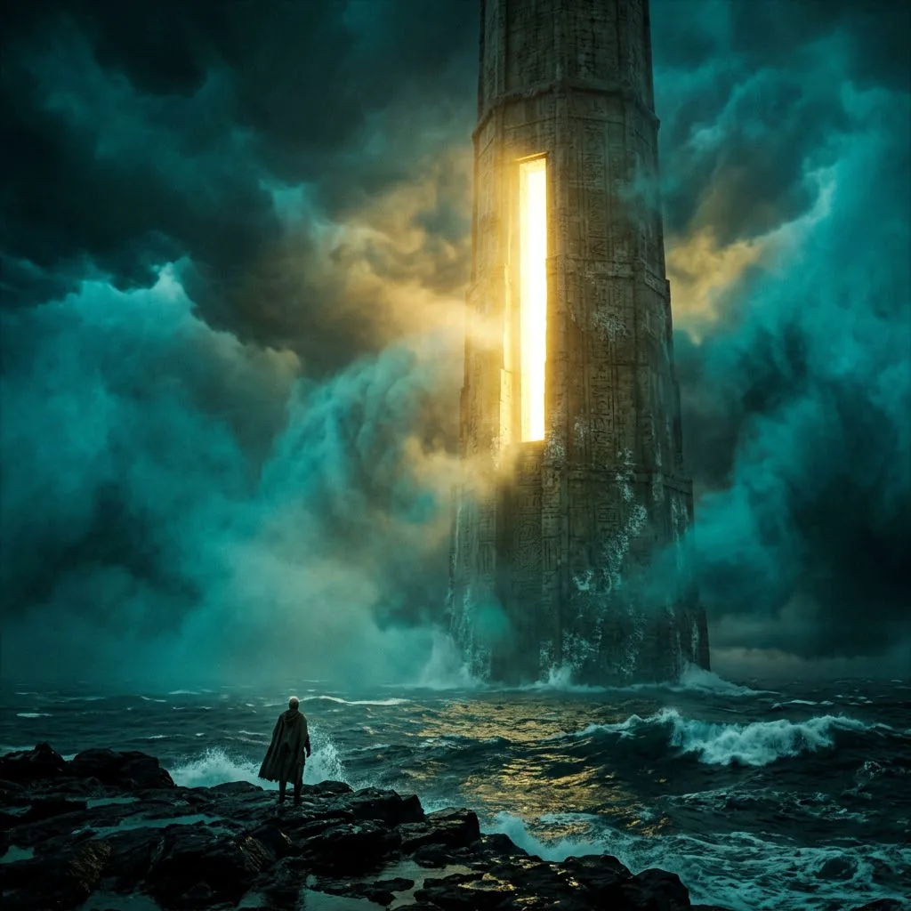
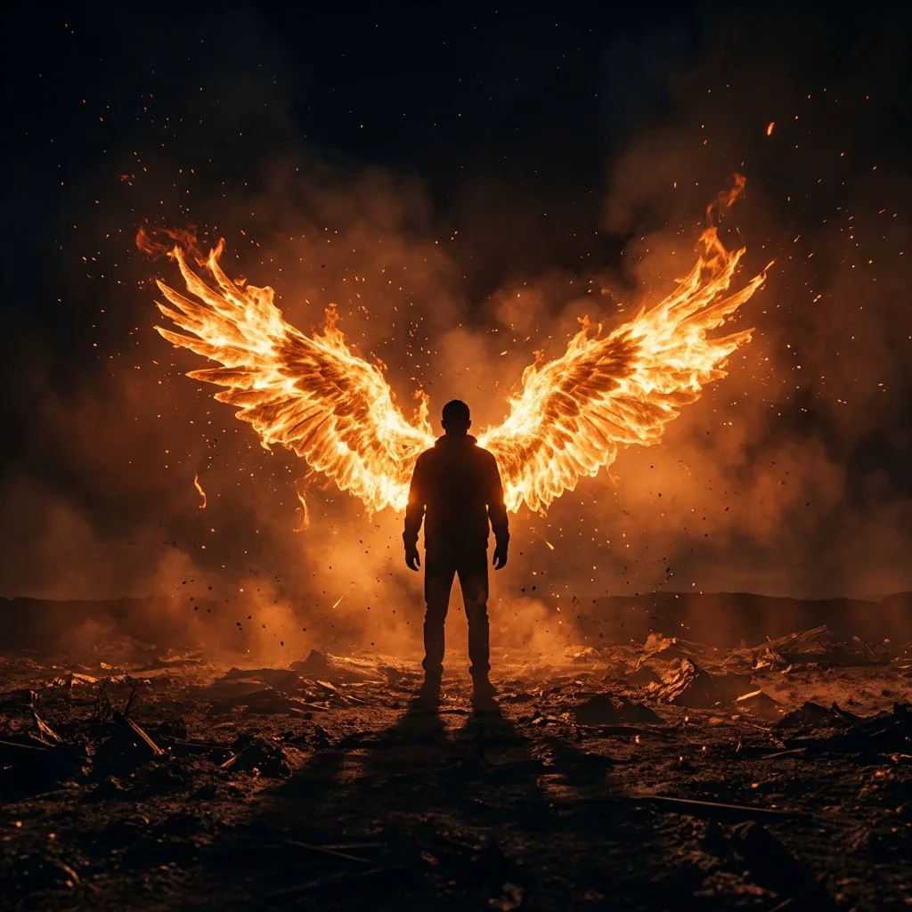
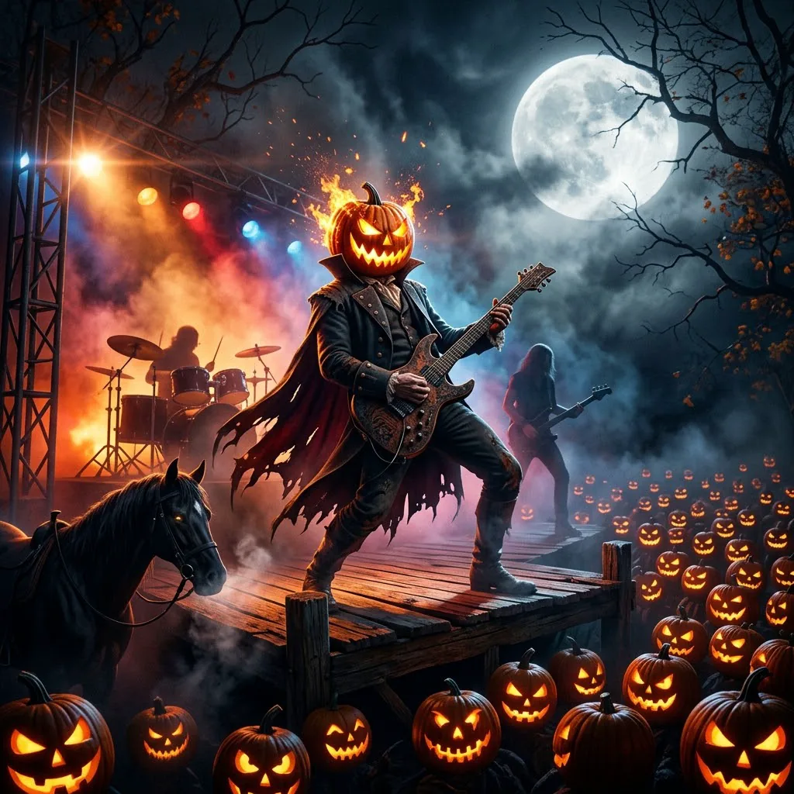

# 创意场景 · Nano Banana 2.1 提示词

[← 返回首页](../../README_zh.md) · 15 条 · [cinel](https://cinel.ai/zh/prompts/scenes-creative?utm_source=github&utm_medium=awesome&utm_campaign=awesome-nano-banana-2.1-prompts)

### 剪影树与城市日落合成

<a href="https://cinel.ai/zh/prompts/p/silhouette-tree-city-sunset-composite?utm_source=github&utm_medium=awesome&utm_campaign=awesome-nano-banana-2.1-prompts"></a>

> 来自 @churvikv 的结构化风景提示词，为 GPT Image 2.5 编写。它按 SKY、SUN、TREE、CITY 分块，每块负责一层：琥珀到灰蓝渐变、带条状卷云的天空，正中一轮巨大圆日，舒展的大树纯黑剪影，两侧黑色摩天楼。树与城的对比就是画面的故事。我们保留结构，改成了方图。适合壁纸、专辑封面和安静诗意的海报。

```text
Photorealistic silhouette sunset composite, square 1:1 composition, cinematic, ultra-detailed, edge to edge, no frame. SKY: a furnace of amber, apricot and burnt gold, deepest at the horizon, cooling to smoky blue-grey at the top, long streaky cirrus clouds sweeping diagonally with gold-lit undersides. SUN: one huge perfectly round pale white-hot sun disc exactly at the centre just above the treeline, its rim bleeding a soft warm halo. TREE: dead centre in front of the sun, a single massive spreading broadleaf tree in pure black silhouette, thick trunk flaring into a rounded knoll, vast dense canopy of fine branch tracery. CITY: flanking the tree, a dense skyline of black skyscraper silhouettes along the horizon. FOREGROUND: dark grass knoll and a few tiny human silhouettes for scale. No text.
```

- 原作者: [@churvikv](https://x.com/churvikv)
- 原帖: https://x.com/churvikv/status/2110114825082945740
- [在 cinel 上查看详情并一键生成](https://cinel.ai/zh/prompts/p/silhouette-tree-city-sunset-composite?utm_source=github&utm_medium=awesome&utm_campaign=awesome-nano-banana-2.1-prompts)

### 月夜港湾里的霓虹游艇

<a href="https://cinel.ai/zh/prompts/p/neon-yacht-moonlit-harbour?utm_source=github&utm_medium=awesome&utm_campaign=awesome-nano-banana-2.1-prompts"></a>

> 来自 @churvikv 的夜港提示词，为 GPT Image 2.5 编写，同样按 HARBOUR、MOON、BOAT、HILLS 分块：平静的黑水与拉长的倒影，环形山清晰的巨大满月，被紫外洋红和电光青色笼罩的白色游艇，以及背后的暗色山脊。霓虹与月光的冷暖对比是画面的关键。适合壁纸、夜生活海报和合成波风格封面。

```text
Photorealistic night harbour scene, square 1:1 composition, cinematic, ultra-detailed, edge to edge. HARBOUR: the lower half is calm black water in fine horizontal chop carrying long smeared vertical reflections. MOON: high in the deep navy sky hangs one enormous sharply detailed full moon with crisp craters and a soft blue-white halo. BOAT: just left of centre a sleek modern white motor yacht at rest, seen broadside, its hull washed in vivid neon ultraviolet magenta and its upper deck and railings glowing electric cyan, dark tinted glass bridge, radar mast, blue-lit stern platform, small dark portholes. HILLS: layered dark ridgelines behind, dotted with a few warm house lights. Long neon and moonlight reflections in the water. No text, no logos.
```

- 原作者: [@churvikv](https://x.com/churvikv)
- 原帖: https://x.com/churvikv/status/2109710598972035578
- [在 cinel 上查看详情并一键生成](https://cinel.ai/zh/prompts/p/neon-yacht-moonlit-harbour?utm_source=github&utm_medium=awesome&utm_campaign=awesome-nano-banana-2.1-prompts)

### 满月山脊小屋奇幻夜景

<a href="https://cinel.ai/zh/prompts/p/full-moon-ridge-house-fantasy-landscape?utm_source=github&utm_medium=awesome&utm_campaign=awesome-nano-banana-2.1-prompts"></a>

> 来自 @churvikv 的奇幻风景提示词，用 GPT Image 2.5 Flare 生成。分块搭建画面：星光密布、带琥珀星云的夜空和巨大满月，被月光照亮的嶙峋山峰，谷中积聚的雾气，山脊上窗户透着暖光的老石屋，以及前景一棵火红的秋树。暖色窗光和冷月光的对比带来童话般的感觉。适合书籍封面、壁纸和温馨奇幻插画。

```text
Surreal photorealistic night fantasy landscape, square 1:1 composition, cinematic, ultra-detailed. SKY: an immense star-filled night sky, dense pinpoint stars and a warm amber nebula glow behind the moon; a huge luminous full moon with crisp craters in the upper right with a soft warm halo. MOUNTAINS: on the left a towering dark rocky mountain catching cold silver moonlight, distant snow-dusted ridgelines fading into blue-grey mist, low clouds spilling into the valley. HOUSE: perched on a forested ridge, a weathered gabled stone house with a steep roof, two chimneys and small windows glowing warm gold. FOREGROUND RIGHT: a tall slender tree in fiery orange and amber autumn leaves. A winding path leads toward the moon. No text.
```

- 原作者: [@churvikv](https://x.com/churvikv)
- 原帖: https://x.com/churvikv/status/2109362817786896480
- [在 cinel 上查看详情并一键生成](https://cinel.ai/zh/prompts/p/full-moon-ridge-house-fantasy-landscape?utm_source=github&utm_medium=awesome&utm_campaign=awesome-nano-banana-2.1-prompts)

### 3D 剪贴簿悬浮照片剪纸

<a href="https://cinel.ai/zh/prompts/p/3d-scrapbook-floating-photo-cutout?utm_source=github&utm_medium=awesome&utm_campaign=awesome-nano-banana-2.1-prompts"></a>

> 来自 @Taaruk_ 的混合媒介提示词。一个写实场景变成一张厚实、弯曲、边缘分层、带柔和阴影的纸片，悬浮在暖象牙白纸面上，小小的手绘火柴人推着、抬着、扶着它的边缘，旁边配手写说明。场景用文字描述，不需要上传照片。我们用了原文中的海岸悬崖与灯塔场景。适合杂志封面、旅行手账和有趣的品牌内容。

```text
Create a creative minimalist 3D scrapbook composition featuring a realistic photograph transformed into a thick, floating paper cutout on a warm ivory textured background. The photograph shows dramatic white coastal cliffs covered in vibrant green grass, deep blue ocean waves and a striking red-and-white lighthouse beneath a cloudy sky. Make the photograph a curved, folded sheet of thick paper with realistic depth, visible layered edges, soft shadows and a floating effect. Add tiny hand-drawn black stick-figure characters interacting with the paper, pushing, lifting and holding its edges, with a playful handwritten caption "Same place, different layer." Elegant editorial photography, realistic textures, subtle imperfections, minimalist art direction, soft beige palette. Square 1:1.
```

- 原作者: [@Taaruk_](https://x.com/Taaruk_)
- 原帖: https://x.com/Taaruk_/status/2110655754927772000
- [在 cinel 上查看详情并一键生成](https://cinel.ai/zh/prompts/p/3d-scrapbook-floating-photo-cutout?utm_source=github&utm_medium=awesome&utm_campaign=awesome-nano-banana-2.1-prompts)

### 抽象概念的物理化呈现

<a href="https://cinel.ai/zh/prompts/p/abstract-concept-as-physical-phenomenon?utm_source=github&utm_medium=awesome&utm_campaign=awesome-nano-banana-2.1-prompts"></a>

> 来自 @Gdgtify 的分步模板。它先推断概念的行为方式（累积、泄漏、侵蚀），为它匹配一种自然过程，再加入一个习以为常地适应它的普通人，并留下水位线和修补痕迹作为证据。渲染规则很严格：冷静写实，阴天光线，无标签，无文字。我们试了“通知过载”，表现为发光纸条像潮水一样淹没街道。适合评论配图、文章封面和概念艺术。

```text
A single calm observational photograph that turns the abstract concept of notification overload into a physical phenomenon: a slow rising tide of small glowing white paper slips flooding an ordinary apartment street. One ordinary person in a raincoat wades through it with routine calm, carrying a bucket and bailing slips out of a doorway; the walls show successive high-water marks and repairs at different heights, and one old repair sits far below the current level. Long lens, overcast light, quiet realism. No symbols painted on the phenomenon, no labels, no text, no second metaphor. Square 1:1.
```

- 原作者: [@Gdgtify](https://x.com/Gdgtify)
- 原帖: https://x.com/Gdgtify/status/2109653566558437642
- [在 cinel 上查看详情并一键生成](https://cinel.ai/zh/prompts/p/abstract-concept-as-physical-phenomenon?utm_source=github&utm_medium=awesome&utm_campaign=awesome-nano-banana-2.1-prompts)

### 单词提示词：Thoughts（思绪）

<a href="https://cinel.ai/zh/prompts/p/one-word-prompt-thoughts?utm_source=github&utm_medium=awesome&utm_campaign=awesome-nano-banana-2.1-prompts"></a>

> 来自 @AllaAisling 的单词提示词系列：整条提示词只有一个词，其余全部交给模型决定。“Thoughts”通常会生成关于头脑和思绪的超现实隐喻。我们只输入这个词，未做任何修改，这次生成的是一位女子在洒满阳光的书桌前写字的安静画面。每次结果都不同，这正是它的乐趣。适合创意热身、模型对比和灵感启发。

```text
Thoughts
```

- 原作者: [@AllaAisling](https://x.com/AllaAisling)
- 原帖: https://x.com/AllaAisling/status/2109313324504551930
- [在 cinel 上查看详情并一键生成](https://cinel.ai/zh/prompts/p/one-word-prompt-thoughts?utm_source=github&utm_medium=awesome&utm_campaign=awesome-nano-banana-2.1-prompts)

### 单词提示词：Opportunity（机遇）

<a href="https://cinel.ai/zh/prompts/p/one-word-prompt-opportunity?utm_source=github&utm_medium=awesome&utm_campaign=awesome-nano-banana-2.1-prompts"></a>

> @AllaAisling 单词提示词系列的另一条。整条提示词就是“Opportunity”，隐喻、场景、光线和构图都由模型决定，常见的答案是门、道路和透光的出口。我们只输入这个词，不加任何内容，这次模型按字面理解，生成了一辆独自停在红色火星荒原上的探测车。这是快速了解模型默认审美、为励志内容或封面找灵感的好方法。

```text
Opportunity
```

- 原作者: [@AllaAisling](https://x.com/AllaAisling)
- 原帖: https://x.com/AllaAisling/status/2110040616172474641
- [在 cinel 上查看详情并一键生成](https://cinel.ai/zh/prompts/p/one-word-prompt-opportunity?utm_source=github&utm_medium=awesome&utm_campaign=awesome-nano-banana-2.1-prompts)

### 现代小哥闯入中世纪加冕礼

<a href="https://cinel.ai/zh/prompts/p/modern-guy-crashes-medieval-coronation?utm_source=github&utm_medium=awesome&utm_campaign=awesome-nano-banana-2.1-prompts"></a>

> 改编自 @Caden_Flux 的 20 秒 Seedance 2.5 视频提示词。原文是一段分镜喜剧：一个普通现代男人误入庄严的中世纪加冕礼，顺手“搞定”后离开。原作的角色设定图是作者自己上传的，我们改用文字通用地描述国王、王子和路人。我们选了第 2 镜作为关键帧：国王举着王冠僵在半空，穿卫衣的陌生人从他和王子中间径直走过。适合喜剧缩略图、短片提案和梗图内容。

```text
A single key frame from a photorealistic medieval fantasy film with absurdist comedy: in an enormous royal throne room with towering stone pillars, golden chandeliers, stained-glass windows, red velvet banners and a golden throne, an elderly king with a gray-streaked beard and burgundy robes freezes, holding an ornate golden crown in midair above a kneeling prince in a blue cloak, while a casually dressed modern man in a dark hoodie, jeans and sneakers strolls right between them as if he belongs there. The royal court on both sides of the red carpet stares in shock. Warm golden sunlight streaming through the windows, epic serious atmosphere. Square 1:1.
```

- 原作者: [@Caden_Flux](https://x.com/Caden_Flux)
- 原帖: https://x.com/Caden_Flux/status/2109652904864829898
- [在 cinel 上查看详情并一键生成](https://cinel.ai/zh/prompts/p/modern-guy-crashes-medieval-coronation?utm_source=github&utm_medium=awesome&utm_campaign=awesome-nano-banana-2.1-prompts)

### 长椅手机恶作剧爱情喜剧静帧

<a href="https://cinel.ai/zh/prompts/p/bench-phone-prank-romcom-still?utm_source=github&utm_medium=awesome&utm_campaign=awesome-nano-banana-2.1-prompts"></a>

> 改编自 @Just_sharon7 的 DomoAI 视频提示词。原文是一段带时间轴的爱情喜剧恶作剧，两位虚构角色造型固定：一个埋头看手机的严肃男生，和一个俏皮的粉发女生。我们挑了她在他身旁坐下、带着坏笑偷看屏幕的瞬间。柔和的阴天光线和自然的表演让画面可信。适合短剧缩略图、分镜画面和生活方式广告。

```text
A single key frame from a photorealistic romantic comedy: in a peaceful modern courtyard with brick pavement, trimmed hedges and small trees, a serious young man about 25 with swept-back brown hair, a navy oversized jacket and light-gray trousers sits on a wooden bench completely absorbed in his smartphone, while a playful young woman about 23 with very long straight pastel-pink hair and bangs, a cream cropped cardigan and a beige skirt, sits beside him and peeks at his screen with a mischievous grin. Bright overcast daylight, soft natural shadows, natural acting, wide cinematic framing. Square 1:1.
```

- 原作者: [@Just_sharon7](https://x.com/Just_sharon7)
- 原帖: https://x.com/Just_sharon7/status/2110031404130250997
- [在 cinel 上查看详情并一键生成](https://cinel.ai/zh/prompts/p/bench-phone-prank-romcom-still?utm_source=github&utm_medium=awesome&utm_campaign=awesome-nano-banana-2.1-prompts)

### 最后的海洋：太空运载舰之战

<a href="https://cinel.ai/zh/prompts/p/last-ocean-carrier-space-battle?utm_source=github&utm_medium=awesome&utm_campaign=awesome-nano-banana-2.1-prompts"></a>

> 改编自 @AllaAisling 的 15 秒 Wan 3.0 视频提示词。这是她参加 Prompt Drop Weekend 的作品：地球已经干涸，最后的海洋被装在巨型运载舰上的透明球体里。导弹击裂隔离场后，人类飞行员冲进外泄的水流，用飞船充当护盾。我们定格在巨浪冲入太空、战机在水周围筑起屏障的瞬间。适合科幻海报、书籍封面和预告片主视觉。

```text
A single key frame from an epic photorealistic sci-fi film: a gigantic spacecraft carries Earth's last ocean inside a transparent spherical containment field; the field has just cracked and a colossal wave of blue water bursts into space, while small human defense fighters fly in tight formation around the escaping water, putting their ships between the ocean and incoming enemy missile trails. Stars, a distant green planet, spectacular water physics in space, huge scale, dramatic rim lighting. No text, no logos. Square 1:1.
```

- 原作者: [@AllaAisling](https://x.com/AllaAisling)
- 原帖: https://x.com/AllaAisling/status/2109404676466626802
- [在 cinel 上查看详情并一键生成](https://cinel.ai/zh/prompts/p/last-ocean-carrier-space-battle?utm_source=github&utm_medium=awesome&utm_campaign=awesome-nano-banana-2.1-prompts)

### 彩铅手绘渐变为真实地标

<a href="https://cinel.ai/zh/prompts/p/colored-pencil-to-real-landmark-transition?utm_source=github&utm_medium=awesome&utm_campaign=awesome-nano-banana-2.1-prompts"></a>

> 来自 @Naiknelofar788 的 GPT Image 2.5 提示词模板。画面一侧是象牙色速写本上的彩铅与蜡笔手绘，笔触横跨画面逐渐变成真实的地标、街道和天空。我们用意大利佛罗伦萨的老桥填充。适合旅行海报、文旅社媒内容和艺术画册封面。

```text
Create a breathtaking artistic composition of the Ponte Vecchio in Florence, Italy, where a hand-drawn colored-pencil illustration seamlessly transforms into a beautifully detailed, realistic scene.

On one side, the landmark appears as an intricate drawing on textured ivory sketchbook paper, featuring visible pencil strokes, wax-crayon shading, delicate crosshatching, and imperfect hand-drawn lines. Moving across the composition, the colored strokes gradually evolve into the real landmark, surrounded by its authentic streets, architecture, and recognizable local environment.

Tiny pencil marks transform into real trees, sketchy rooftops become actual buildings, and loose strokes of color turn into the natural sky. The transition must feel fluid and artistic, as if the entire city is being brought to life by an invisible artist.

Preserve the landmark’s exact real-world architecture, proportions, and recognizable details. Use a sophisticated palette of warm terracotta, muted turquoise, golden yellow, deep cobalt blue, and natural earthy tones.

Add subtle paper grain, expressive colored-pencil textures, wax-crayon details, imperfect outlines, and beautiful natural lighting. Keep the composition clean, visually striking, and professionally art-directed, with the landmark as the unmistakable focal point.

Place the real name of the city in elegant, hand-lettered typography at the top, integrated naturally into the artwork.

Style: Contemporary editorial illustration meets realistic colored-pencil and wax-crayon artwork, tactile textures, artistic transformation, premium art-book aesthetic, intricate details, visually captivating composition.

Avoid: Generic fantasy architecture, distorted landmarks, excessive visual clutter, plastic-looking 3D effects, and artificial-looking buildings. Square 1:1 composition.
```

- 原作者: [@Naiknelofar788](https://x.com/Naiknelofar788)
- 原帖: https://x.com/Naiknelofar788/status/2109131862455230806
- [在 cinel 上查看详情并一键生成](https://cinel.ai/zh/prompts/p/colored-pencil-to-real-landmark-transition?utm_source=github&utm_medium=awesome&utm_campaign=awesome-nano-banana-2.1-prompts)

### 一词提示词：Control（控制）

<a href="https://cinel.ai/zh/prompts/p/one-word-prompt-control?utm_source=github&utm_medium=awesome&utm_campaign=awesome-nano-banana-2.1-prompts"></a>

> 来自 @AllaAisling 的一词提示词系列：整个提示词只有一个单词，其余全部交给模型。我们原样使用单词“Control”，未做任何修改。这次生成的是一间忙碌的控制室：一名操作员坐在桌前，四周是显示图表、地图和监控画面的屏幕。每次结果都不同，这正是乐趣所在。适合创意热身、模型对比和寻找灵感。

```text
Control
```

- 原作者: [@AllaAisling](https://x.com/AllaAisling)
- 原帖: https://x.com/AllaAisling/status/2109674201825050672
- [在 cinel 上查看详情并一键生成](https://cinel.ai/zh/prompts/p/one-word-prompt-control?utm_source=github&utm_medium=awesome&utm_campaign=awesome-nano-banana-2.1-prompts)

### 风暴海上发光巨塔关键帧

<a href="https://cinel.ai/zh/prompts/p/glowing-sea-tower-storm-keyframe?utm_source=github&utm_medium=awesome&utm_campaign=awesome-nano-banana-2.1-prompts"></a>

> 灵感来自 @DrSadek_ 用 PixVerse 上的 Seedance 2.5 制作的视频《The Light Across the Sea》。原帖没有分享提示词，因此我们用自己的话描述了一帧关键画面：风暴翻涌的青绿海面上一座巨大古塔，金光倾泻而出，岸边站着一个小小人影。适合奇幻小说封面、游戏加载画面和专辑封面。

```text
A single cinematic key frame: a colossal ancient stone tower rises from a dark stormy sea, a brilliant golden light pouring from a tall opening in its side, thick turquoise mist and churning clouds rolling around it, a tiny lone figure standing on a black rocky shore in the foreground looking toward the light, deep teal and gold palette, epic scale, atmospheric fantasy realism, no text. Square 1:1 composition.
```

- 原作者: [@DrSadek_](https://x.com/DrSadek_)
- 原帖: https://x.com/DrSadek_/status/2109358373888241928
- [在 cinel 上查看详情并一键生成](https://cinel.ai/zh/prompts/p/glowing-sea-tower-storm-keyframe?utm_source=github&utm_medium=awesome&utm_campaign=awesome-nano-banana-2.1-prompts)

### 夜色中的火焰之翼天使剪影

<a href="https://cinel.ai/zh/prompts/p/fire-winged-angel-silhouette-night?utm_source=github&utm_medium=awesome&utm_campaign=awesome-nano-banana-2.1-prompts"></a>

> 根据 @azed_ai 配文“share your Angel”的图片反向撰写的提示词（原帖没有提示词）。我们用自己的话描述了画面：一个孤独的黑色身影，身后是由火焰组成的巨大翅膀，火星穿过橙色烟雾升向漆黑夜空。强逆光让人物保持纯剪影。适合书籍封面、专辑封面和奇幻活动海报。

```text
A lone dark silhouetted figure stands in a vast smoky wasteland at night, enormous outstretched wings made entirely of roaring orange fire spreading from its back, glowing embers and sparks drifting upward, thick haze lit orange from within, low horizon, deep black sky, dramatic backlight, cinematic photorealistic fantasy, high contrast, no text. Square 1:1 composition.
```

- 原作者: [@azed_ai](https://x.com/azed_ai)
- 原帖: https://x.com/azed_ai/status/2110640831959081376
- [在 cinel 上查看详情并一键生成](https://cinel.ai/zh/prompts/p/fire-winged-angel-silhouette-night?utm_source=github&utm_medium=awesome&utm_campaign=awesome-nano-banana-2.1-prompts)

### 空谷舞台南瓜头独奏

<a href="https://cinel.ai/zh/prompts/p/hollow-stage-pumpkin-head-solo?utm_source=github&utm_medium=awesome&utm_campaign=awesome-nano-banana-2.1-prompts"></a>

> 根据 @RealLeeForest 于 2026-10-10 的帖子改写（记录时 6 赞）。我们改成一张干净的1:1南瓜头写真，去掉品牌、Logo、名人/IP元素，也不需要你的照片。一次只改一个变量。

```text
Cinematic concert still, square 1:1: a headless horseman figure mid-solo on a crooked autumn stage, blazing jack-o'-lantern head, band silhouettes behind, crowd of carved pumpkin faces in the dark, a horse waiting at the edge of the lights under a full moon, dramatic stage haze, no text, no logo, no celebrity. Square 1:1 composition.
```

- 原作者: [@RealLeeForest](https://x.com/RealLeeForest)
- 原帖: https://x.com/RealLeeForest/status/2109057357926085014
- [在 cinel 上查看详情并一键生成](https://cinel.ai/zh/prompts/p/hollow-stage-pumpkin-head-solo?utm_source=github&utm_medium=awesome&utm_campaign=awesome-nano-banana-2.1-prompts)

